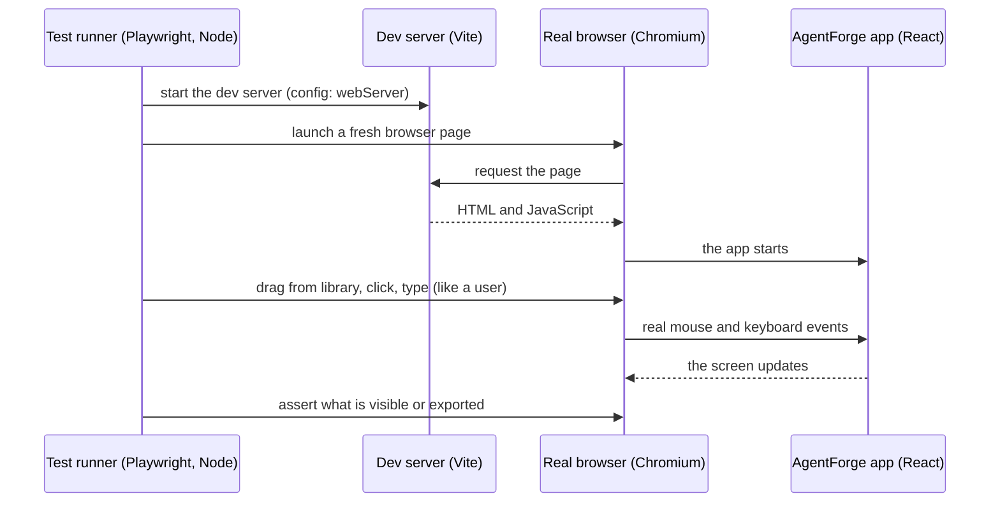
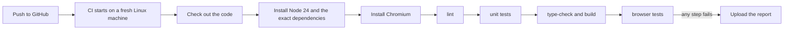
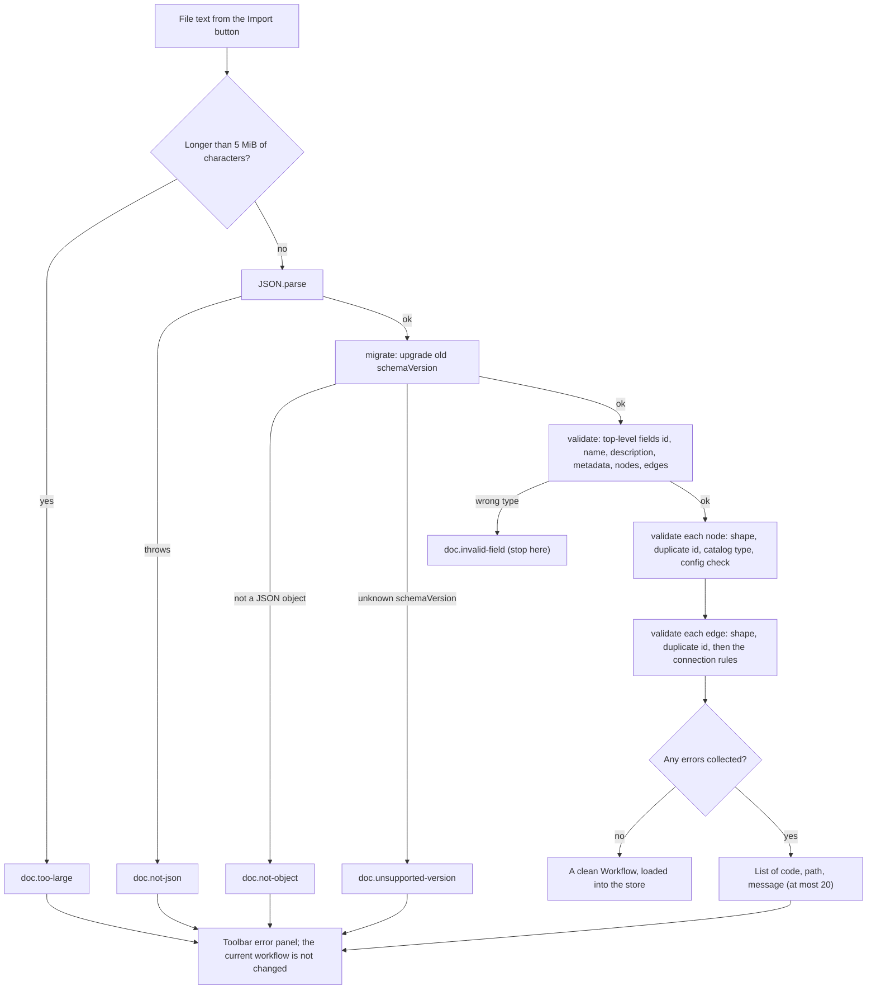

# AgentForge Learning Guide

> **For the Product Owner.** Part 1 is a plain-language **primer** (reference material: what we are building and how the code is organised). Part 2 is the **teaching record** (lessons actually taught and what you demonstrated).
> The **curriculum and statuses** are in `docs/LEARNING.md`. Learning progress is tracked separately from implementation progress.
> **Living document.** The Principal Architect updates it at the end of every task (D-028). The primer describes the project **as it is today**; where something is planned but not built, it says so.
> Last updated: 2026-11-03, after Phase 1.1 T2 (Lesson L2).

# Part 1: Primer

---

## 1. What we are building

AgentForge is a **visual builder for AI workflows**, in the same family as n8n, Langflow and Dify. A user:

1. **Draws** a workflow on a canvas by dragging boxes (called *nodes*) and connecting them with lines.
2. **(Later)** describes a workflow in plain English and lets AI draw it.
3. **(Later)** runs the workflow and watches what happens at each step.
4. **(Later)** builds *agents*: AI that decides its own next steps in a loop and can use tools.

A tiny example workflow: *Manual Trigger → LLM Prompt ("summarise this") → Output*. You press run, the text goes to an AI model, and the answer appears in the Output node.

## 2. Where we are today

| Built and tested | Not built yet |
|---|---|
| The visual editor in the browser: drag nodes from a library, connect them with rules, edit each node's settings, save the workflow to a `.json` file and load it back | Running workflows (the "engine") |
| A catalog of 6 node types | AI models, agents, tools (Phase 4) |
| 83 unit tests and 27 browser tests | Natural-language workflow generation (Phase 5) |
| A CI workflow that runs the checks on GitHub | The backend server, database, saving to a server (Phase 2) |

**Important:** today everything runs **in your browser only**. There is no server. Nothing runs a workflow yet. The editor produces a *description* of a workflow; later phases will execute it.

| Phase | What it delivers | Status |
|---|---|---|
| 1 | The visual editor | Done and accepted |
| 1.1 | Hardening: stricter file format rules, better settings forms, upgrades for old files, warnings, browser tests | In progress (tasks 1 and 2 of 10 done) |
| 2 | Backend server and database; save/load workflows | Planned, not approved |
| 3 | Execution engine: actually run workflows | Planned |
| 4 | AI runtime: LLM and Agent nodes | Planned |
| 5 | Describe a workflow in English and get it drawn | Planned |
| 6 | MCP and other integrations | Planned |
| 7 | Logins, credentials, production hardening | Planned |

## 3. The big picture

```
        YOUR BROWSER (built, Phase 1)                         SERVER (not built yet)
 ┌───────────────────────────────────────────┐        ┌─────────────────────────────────┐
 │ Node library  │  Canvas  │ Settings panel │        │ Stores workflows (database)     │
 │ (drag from)   │ (draw)   │ (edit a node)  │  <──>  │ Validates them                  │
 │               │          │                │  Phase │ Runs them (engine)              │
 │   Editor state ("store") = the workflow   │   2+   │ Runs AI agents                  │
 └───────────────────────────────────────────┘        └─────────────────────────────────┘
              │  Export / Import
              ▼
        a  workflow.json  file
```

The most important idea in the whole project: **the workflow is a JSON document** (a text file with a defined shape). The editor draws it, the server will store it, the engine will run it, and AI will generate it. Everything revolves around that one document, so we are careful about its exact format.

## 4. Key ideas (a glossary with examples)

**Workflow.** The whole diagram: nodes plus the lines between them.

**Node.** One box. It has a *type* (for example `llm.prompt`), a *label* you can rename, *settings* (called `config`) and a *position* on the canvas. The six types today: Manual Trigger, LLM Prompt, HTTP Request, Condition, Agent, Output.

**Port.** A connection point on a node. *Input* ports are on the left and *output* ports on the right. Each has a name (`input`, `text`, `data`) and a *data type* (`text`, `json`, `number`, ...).

**Edge.** A line from one node's output port to another node's input port.

**Data types and compatibility.** You can only connect compatible ports. `any` connects to everything; otherwise the types must match. So a number cannot flow into a text input.

**Catalog and node definition.** The catalog is the list of node types the platform offers. A *definition* describes one type: its ports, its settings, its icon. The library, the settings forms, the validator and (later) the engine and the AI generator all read the same catalog, so there is one source of truth. See `frontend/src/catalog/nodes.ts`.

**Config schema.** A description of what settings a node accepts (for example `temperature` is a number from 0 to 2). The settings panel builds its form from it, and the importer uses it to check files. We use a small, documented subset of **JSON Schema**, a standard way to describe JSON.

**Workflow JSON.** The file format. A minimal real example (a trigger connected to an output):

```json
{
  "schemaVersion": "1.0",
  "id": "wf_1a2b3c4d",
  "name": "Untitled workflow",
  "description": "",
  "nodes": [
    { "id": "n_1", "type": "trigger.manual", "typeVersion": 1, "label": "Manual Trigger",
      "config": { "payload": {} }, "position": { "x": 100, "y": 200 } },
    { "id": "n_2", "type": "output.result", "typeVersion": 1, "label": "Output",
      "config": { "format": "text" }, "position": { "x": 400, "y": 200 } }
  ],
  "edges": [
    { "id": "e_1", "source": { "nodeId": "n_1", "port": "data" },
      "target": { "nodeId": "n_2", "port": "input" } }
  ],
  "metadata": {}
}
```

**`schemaVersion` vs `typeVersion`.** Two separate version numbers. `schemaVersion` versions the *file format*. `typeVersion` versions *one node type* (if we change how the Agent node works, it becomes version 2). Keeping them separate lets each evolve without breaking the other.

**Migration.** Upgrading an old file to the current format *in memory*, without overwriting the original. Planned in Phase 1.1 (tasks T5 and T6).

**Validation (errors) vs warnings.** *Errors* mean the file is structurally wrong (unknown node type, impossible connection); it is rejected. *Warnings* mean "this looks incomplete" (an empty required setting, an unconnected node); they never stop you from working. We keep them strictly separate (decision D-018).

**DAG and "no cycles".** A *directed acyclic graph*: arrows that never loop back. The workflow engine will run nodes in dependency order, which only works if there are no loops. Anything that needs looping (an agent thinking in steps) happens *inside* the Agent node using a library called LangGraph. The editor already refuses a connection that would create a cycle.

**Condition and branches (planned).** A Condition node sends data down either its `true` or its `false` port. Nodes on the branch not taken are *skipped*. The exact rules are written in `docs/PHASE1_1_PLAN.md` section 3.4.

**Agent (planned).** A node where an AI model decides what to do next, repeatedly, and can call tools.

**Credentials.** API keys and passwords. **They never go inside a workflow file** (decision D-016). Later, workflows will refer to a stored credential by id. Until then, a detector will warn if someone pastes a secret into a setting (planned, task T9).

**Provider.** Which AI service a node uses: Ollama (local), OpenAI, Anthropic or Groq. We design so adding one does not change the file format.

**Canonical JSON (planned, task T4).** Writing a workflow to text in one exact, repeatable way (keys sorted, numbers formatted the same everywhere) so the same workflow always produces byte-identical text. This matters for comparing, hashing and testing across TypeScript, Python and the database.

**Fixtures (planned, task T3).** Shared test data files that both the TypeScript tests and, later, the Python backend tests read, so both sides provably agree.

## 5. A tour of the code

Everything built so far lives in `frontend/`. Think of it in layers:

```
frontend/src/
  workflow/      THE CONTRACT: types, rules, parsing. No screen code in here.
    types.ts          what a Workflow, node, edge, port and node definition look like
    connections.ts    "may this edge exist?" (the 7 connection rules)
    validate.ts       checks an imported file and returns a clean Workflow or a list of errors
    configSchema.ts   checks a node's settings against its schema
    migrate.ts        upgrades old file formats
    serialize.ts      export to text, import from text
  catalog/       the six node types (nodes.ts) and lookups (index.ts)
  store/         editorStore.ts: the single source of truth for the workflow being edited
  canvas/        the drawing surface (React Flow) and flowMapping.ts, the only place that
                 translates our workflow into React Flow's objects
  nodes/         WorkflowNode.tsx: one component that draws every node type from the catalog
  library/       the searchable, draggable list of node types
  config-panel/  the settings form for the selected node
  app/           the page layout and the toolbar (New / Import / Export)
frontend/e2e/    browser tests that click through the real app (Playwright)
```

**Follow one action through the code.** You drag "LLM Prompt" onto the canvas:

1. `library/Library.tsx` starts a drag that carries the text `llm.prompt`.
2. `canvas/Canvas.tsx` receives the drop, converts the mouse position to canvas coordinates, and calls `addNode`.
3. `store/editorStore.ts` looks up the definition in the catalog, creates a node with default settings, and updates the workflow.
4. The store change re-renders: `canvas/flowMapping.ts` converts the workflow to React Flow objects, and `nodes/WorkflowNode.tsx` draws the box with its ports.
5. You connect two ports: `Canvas.tsx` asks `workflow/connections.ts` whether it is allowed, and only then calls `store.connect`.
6. You click Export: `app/Toolbar.tsx` calls `serialize.ts`, which writes the workflow to a `.json` file.

**Suggested reading order** (each is short): `workflow/types.ts` → `catalog/nodes.ts` → `workflow/connections.ts` → `store/editorStore.ts` → `canvas/Canvas.tsx` → `workflow/validate.ts`.

## 6. How we know it works

| Kind | Tool | What it does | Command |
|---|---|---|---|
| **Unit tests** | Vitest | Small, fast tests of single functions (the connection rules, the store, import/export). 48 today. | `npm test` |
| **Browser tests** | Playwright | A real browser clicks through the app: drag, connect, edit, export, import. 26 today. | `npm run test:e2e` |
| **Type check** | TypeScript | Catches mismatched data shapes before running | part of `npm run build` |
| **Lint** | Oxlint | Catches suspicious code patterns | `npm run lint` |
| **Everything** | | All of the above, in order | `npm run verify` |

"Green" means *the checks we wrote passed*. It does **not** mean there are no bugs. To make sure the tests are meaningful, we sometimes break the code on purpose and confirm a test fails (we did this for T1: removing the cycle rule made the cycle test fail).

## 7. How the team works

You are the **Product Owner**: you decide *what* and *why*, and you accept results. Claude, as **Principal Architect**, decides *how*, plans the work and keeps the documents honest. A **Sonnet 5.5** subagent writes the code for one task at a time. An **Opus 5.5** subagent reviews each task independently and never edits files. A **Sonnet 5.5 tutor** subagent prepares the lessons in Part 2 of this file. Then the architect reports to you in plain language. The full loop is in `CLAUDE.md` section 16 and decision D-027.

| Document | Read it to learn |
|---|---|
| `docs/PROJECT_BRAIN.md` | The current state, always |
| `docs/DECISIONS.md` | Every decision, and whether it is approved |
| `docs/ARCHITECTURE.md` | How the whole system is designed |
| `docs/ROADMAP.md` | The phases and where we are |
| `docs/PHASE1_1_PLAN.md` | The current detailed plan, task by task |
| `docs/DEVELOPMENT_LOG.md` | A diary of what was done, with real test results |
| `docs/LEARNING.md` | The curriculum: 12 modules, your learning status, interview questions |

## 8. Try it yourself

```
cd frontend
npm install              # first time only
npm run dev              # open http://localhost:5173
```

**Exercises**

1. **Build and export.** Drag Manual Trigger, LLM Prompt and Output onto the canvas and connect them. Click Export and open the `.json` file. Find your three nodes and two edges, and match them to section 4.
2. **Break a rule.** Drag two LLM Prompt nodes onto the canvas, connect A to B, then try to connect B back to A (a loop). Also try connecting the HTTP Request node's `Status` (a number) to an Agent's `Task` (text). The editor refuses both; `workflow/connections.ts` is the code that decides.
3. **Bad settings.** Select LLM Prompt and type `5` as the temperature. The form flags it and does not save it.
4. **Round trip.** Export, press New, Import the file. Export again and compare the two files; they are identical.
5. **See a test fail.** In `frontend/src/workflow/connections.ts`, comment out the line that returns `'cycle'`, run `npm run test:e2e`, and watch the cycle test fail. Undo the change (`git checkout -- frontend/src/workflow/connections.ts`).

## 9. Why we made these choices (short answers)

| Choice | Why |
|---|---|
| **A JSON document is the heart of the system** | One shared, checkable format that the editor, server, engine and AI can all agree on |
| **Our file format is separate from React Flow's** | The drawing library is a view detail; it must not leak into saved files or the backend |
| **One catalog drives everything** | Adding a node type means adding data, not changing five places |
| **The engine and LangGraph are separate** | A predictable "run these steps in order" engine for normal workflows; the looping, unpredictable AI behaviour is contained inside the Agent node |
| **Zustand for editor state** | Small, simple, and the canvas, library and settings panel all need to share the same workflow |
| **Our own small JSON Schema checker** | Fewer dependencies, and we can keep TypeScript and Python in exact agreement with shared test data |
| **TypeScript first, then Python models** | We built the editor first; in Phase 2 the backend models become the source of truth and generate the TypeScript types |
| **Warnings never block you** | An editor must let you hold half-finished work |
| **No secrets in files, ever** | A workflow file gets shared, committed and stored; a key inside would leak |

## 10. What happens next

Phase 1.1, in order: **T1** browser tests and CI (done); **T2** structured error codes; **T3** shared fixtures; **T4** strict, repeatable JSON; **T5** better settings schemas and the Groq provider; **T6** upgrading old files; **T8** the branch rules written down; **T7** warnings in the editor; **T9** secret detection; **T10** final documentation and review. Then, if you approve it, Phase 2: the backend server and database.

## 11. Glossary, quick reference

| Term | One line |
|---|---|
| **React / TypeScript / Vite** | The tools the frontend is made with: UI library, typed JavaScript, dev server and bundler |
| **React Flow (`@xyflow/react`)** | The library that draws the canvas, nodes and lines |
| **Zustand** | The small library that holds the editor's state |
| **Vitest / Playwright** | Unit-test runner / real-browser test runner |
| **CI** | Continuous integration: an automatic run of the checks on every change pushed to GitHub |
| **LangGraph** | A library for AI agents that loop and use tools (Phase 4) |
| **MCP** | Model Context Protocol: a standard way for AI to use outside tools (Phase 6) |
| **Pydantic / FastAPI** | Python tools for data models and the web server (Phase 2) |
| **PostgreSQL / JSONB** | The database and its JSON column type (Phase 2) |
| **Commit** | A saved snapshot of the project in Git |

---
---

# Part 2: Teaching record

> **What this part is.** A record of the lessons actually taught and what the Product Owner demonstrated. It is separate from the primer above (reference material) and from implementation progress.
> **Rule (D-029).** Every lesson ends with a **Knowledge Check / Interview Questions** section. You answer all of them in one dedicated learning session at the end of the project and submit the answers for evaluation. **Only then** are statuses updated. Until then every concept is **Explained (no evidence)**. The curriculum and statuses live in `docs/LEARNING.md`.

## Lesson index

| Lesson | After task | Modules | Taught | Check questions | Status |
|---|---|---|---|---|---|
| **L1** | Phase 1.1 T1: Playwright and CI | 12 (testing and CI) | 2026-11-03 | 5 (answered at the end of the project) | Explained; evaluation pending |
| **L2** | Phase 1.1 T2: structured validation errors | 3 (main); also 1 and 12 | 2026-11-03 | 6 (answered at the end of the project) | Explained; evaluation pending |

## Concept index

| Concept | Module | Lesson | Status |
|---|---|---|---|
| End-to-end test versus unit test | 12 | L1 | Explained (no evidence) |
| Test fixture and helper functions | 12 | L1 | Explained (no evidence) |
| Auto-waiting assertions | 12 | L1 | Explained (no evidence) |
| Flaky tests and retries | 12 | L1 | Explained (no evidence) |
| Vacuous tests and fault injection | 12 | L1 | Explained (no evidence) |
| Continuous integration (CI) | 12 | L1 | Explained (no evidence) |
| Supply-chain pinning by commit SHA | 12 | L1 | Explained (no evidence) |
| Machine-readable versus human-readable errors | 3 | L2 | Explained (no evidence) |
| Stable error codes as a contract (namespaced codes) | 1, 3 | L2 | Explained (no evidence) |
| JSON Pointer (RFC 6901) | 3 | L2 | Explained (no evidence) |
| String-literal union types and compile-time exhaustiveness (`ErrorCode`) | 3 | L2 | Explained (no evidence) |
| Validate, do not trust, at a boundary (own-property lookups) | 3, 12 | L2 | Explained (no evidence) |
| Table-driven tests, one test per code, guard tests | 12 | L2 | Explained (no evidence) |
| Errors versus warnings (D-018), applied to the import path | 3 | L2 | Explained (no evidence) |
| Primer concepts (workflow, node, port, edge, catalog, config schema, `schemaVersion` vs `typeVersion`, validation vs warnings, DAG, credentials) | 1, 2, 3, 6, 7 | Primer (Part 1) | Explained as reference (no evidence, no lesson) |

---

## Lesson L1: Testing the editor like a user, and checking it automatically

**Task:** Phase 1.1 T1 (Playwright browser tests and the CI workflow). **Module:** 12 (Security, Testing and Deployment).

### 1. The problem

After Phase 1, the editor worked, and we knew it because someone (me) had clicked through it with a throwaway script that nobody else could run. In the next tasks (T2 to T9) we change the *rules* the editor depends on: how files are parsed, how settings are checked, how connections are judged. Any of those changes could quietly break something as basic as dragging a node. We needed a **robot user** that repeats the same checks, the same way, every time, and on every change.

### 2. The concept

**End-to-end (E2E) testing** means a program drives the *real application in a real browser*, the way a person would: it drags, clicks, types, then looks at what happened. It protects against **regressions** (something that used to work stops working).

Compare it with a **unit test**, which tests one small function in isolation (for example "is this connection allowed?"). Unit tests are fast and precise. E2E tests are slower but prove that all the pieces, including the screen, work together. Teams use both; a common picture is a *pyramid*: many unit tests, fewer E2E tests.

**Continuous integration (CI)** means a server automatically runs all the checks whenever code is pushed, so a break is noticed within minutes and not weeks.

### 3. Why this approach

- **Playwright** drives a real Chromium browser, so drag and drop, layout and keyboard behaviour are real, not simulated. It also *waits automatically* (see section 4), which removes most flakiness.
- **One browser (Chromium) and a fixed window size**, because the drag and connect tests depend on exact positions; fewer variables means more repeatable results.
- **A fresh page per test**, so tests cannot affect each other.
- **A rule that any console error fails the test**, so hidden crashes cannot pass unnoticed.
- **CI on GitHub** with a single command (`npm run verify`) so "green locally" and "green in CI" mean the same thing.
- **Actions pinned to a commit SHA** instead of a version tag (explained below).

### 4. How it works internally



**Auto-waiting.** A line such as `expect(editor.nodes).toHaveCount(3)` does not check once; it keeps re-checking until it is true or a time limit passes. That is better than "wait 2 seconds", which is either too slow or too short. The tests never use fixed sleeps.

**Flaky tests.** A test that sometimes passes and sometimes fails for no code reason. In CI we allow one retry (to keep a trace of what happened) but also set `failOnFlakyTests`, so a test that needed a retry still turns the run red and gets fixed instead of hidden.

### 5. How it communicates with other components

- The **runner** talks to the **browser** over a control channel (like a remote control).
- The **browser** talks to the **dev server** over ordinary HTTP, exactly as a user's browser would.
- Tests talk to the app only through the **screen** and the **exported file**, never by reaching into its internals. That is why they survive refactors.
- **CI** runs `npm run verify` on a GitHub machine:



### 6. Important code paths

| Where | What it does |
|---|---|
| `frontend/playwright.config.ts` | Chromium only, fixed window, starts its own dev server on a dedicated port and never reuses a running one, retries and flaky-failure policy for CI |
| `frontend/e2e/fixtures.ts` | Gives every test a fresh editor page and fails the test on any console error or uncaught error |
| `frontend/e2e/editor.ts` | Helpers that act like a user: `drop` (drag from the library onto the canvas), `connect` (drag between two ports), `exportWorkflow`, `importText` |
| `frontend/e2e/connections.e2e.ts` | One test per connection rule: valid, occupied input, duplicate, type mismatch, cycle, and live feedback while dragging |
| `frontend/package.json` (`verify`) | The single command: lint, unit tests, build with type-check, browser tests |
| `.github/workflows/ci.yml` | Runs `npm run verify` on GitHub on every push and pull request |

### 7. Alternatives and trade-offs

| Option | Good | Costs |
|---|---|---|
| **Playwright (chosen)** | Real browser, auto-waiting, good traces | Heavier than unit tests; needs a browser download |
| Cypress or Selenium | Also drive real browsers | Different trade-offs in speed, setup and API; no strong reason to switch |
| A simulated DOM (jsdom) with Testing Library | Very fast | Not a real browser: no real layout, so dragging and connecting cannot be tested properly |
| Only unit tests | Fastest, most precise | Cannot prove the screen, store and rules work together |
| Pin actions by tag (`@v7`) | Convenient | A tag can be moved; whoever controls the action repository could change what your CI runs |
| **Pin actions by commit SHA (chosen)** | The exact code is fixed and reviewable | Updates are manual |

### 8. Real-world applications

Every product team keeps a small E2E "smoke" suite in CI and treats flaky tests as bugs. Pinning CI actions to commit SHAs is a standard supply-chain precaution; in March 2025 a widely used GitHub Action (`tj-actions/changed-files`) was publicly reported as compromised, with its version tags repointed to malicious code, and workflows pinned to SHAs were not affected.

### Two lessons from our own review (real examples)

1. **A green test can be meaningless (a "vacuous" test).** The independent reviewer found that our test "a duplicate connection is rejected" still passed if we *deleted* the duplicate rule, because a different rule (the input is already occupied) rejected the same connection. The test was green but proved nothing about the rule in its title. The fix builds a situation where only the rule under test can reject, and we **proved** it by deleting the rule and watching the test fail. This technique, deliberately breaking the code to see whether a test notices, is called **fault injection** (or mutation testing).
2. **Understand your tools before asserting exact numbers.** Our first drag test failed because the node moved 90% of the mouse distance: the canvas library uses the first mouse movement to *start* the drag. The honest fix was to change what we assert (the exported position matches where the node really is), not to loosen the numbers until the test passed.

### Knowledge Check / Interview Questions

*Answers are not given here. Study this lesson and `docs/LEARNING.md`, then answer all questions in the dedicated learning session at the end of the project.*

1. We pinned the CI actions to a long commit code instead of a version tag like `v7`. In your own words, why? What attack does it defend against?
2. A test called "duplicate connections are rejected" stayed green after we deleted the duplicate rule. What does that tell you about a green test, and how do you check that a test is able to fail?
3. Give one kind of bug an end-to-end test would catch that a unit test of the connection rules would not, and one kind the unit test catches better.
4. What is "auto-waiting" in Playwright, and why is it better than waiting a fixed two seconds?
5. Locally and in CI we run the same single command (`npm run verify`). Why is that useful, and what does it consist of?

---

## Lesson L2: Errors that a program can read, not only a person

**Task:** Phase 1.1 T2 (structured validation errors), commit `29b8aeb`. **Modules:** 3 (Workflow JSON and State Management) mainly; also touches 1 (contracts) and 12 (testing).

### 1. The problem

When you imported a broken workflow file, the editor told you what was wrong as a **sentence**, for example `nodes[2]: duplicate node id "t".` A person can read that. A program cannot use it. Three things we are about to build need more:

- **The future Python backend** must reject the same bad files for the same reasons, and we want to *prove* it with shared tests (task T3). Comparing English sentences across two languages is fragile; one reworded message and every test breaks.
- **The future API** (Phase 2) will answer a bad request with an error body (HTTP 422). The frontend needs to know *which field* to highlight, not just show text.
- **The future AI generator** (Phase 5) will get validation errors fed back to it so it can repair its own draft. A model, like a program, does better with `{ what, where }` than with prose.

So before T3 we changed every error on the import path from a string into a small object with three parts.

### 2. The concept

Every error is now `{ code, path, message }`:

| Part | Plain meaning | Example | Who it is for |
|---|---|---|---|
| `code` | A short, stable **name** for the kind of problem | `node.unknown-type`, `connection.cycle` | Programs, tests, other languages |
| `path` | **Where** in the imported file the problem is | `/nodes/2/config/provider` | Programs (and humans debugging) |
| `message` | The sentence a person reads | `nodes[1] ("l"): unknown node type mystery.node@1.` | People |

Three ideas sit behind this:

1. **Machine-readable versus human-readable.** A message is written for people and may change (wording, translation). A code is a **contract**: once published, it never changes meaning. Good APIs return both.
2. **JSON Pointer (RFC 6901).** A standard text format for "the thing at this place inside a JSON document". `/nodes/2/config/provider` means: take `nodes`, its item number 2 (counting from 0), then `config`, then `provider`. The empty string `""` means the whole document. Characters `/` and `~` inside a key are escaped as `~1` and `~0`, so a key named `a/b` becomes `/a~1b`.
3. **Errors versus warnings (D-018).** These objects are only for **errors**: the file is structurally wrong and the import is rejected. "Looks incomplete" warnings are a separate list from a separate function (planned, T7) and are never mixed in.

The codes are grouped by a **namespace prefix** (`doc.`, `node.`, `edge.`, `connection.`, `schema.`). There are 23 today. They are listed in one place, `ERROR_CODES` in `frontend/src/workflow/errors.ts`, and more will be added by later tasks (for example `doc.duplicate-key` in T4). The plan for the full table is `docs/PHASE1_1_PLAN.md` section 3.2.

### 3. Why this approach

- **A plain object, not an exception or a class.** The import path already "never throws; returns readable errors" (see `importWorkflow`). Returning data keeps that, and a plain `{code, path, message}` turns into JSON with no effort, which is exactly what an API response and a shared test fixture are.
- **Strings from a closed list.** `ErrorCode` is a TypeScript type built from the `ERROR_CODES` list, so a typo such as `'node.unknwon-type'` does not compile.
- **The message text did not change.** T2 added structure; it did not rewrite sentences. That keeps the change small and lets the old assertions on wording stay valid.
- **The error list is plain data that both languages can read.** In Phase 2 the Python backend will produce the same `code` and `path` for the same input. That is **planned, not built**: there is no `backend/` folder yet, and until the shared fixtures run in Python (T3 writes them; Phase 2 adds the Python runner) nobody can claim the two sides agree.

### 4. How it works internally

The import path, from the file's text to a result (`frontend/src/workflow/serialize.ts`, `migrate.ts`, `validate.ts`):



Points worth knowing:

- **Early exits versus collecting.** The first four failures (too large, not JSON, not an object, unsupported version) stop immediately, because nothing else can be checked. Bad top-level fields also stop. After that the validator **collects**: it keeps going through every node and every edge so the user sees many problems at once, up to `MAX_ERRORS = 20` (extra errors are silently dropped).
- **One problem per node or edge, but all settings problems.** A node that is malformed, has a duplicate id or an unknown type reports that one problem and moves on (the `return err(...)` lines in `validate.ts`). Its settings are checked by `validateConfig`, which can report several errors for one node.
- **Who knows the path.** `validateConfig` in `configSchema.ts` does not know where the node sits in the file, so it returns `{ key, code, message }`. `validate.ts` builds the full pointer with `jsonPointer('nodes', i, 'config', key)`. This split matters because the settings form in the editor (`config-panel/ConfigPanel.tsx`) reuses the same checking code through `parseConfigInput`, and a form field has no document path.
- **One check, many callers.** The internal `checkValue` function in `configSchema.ts` is the single place that decides "is this value valid for this setting" and returns a code plus a message. The form and the importer both go through it, so they cannot disagree. This is the "avoid duplicated business logic" rule in action.
- **Reusing the editor's connection rules.** For each edge the importer calls `checkConnection` from `connections.ts`, the same function the canvas uses while you drag. It returns the *first* rule that fails, in a fixed order: unknown node, unknown port, self-loop, duplicate, input already occupied, type mismatch, cycle. Each edge is checked "as if it were being added" to the edges accepted so far.
- **The type system keeps the two lists in step.** The line that turns a connection problem into a code is the template `connection.${problem}`. TypeScript knows the result must be one of the codes in `ErrorCode`, so if someone adds an eighth connection rule and forgets to add its code, the project does not compile. This is a **string-literal union** with **compile-time exhaustiveness**: the compiler checks you covered every case.

### 5. How it communicates with other components

- `importWorkflow` (in `serialize.ts`) is the only entry point. It returns `{ ok: true, workflow }` or `{ ok: false, errors }`. The same `ValidationError` type is used by `migrate.ts`, `validate.ts` and `serialize.ts`, so nothing has to translate between layers.
- `frontend/src/app/Toolbar.tsx` receives the list and shows each item as the **code** in a small badge followed by the **message**. The path is shown next to the message as plain, muted text (for example `at /nodes/0/type`), so everyone can see it (the first version hid it in a tooltip, which a review flagged as not accessible). A failed import leaves the current workflow untouched; only a fully valid file replaces it.
- The browser test `frontend/e2e/import-export.e2e.ts` checks this on the real screen: a broken file shows `doc.not-json`, and a file with an unknown node type shows `node.unknown-type`, while the three nodes and two edges already on the canvas stay.
- **Planned, not built:** T3 will move the test cases into shared JSON fixture files (in a new `contracts/` folder) that the TypeScript tests read now and the Python backend tests will read in Phase 2. The comparison will look at `{code, path}` only and ignore the human message and the order of the list.

### 6. Important code paths

| Where | What it does |
|---|---|
| `frontend/src/workflow/errors.ts` | `ERROR_CODES` (the closed list), `ErrorCode` (the type made from it), `ValidationError` (`{code, path, message}`), `jsonPointer(...)` (builds an escaped RFC 6901 pointer) |
| `frontend/src/workflow/validate.ts` | `validateWorkflow`: shape, nodes, edges; the small `err` helper that records an error and enforces the 20 limit; the `connection.${problem}` mapping |
| `frontend/src/workflow/configSchema.ts` | `checkValue` (one check, one code), `validateConfig` (returns `{key, code, message}` for each setting problem); `ConfigErrorCode` is limited to the `schema.*` codes |
| `frontend/src/workflow/migrate.ts` | `migrate`: reports `doc.not-object` and `doc.unsupported-version` with the path `/schemaVersion` |
| `frontend/src/workflow/serialize.ts` | `importWorkflow`: size check (`doc.too-large`), `JSON.parse` (`doc.not-json`), then migrate and validate |
| `frontend/src/workflow/connections.ts` | `checkConnection` and `CONNECTION_ERROR_MESSAGES`: the seven connection rules and their sentences |
| `frontend/src/app/Toolbar.tsx` | The import error panel |
| `frontend/src/workflow/errors.test.ts` | The table of cases (one real bad file per code) and the guard tests |
| `frontend/src/workflow/serialize.test.ts`, `frontend/e2e/import-export.e2e.ts` | Existing tests re-expressed on `{code, path}`; the on-screen check |

#### How we test it: table-driven tests and guard tests

`errors.test.ts` is a good example of three test ideas.

1. **Table-driven test.** Instead of 23 hand-written tests, there is one table: for each code, a function that builds a real bad file and the path we expect. One loop runs them all. Adding a code means adding one row.
2. **One test per code, with a real input.** Each row starts from a valid workflow and makes **one** small edit, and a first test proves the starting workflow is valid. That is how we know a failure comes from the edit and from nothing else. The test asserts the *exact* code and path, not just "it failed".
3. **Guard tests.** These tests do not test behaviour; they test the *tests*. One checks that every code in `ERROR_CODES` has a row in the table and that every row is a real code, so nobody can add a code and forget its test. Another checks that every connection rule has a matching `connection.*` code and the counts are equal. The table is also typed `Record<ErrorCode, ...>`, so the compiler rejects a missing row as well. Why both? Vitest strips types without checking them, so the runtime guard catches the omission when tests run, and the type check catches it when the project is built.

### 7. Alternatives and trade-offs

| Option | Good | Costs |
|---|---|---|
| Strings only (before T2) | Simplest | Programs must read prose; one rewording breaks consumers; no location; cannot be shared with another language |
| Throw an exception on the first error | Natural in many languages | Only one problem at a time; exceptions do not travel across languages or over HTTP; control flow gets harder to follow |
| A single numeric code (like HTTP `422` or `errno`) | Compact | Unreadable; no room for location; numbers have no namespace, so adding codes means central coordination |
| Error classes (`UnknownNodeTypeError`, ...) | Typed in-language | Do not serialise to JSON or cross to Python; adding a class per rule is heavy |
| Use a JSON Schema library's error format (for example Ajv) | Ready-made, includes a pointer | Our schema language is a small subset we control (so TypeScript and Python can agree); the library's keywords would become our public contract, and we also have rules a schema cannot express (graph cycles, connection types) |
| **`{code, path, message}` with namespaced string codes (chosen)** | Stable, readable in logs, language-neutral, carries location, easy to turn into fixtures and API bodies | We must keep the code list consistent (hence the guard tests); a code never changes meaning once released |

One more design choice: `path` is a **JSON Pointer string**, not an array of keys. A single string is easy to compare, store and show, and the standard defines the escaping. An array (as some libraries use) avoids escaping but is awkward to compare in fixtures.

### 8. Real-world applications

- **HTTP APIs.** RFC 9457 "Problem Details for HTTP APIs" standardises a JSON error body with a stable `type` and a human `detail`, plus extension fields. FastAPI (our Phase 2 backend) returns validation failures as a list of objects, each with a location (`loc`), a machine-readable `type` and a human `msg`. Our shape was chosen to map onto that naturally.
- **Compilers and linters.** Diagnostics carry a file, line and column plus a rule or error id (TypeScript's `TS2322`, ESLint's rule names). The id lets you search, suppress and count; the message tells you what happened.
- **Form libraries.** Libraries such as Zod and Ajv report problems with a field path so the UI can put the red text next to the right input.

### Two lessons from our own review (real examples)

1. **A test that did not test what its title said, caught by asserting the exact code.** The old test was titled "edges: ..., cycle". Its last check only demanded that the message match `/e4.*(cycle|already has a connection)/`, which accepts either wording. When T2 changed it to assert the exact code, it turned out the failing rule was `connection.input-occupied`, not `connection.cycle`: the edge `e4` pointed at an input that `e1` already used, and `checkConnection` checks "input occupied" **before** "cycle" because the rules run in a fixed order. So the old test never exercised a cycle. The commit adds a comment saying so, a follow-up commit renamed the test, and `errors.test.ts` now has a real cycle (two HTTP nodes feeding each other) for `connection.cycle`. Same family as the "vacuous test" in Lesson L1: a loose assertion lets the wrong thing pass.
2. **An imported key can name something JavaScript quietly gives every object.** The independent reviewer found that a setting called `constructor` (or an own `__proto__` key written in the file) slipped past the "unknown setting" check. The reason: `schema.properties[key]` is an ordinary object lookup, and for the key `"constructor"` JavaScript returns an *inherited* member of every object, which looked like "a known setting", so no error was raised. The same mistake was possible for a `schemaVersion` of `"constructor"` in `migrate.ts`. The fix is to ask for an **own** property (`Object.hasOwn(...)`) before trusting the lookup. This was found in review and fixed in a follow-up commit (`b9d136a`). A second look then found the **same bug class in the canvas**: `flowMapping.ts` stored node sizes in a plain object keyed by node id, and node ids also come from imported files, so a node id of `"constructor"` or `"__proto__"` would have returned an inherited value instead of a size. It was fixed by switching that lookup to a `Map` (`60b1609`), which has no inherited keys. It is a classic **trust-boundary bug**: file contents are untrusted, and an untrusted string used as an object key must never be allowed to reach inherited members. Task T3 carries it forward: the shared fixtures will include keys named `constructor`, `toString`, `hasOwnProperty`, `valueOf` and `__proto__`, so the future Python side proves the same behaviour.

### Knowledge Check / Interview Questions

*Answers are not given here. Study this lesson and `docs/LEARNING.md`, then answer all questions in the dedicated learning session at the end of the project.*

1. A teammate says: "Why not keep the error strings and just have the Python backend produce the same sentences?" Give at least two concrete reasons the `{code, path, message}` design is better, and say which part of the object each reason relies on.
2. Write the JSON Pointer for the `provider` setting of the third node in the file, and for a setting whose key is `a/b`. What does the empty string `""` point to, and which of our errors uses it?
3. The old "cycle" test never produced a cycle error. Explain exactly why, which behaviour of `checkConnection` caused it, and how asserting the exact code exposed it. What does this tell you about assertions such as "the message matches A or B"?
4. `ErrorCode` is a union built from the `ERROR_CODES` list, and `errors.test.ts` also has runtime guard tests. What does the type protect you from, what do the guard tests protect you from, and why are both needed?
5. Config keys come from an untrusted file. Explain the `constructor` bug in plain language: what did the lookup return, why was no error produced, and why is `Object.hasOwn` the fix? Name one other way to avoid the problem.
6. Compare returning `{code, path, message}` objects with throwing exceptions or using error classes for a validator that must run in both TypeScript and Python and may later produce an HTTP response. Which would you choose and why?