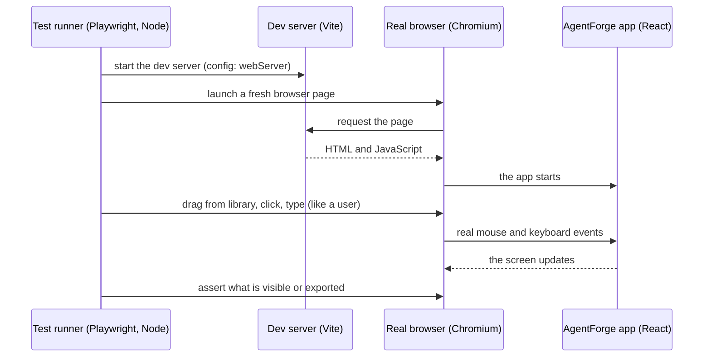
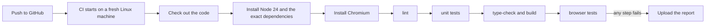
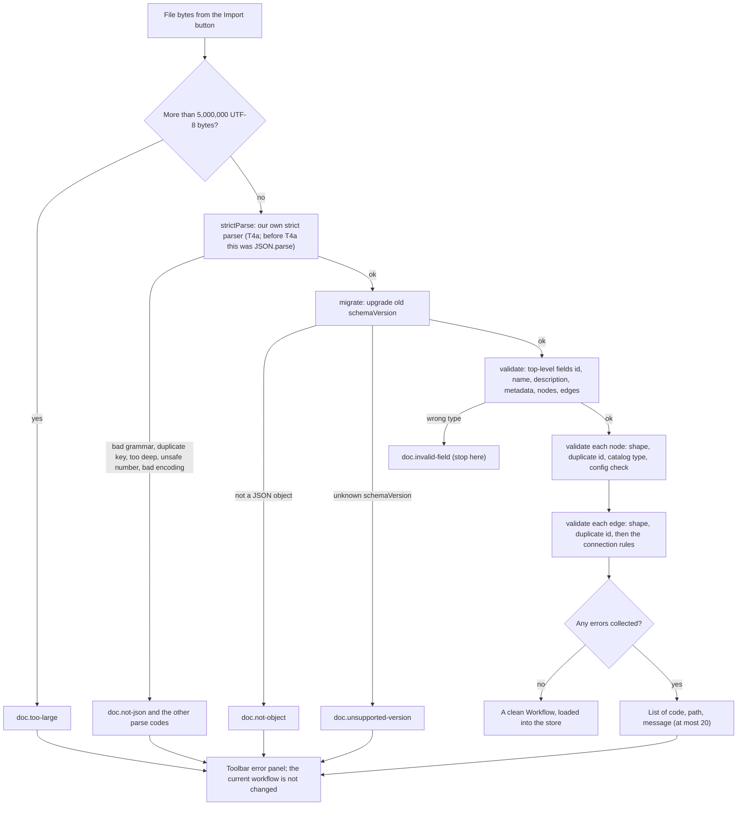
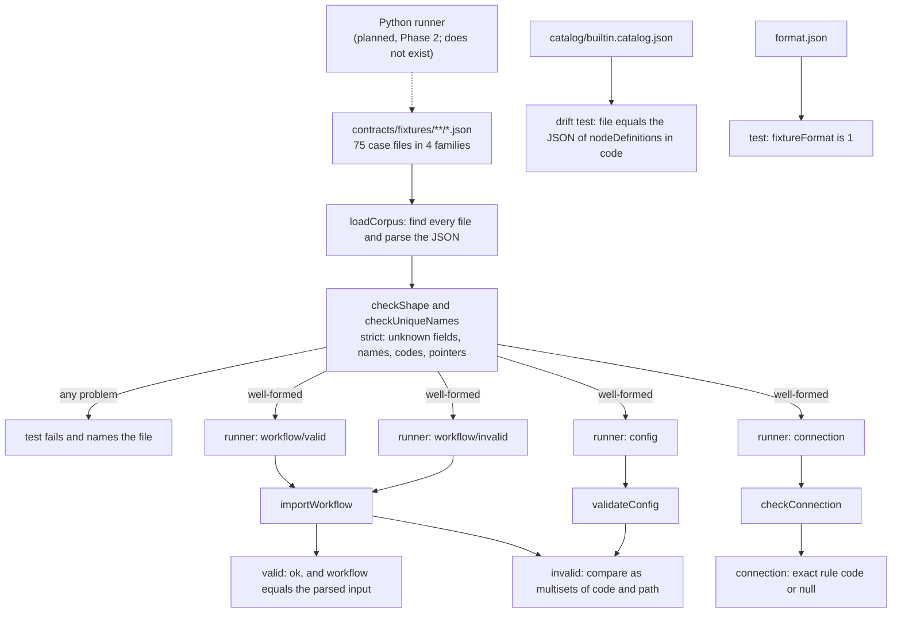
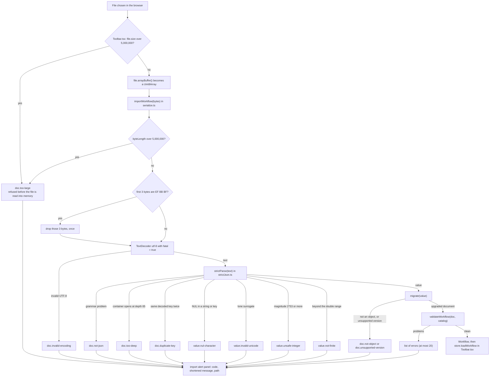
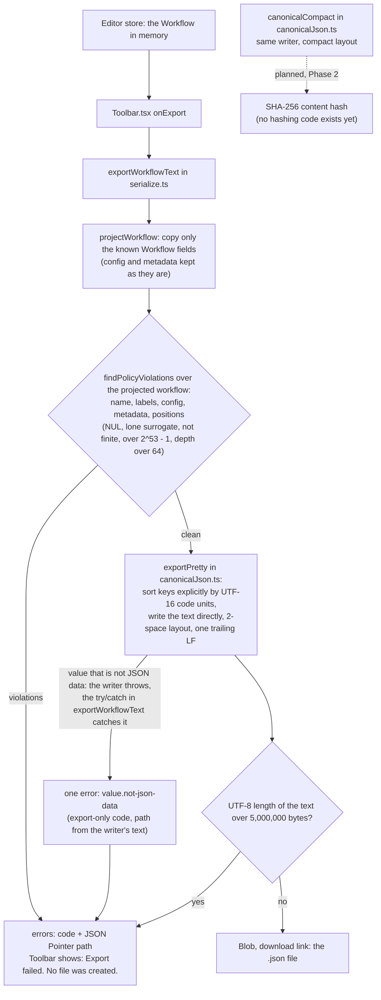
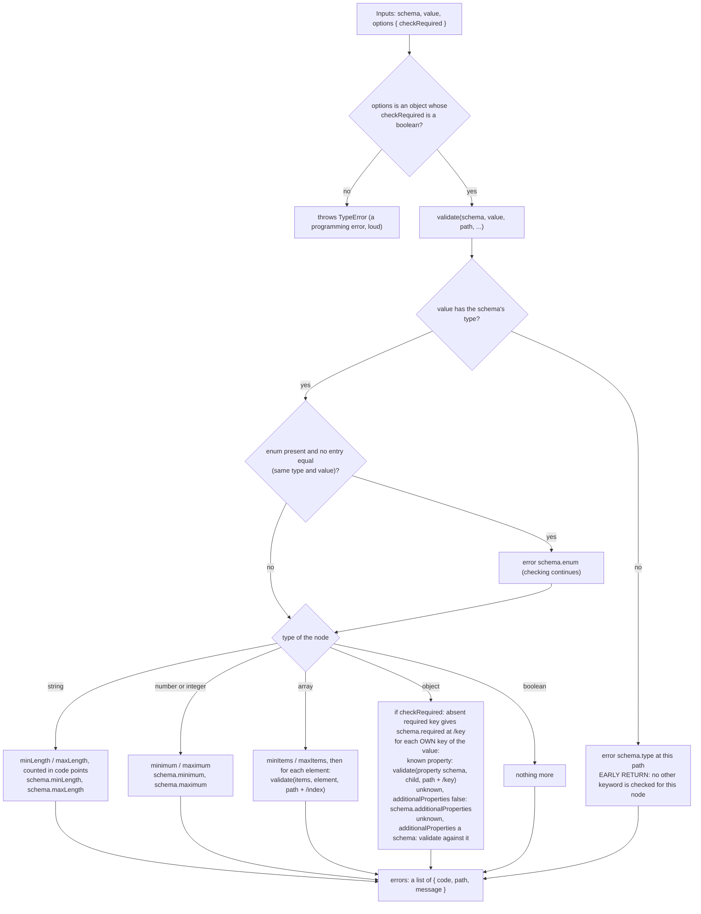
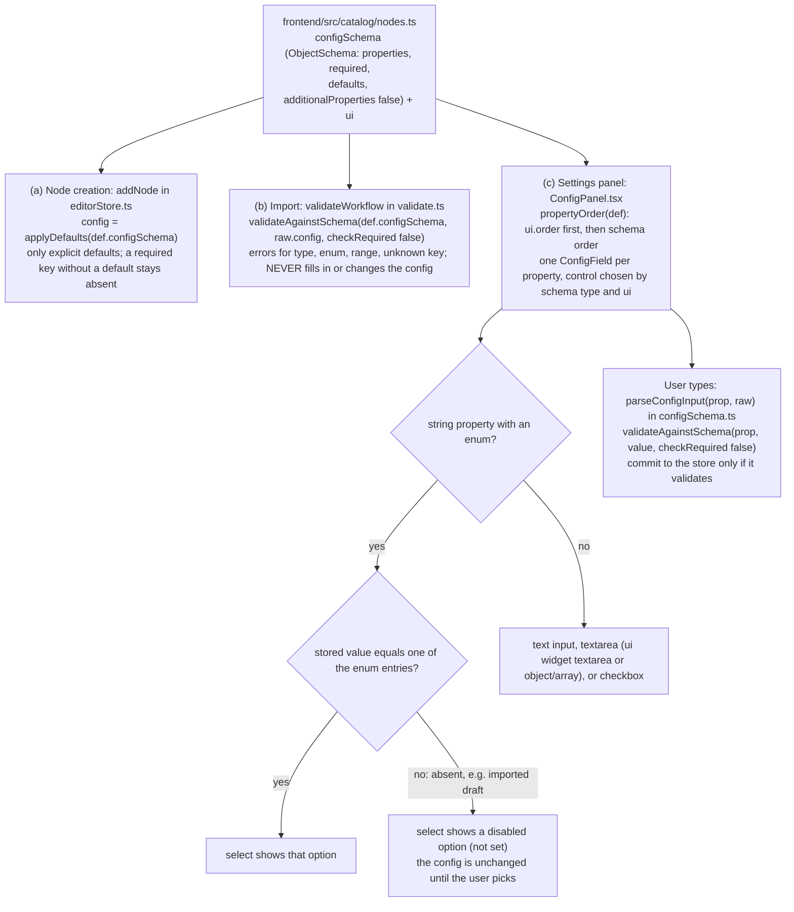

# AgentForge Learning Guide

> **For the Product Owner.** Part 1 is a plain-language **primer** (reference material: what we are building and how the code is organised). Part 2 is the **teaching record** (lessons actually taught and what you demonstrated).
> The **curriculum and statuses** are in `docs/LEARNING.md`. Learning progress is tracked separately from implementation progress.
> **Living document.** The Principal Architect updates it at the end of every task (D-028). The primer describes the project **as it is today**; where something is planned but not built, it says so.
> Last updated: 2026-11-05, after Phase 1.1 T5b and its review fixes (Lesson L7, commits `7b09662` and `44bd7f4`). T6 (node migrations) is running and is not described here.

# Part 1: Primer

---

## 1. What we are building

AgentForge is a **visual builder for AI workflows**, in the same family as n8n, Langflow and Dify. A user:

1. **Draws** a workflow on a canvas by dragging boxes (called *nodes*) and connecting them with lines.
2. **(Later)** describes a workflow in plain English and lets AI draw it.
3. **(Later)** runs the workflow and watches what happens at each step.
4. **(Later)** builds *agents*: AI that decides its own next steps in a loop and can use tools.

A tiny example workflow: *Manual Trigger → LLM Prompt ("summarise this") → Output*. You press run, the text goes to an AI model, and the answer appears in the Output node.

## 2. Where we are today

| Built and tested | Not built yet |
|---|---|
| The visual editor in the browser: drag nodes from a library, connect them with rules, edit each node's settings, save the workflow to a `.json` file and load it back | Running workflows (the "engine") |
| A catalog of 6 node types | AI models, agents, tools (Phase 4) |
| 934 unit tests in 15 test files and 35 browser tests (at commit `44bd7f4`) | Natural-language workflow generation (Phase 5) |
| A CI workflow that runs the checks on GitHub | The backend server, database, saving to a server (Phase 2) |

**Important:** today everything runs **in your browser only**. There is no server. Nothing runs a workflow yet. The editor produces a *description* of a workflow; later phases will execute it.

| Phase | What it delivers | Status |
|---|---|---|
| 1 | The visual editor | Done and accepted |
| 1.1 | Hardening: stricter file format rules, better settings forms, upgrades for old files, warnings, browser tests | In progress (tasks 1 to 5 of 10 done, with task 5 in two halves, T5a and T5b; T6, upgrading old files, is next) |
| 2 | Backend server and database; save/load workflows | Planned, not approved |
| 3 | Execution engine: actually run workflows | Planned |
| 4 | AI runtime: LLM and Agent nodes | Planned |
| 5 | Describe a workflow in English and get it drawn | Planned |
| 6 | MCP and other integrations | Planned |
| 7 | Logins, credentials, production hardening | Planned |

## 3. The big picture

```
        YOUR BROWSER (built, Phase 1)                         SERVER (not built yet)
 ┌───────────────────────────────────────────┐        ┌─────────────────────────────────┐
 │ Node library  │  Canvas  │ Settings panel │        │ Stores workflows (database)     │
 │ (drag from)   │ (draw)   │ (edit a node)  │  <──>  │ Validates them                  │
 │               │          │                │  Phase │ Runs them (engine)              │
 │   Editor state ("store") = the workflow   │   2+   │ Runs AI agents                  │
 └───────────────────────────────────────────┘        └─────────────────────────────────┘
              │  Export / Import
              ▼
        a  workflow.json  file
```

The most important idea in the whole project: **the workflow is a JSON document** (a text file with a defined shape). The editor draws it, the server will store it, the engine will run it, and AI will generate it. Everything revolves around that one document, so we are careful about its exact format.

## 4. Key ideas (a glossary with examples)

**Workflow.** The whole diagram: nodes plus the lines between them.

**Node.** One box. It has a *type* (for example `llm.prompt`), a *label* you can rename, *settings* (called `config`) and a *position* on the canvas. The six types today: Manual Trigger, LLM Prompt, HTTP Request, Condition, Agent, Output.

**Port.** A connection point on a node. *Input* ports are on the left and *output* ports on the right. Each has a name (`input`, `text`, `data`) and a *data type* (`text`, `json`, `number`, ...).

**Edge.** A line from one node's output port to another node's input port.

**Data types and compatibility.** You can only connect compatible ports. `any` connects to everything; otherwise the types must match. So a number cannot flow into a text input.

**Catalog and node definition.** The catalog is the list of node types the platform offers. A *definition* describes one type: its ports, its settings, its icon. The library, the settings forms, the validator and (later) the engine and the AI generator all read the same catalog, so there is one source of truth. See `frontend/src/catalog/nodes.ts`.

**Config schema.** A description of what settings a node accepts (for example `temperature` is a number from 0 to 2). The settings panel builds its form from it, and the importer uses it to check files. We use a small, documented subset of **JSON Schema**, a standard way to describe JSON. The checker for that subset (Lesson L6) is now the only one: since T5b (Lesson L7) the catalog, the "new node" step, the settings panel and the importer all use it. A setting's starting value is its schema `default`, applied only when you create a node; how a setting is *drawn* (a multi-line box, its height) lives in a separate `ui` block, never in the schema.

**Workflow JSON.** The file format. A minimal real example (a trigger connected to an output):

```json
{
  "schemaVersion": "1.0",
  "id": "wf_1a2b3c4d",
  "name": "Untitled workflow",
  "description": "",
  "nodes": [
    { "id": "n_1", "type": "trigger.manual", "typeVersion": 1, "label": "Manual Trigger",
      "config": { "payload": {} }, "position": { "x": 100, "y": 200 } },
    { "id": "n_2", "type": "output.result", "typeVersion": 1, "label": "Output",
      "config": { "format": "text" }, "position": { "x": 400, "y": 200 } }
  ],
  "edges": [
    { "id": "e_1", "source": { "nodeId": "n_1", "port": "data" },
      "target": { "nodeId": "n_2", "port": "input" } }
  ],
  "metadata": {}
}
```

**`schemaVersion` vs `typeVersion`.** Two separate version numbers. `schemaVersion` versions the *file format*. `typeVersion` versions *one node type* (if we change how the Agent node works, it becomes version 2). Keeping them separate lets each evolve without breaking the other.

**Migration.** Upgrading an old file to the current format *in memory*, without overwriting the original. Planned in Phase 1.1 (task T6, in progress; not built at the time of Lesson L7).

**Validation (errors) vs warnings.** *Errors* mean the file is structurally wrong (unknown node type, impossible connection); it is rejected. *Warnings* mean "this looks incomplete" (an empty required setting, an unconnected node); they never stop you from working. We keep them strictly separate (decision D-018).

**DAG and "no cycles".** A *directed acyclic graph*: arrows that never loop back. The workflow engine will run nodes in dependency order, which only works if there are no loops. Anything that needs looping (an agent thinking in steps) happens *inside* the Agent node using a library called LangGraph. The editor already refuses a connection that would create a cycle.

**Condition and branches (planned).** A Condition node sends data down either its `true` or its `false` port. Nodes on the branch not taken are *skipped*. The exact rules are written in `docs/PHASE1_1_PLAN.md` section 3.4.

**Agent (planned).** A node where an AI model decides what to do next, repeatedly, and can call tools.

**Credentials.** API keys and passwords. **They never go inside a workflow file** (decision D-016). Later, workflows will refer to a stored credential by id. Until then, a detector will warn if someone pastes a secret into a setting (planned, task T9).

**Provider.** Which AI service a node uses: Ollama (local), OpenAI, Anthropic or Groq. We design so adding one does not change the file format. Groq was added in T5b; the one `PROVIDERS` list in `frontend/src/catalog/nodes.ts` feeds both the LLM Prompt and the Agent node.

**Incomplete drafts (decision C1, built in T5b, Lesson L7).** A file whose node is missing a *required* setting (for example an LLM Prompt with no `provider`) still imports. The editor must be able to hold half-finished work. A wrong type, a value outside the allowed list or range, or an unknown setting are still errors. A missing required setting is meant to become a *warning* in the editor (planned, task T7) and an *error only when the workflow is run* (Phase 3, planned).

**Strict parsing (built in task T4a, Lesson L4).** Reading an imported file with our own small parser instead of the browser's built-in one, so that problems the built-in parser hides (a repeated key, a number too big to store exactly, a file that is not valid UTF-8) become clear errors. It also enforces AgentForge's limits: numbers no larger than 2^53 - 1 in magnitude, nesting at most 64 levels, files at most 5,000,000 bytes. See `frontend/src/workflow/strictJson.ts` and `valuePolicy.ts`.

**Canonical JSON and export JSON (built in task T4b, Lesson L5; TypeScript only).** Writing a workflow to text in one exact, repeatable way (keys sorted, numbers formatted the same everywhere) so the same workflow always produces byte-identical text. There are two named forms: `canonical-json/1` (compact, meant for hashing) and `export-json/1` (pretty, 2-space indent, for the `.json` files you download; never hashed). See `frontend/src/workflow/canonicalJson.ts` and `contracts/CANONICAL_JSON.md`. **Built and tested in TypeScript only: the Python version is planned for Phase 2 and no parity is claimed; no hashing code exists yet (planned, Phase 2).**

**Fixtures (built in task T3, Lesson L3).** Shared test data files in the top-level `contracts/` folder, one case per file, with no code inside. The TypeScript tests read them today; the Python backend tests are planned (Phase 2) to read the same files, and only then can the two sides be said to agree.

## 5. A tour of the code

Everything built so far lives in `frontend/`. Think of it in layers:

```
frontend/src/
  workflow/      THE CONTRACT: types, rules, parsing. No screen code in here.
    types.ts          what a Workflow, node, edge, port and node definition look like
    connections.ts    "may this edge exist?" (the 7 connection rules)
    validate.ts       checks an imported file and returns a clean Workflow or a list of errors
    jsonSchema.ts     the JSON Schema subset checker and applyDefaults (T5a, L6)
    configSchema.ts   parses what you type into one settings field and checks it against that property's schema
    codeExemptions.ts two lists of error codes that tests exempt; imported by tests only (T5b)
    migrate.ts        upgrades old file formats
    serialize.ts      export to text (with the export guard), import from text (bytes or text)
    canonicalJson.ts  the two repeatable JSON text writers: compact (for hashing) and pretty (for files) (T4b)
    strictJson.ts     our strict JSON parser for imported files (T4a)
    valuePolicy.ts    the limits (numbers, nesting, text rules) as one shared checker (T4a)
    errors.ts         the error codes and JSON Pointer paths (T2)
  catalog/       the six node types (nodes.ts) and lookups (index.ts)
  store/         editorStore.ts: the single source of truth for the workflow being edited
  canvas/        the drawing surface (React Flow) and flowMapping.ts, the only place that
                 translates our workflow into React Flow's objects
  nodes/         WorkflowNode.tsx: one component that draws every node type from the catalog
  library/       the searchable, draggable list of node types
  config-panel/  the settings form for the selected node, generated from the node's schema (ConfigPanel.tsx)
                 and propertyOrder.ts, the small helper that decides the field order
  app/           the page layout and the toolbar (New / Import / Export)
frontend/e2e/    browser tests that click through the real app (Playwright)
frontend/src/contracts/fixtures.test.ts   the runner for the shared fixtures
```

Outside `frontend/`, the top-level `contracts/` folder holds the language-neutral test data (JSON files, no code) that the runner reads (Lesson L3).

**Follow one action through the code.** You drag "LLM Prompt" onto the canvas:

1. `library/Library.tsx` starts a drag that carries the text `llm.prompt`.
2. `canvas/Canvas.tsx` receives the drop, converts the mouse position to canvas coordinates, and calls `addNode`.
3. `store/editorStore.ts` looks up the definition in the catalog, creates a node whose settings come from `applyDefaults(def.configSchema)` (the schema's `default`s), and updates the workflow.
4. The store change re-renders: `canvas/flowMapping.ts` converts the workflow to React Flow objects, and `nodes/WorkflowNode.tsx` draws the box with its ports.
5. You connect two ports: `Canvas.tsx` asks `workflow/connections.ts` whether it is allowed, and only then calls `store.connect`.
6. You click Export: `app/Toolbar.tsx` calls `exportWorkflowText` in `serialize.ts`, which checks the workflow against the limits, writes it with `canonicalJson.ts` (keys sorted, one exact layout) and only then lets the browser download the `.json` file. If a check fails, the toolbar says "Export failed. No file was created."

**Suggested reading order** (each is short): `workflow/types.ts` → `catalog/nodes.ts` → `workflow/connections.ts` → `store/editorStore.ts` → `canvas/Canvas.tsx` → `workflow/validate.ts`.

## 6. How we know it works

| Kind | Tool | What it does | Command |
|---|---|---|---|
| **Unit tests** | Vitest | Small, fast tests of single functions (the connection rules, the store, import/export, the strict parser, the two JSON writers, the JSON Schema subset validator, the catalog and the shared fixtures in `contracts/`). 934 in 15 test files at commit `44bd7f4`. | `npm test` |
| **Browser tests** | Playwright | A real browser clicks through the app: drag, connect, edit, export, import. 35 at commit `44bd7f4`. | `npm run test:e2e` |
| **Type check** | TypeScript | Catches mismatched data shapes before running | part of `npm run build` |
| **Lint** | Oxlint | Catches suspicious code patterns | `npm run lint` |
| **Everything** | | All of the above, in order | `npm run verify` |

"Green" means *the checks we wrote passed*. It does **not** mean there are no bugs. To make sure the tests are meaningful, we sometimes break the code on purpose and confirm a test fails (we did this for T1: removing the cycle rule made the cycle test fail).

## 7. How the team works

You are the **Product Owner**: you decide *what* and *why*, and you accept results. Claude, as **Principal Architect**, decides *how*, plans the work and keeps the documents honest. A **Sonnet 5.5** subagent writes the code for one task at a time. An **Opus 5.5** subagent reviews each task independently and never edits files. A **Sonnet 5.5 tutor** subagent prepares the lessons in Part 2 of this file. Then the architect reports to you in plain language. The full loop is in `CLAUDE.md` section 16 and decision D-027.

| Document | Read it to learn |
|---|---|
| `docs/PROJECT_BRAIN.md` | The current state, always |
| `docs/DECISIONS.md` | Every decision, and whether it is approved |
| `docs/ARCHITECTURE.md` | How the whole system is designed |
| `docs/ROADMAP.md` | The phases and where we are |
| `docs/PHASE1_1_PLAN.md` | The current detailed plan, task by task |
| `docs/DEVELOPMENT_LOG.md` | A diary of what was done, with real test results |
| `docs/LEARNING.md` | The curriculum: 12 modules, your learning status, interview questions |

## 8. Try it yourself

```
cd frontend
npm install              # first time only
npm run dev              # open http://localhost:5173
```

**Exercises**

1. **Build and export.** Drag Manual Trigger, LLM Prompt and Output onto the canvas and connect them. Click Export and open the `.json` file. Find your three nodes and two edges, and match them to section 4.
2. **Break a rule.** Drag two LLM Prompt nodes onto the canvas, connect A to B, then try to connect B back to A (a loop). Also try connecting the HTTP Request node's `Status` (a number) to an Agent's `Task` (text). The editor refuses both; `workflow/connections.ts` is the code that decides.
3. **Bad settings.** Select LLM Prompt and type `5` as the temperature. The form flags it and does not save it.
4. **Round trip.** Export, press New, Import the file. Export again and compare the two files; they are identical.
5. **See a test fail.** In `frontend/src/workflow/connections.ts`, comment out the line that returns `'cycle'`, run `npm run test:e2e`, and watch the cycle test fail. Undo the change (`git checkout -- frontend/src/workflow/connections.ts`).

## 9. Why we made these choices (short answers)

| Choice | Why |
|---|---|
| **A JSON document is the heart of the system** | One shared, checkable format that the editor, server, engine and AI can all agree on |
| **Our file format is separate from React Flow's** | The drawing library is a view detail; it must not leak into saved files or the backend |
| **One catalog drives everything** | Adding a node type means adding data, not changing five places |
| **The engine and LangGraph are separate** | A predictable "run these steps in order" engine for normal workflows; the looping, unpredictable AI behaviour is contained inside the Agent node |
| **Zustand for editor state** | Small, simple, and the canvas, library and settings panel all need to share the same workflow |
| **Our own small JSON Schema checker** | Fewer dependencies, and we can keep TypeScript and Python in exact agreement with shared test data |
| **TypeScript first, then Python models** | We built the editor first; in Phase 2 the backend models become the source of truth and generate the TypeScript types |
| **Warnings never block you** | An editor must let you hold half-finished work |
| **No secrets in files, ever** | A workflow file gets shared, committed and stored; a key inside would leak |

## 10. What happens next

Phase 1.1, in order: **T1** browser tests and CI (done); **T2** structured error codes (done); **T3** shared fixtures (done); **T4a** strict parsing and the policy limits (done, Lesson L4); **T4b** repeatable (canonical) JSON export (done, Lesson L5; its review fixes are committed); **T5a** the JSON Schema subset validator, explicit defaults and the `schema` fixtures (done, Lesson L6); **T5b** switching the catalog, the settings panel and the importer to it, plus the Groq provider (done, Lesson L7; its review fixes are committed); **T6** upgrading old files with node migrations (next; running now, not described in a lesson yet); **T8** the branch rules written down; **T7** warnings in the editor; **T9** secret detection; **T10** final documentation and review. Then, if you approve it, Phase 2: the backend server and database.

## 11. Glossary, quick reference

| Term | One line |
|---|---|
| **React / TypeScript / Vite** | The tools the frontend is made with: UI library, typed JavaScript, dev server and bundler |
| **React Flow (`@xyflow/react`)** | The library that draws the canvas, nodes and lines |
| **Zustand** | The small library that holds the editor's state |
| **Vitest / Playwright** | Unit-test runner / real-browser test runner |
| **CI** | Continuous integration: an automatic run of the checks on every change pushed to GitHub |
| **LangGraph** | A library for AI agents that loop and use tools (Phase 4) |
| **MCP** | Model Context Protocol: a standard way for AI to use outside tools (Phase 6) |
| **Pydantic / FastAPI** | Python tools for data models and the web server (Phase 2) |
| **PostgreSQL / JSONB** | The database and its JSON column type (Phase 2) |
| **Commit** | A saved snapshot of the project in Git |

---
---

# Part 2: Teaching record

> **What this part is.** A record of the lessons actually taught and what the Product Owner demonstrated. It is separate from the primer above (reference material) and from implementation progress.
> **Rule (D-029).** Every lesson ends with a **Knowledge Check / Interview Questions** section. You answer all of them in one dedicated learning session at the end of the project and submit the answers for evaluation. **Only then** are statuses updated. Until then every concept is **Explained (no evidence)**. The curriculum and statuses live in `docs/LEARNING.md`.

## Lesson index

| Lesson | After task | Modules | Taught | Check questions | Status |
|---|---|---|---|---|---|
| **L1** | Phase 1.1 T1: Playwright and CI | 12 (testing and CI) | 2026-11-03 | 5 (answered at the end of the project) | Explained; evaluation pending |
| **L2** | Phase 1.1 T2: structured validation errors | 3 (main); also 1 and 12 | 2026-11-03 | 6 (answered at the end of the project) | Explained; evaluation pending |
| **L3** | Phase 1.1 T3: shared JSON fixtures and the TypeScript runner | 1, 3, 12 | 2026-11-03 | 6 (answered at the end of the project) | Explained; evaluation pending |
| **L4** | Phase 1.1 T4a: strict JSON parsing and the policy limits | 3 (main), 12, 1 | 2026-11-04 | 6 (answered at the end of the project) | Explained; evaluation pending |
| **L5** | Phase 1.1 T4b (commits `dd33e84`, `d2ef493`): canonical compact JSON, pretty export JSON and the export guard | 3 (main), 1, 12 | 2026-11-04 | 6 (answered at the end of the project) | Explained; evaluation pending |
| **L6** | Phase 1.1 T5a (commits `96cc80d`, `a009b20`): the JSON Schema subset validator, explicit `applyDefaults` and the `schema` fixtures | 3 (main), 7, 12 | 2026-11-05 | 6 (answered at the end of the project) | Explained; evaluation pending |
| **L7** | Phase 1.1 T5b (commits `7b09662`, `44bd7f4`): the catalog, importer (decision C1) and settings panel move onto the JSON Schema subset | 7 (main), 3, 2, 12 | 2026-11-05 | 6 (answered at the end of the project) | Explained; evaluation pending |

## Concept index

| Concept | Module | Lesson | Status |
|---|---|---|---|
| End-to-end test versus unit test | 12 | L1 | Explained (no evidence) |
| Test fixture and helper functions | 12 | L1 | Explained (no evidence) |
| Auto-waiting assertions | 12 | L1 | Explained (no evidence) |
| Flaky tests and retries | 12 | L1 | Explained (no evidence) |
| Vacuous tests and fault injection | 12 | L1 | Explained (no evidence) |
| Continuous integration (CI) | 12 | L1 | Explained (no evidence) |
| Supply-chain pinning by commit SHA | 12 | L1 | Explained (no evidence) |
| Machine-readable versus human-readable errors | 3 | L2 | Explained (no evidence) |
| Stable error codes as a contract (namespaced codes) | 1, 3 | L2 | Explained (no evidence) |
| JSON Pointer (RFC 6901) | 3 | L2 | Explained (no evidence) |
| String-literal union types and compile-time exhaustiveness (`ErrorCode`) | 3 | L2 | Explained (no evidence) |
| Validate, do not trust, at a boundary (own-property lookups) | 3, 12 | L2 | Explained (no evidence) |
| Table-driven tests, one test per code, guard tests | 12 | L2 | Explained (no evidence) |
| Errors versus warnings (D-018), applied to the import path | 3 | L2 | Explained (no evidence) |
| Contract-first design: one shared contract, two implementations (language-neutral fixtures) | 1 | L3 | Explained (no evidence) |
| Data-driven (table-driven) tests with test data kept apart from test code | 12 | L3 | Explained (no evidence) |
| A conformance suite and golden files; circular (self-confirming) tests and expectations written from the specification | 12 | L3 | Explained (no evidence) |
| Comparing `{code, path}` as multisets, never the message | 3, 12 | L3 | Explained (no evidence) |
| Rule order as part of a contract (`checkConnection`), caught only by a fixture | 1, 3 | L3 | Explained (no evidence) |
| Import semantics a second implementation must follow (cascades, stop-early, error cap) | 3 | L3 | Explained (no evidence) |
| Coverage guards, minimum-count floors and a drift test (fail-on-purpose regeneration) | 12 | L3 | Explained (no evidence) |
| A generator spec instead of a huge file (`inputRepeat`) | 12 | L3 | Explained (no evidence) |
| Mutation checks to prove a test can fail (applied to fixtures) | 12 | L3 | Explained (no evidence) |
| Trust boundary: untrusted file input, and why information lost during parsing cannot be recovered by checks afterwards | 3, 12 | L4 | Explained (no evidence) |
| What the built-in `JSON.parse` does silently (last duplicate key wins, big integers lose precision, invalid bytes replaced when decoding text) | 3 | L4 | Explained (no evidence) |
| A strict RFC 8259 parser: recursive descent, first problem only, a result type that never throws | 3 | L4 | Explained (no evidence) |
| Policy limits and where each rule comes from (RFC 8259, I-JSON / RFC 8785, AgentForge policy, PostgreSQL compatibility) | 1, 3 | L4 | Explained (no evidence) |
| Deciding a number's range from its token text, before conversion; why the safe-integer limit exists | 3 | L4 | Explained (no evidence) |
| Limits counted in the right unit: UTF-8 bytes not characters; depth counted as containers open | 3, 12 | L4 | Explained (no evidence) |
| Strict UTF-8 decoding, the byte order mark, and lone surrogates | 3 | L4 | Explained (no evidence) |
| Safe object construction (`defineProperty`, a key named `__proto__`) | 3, 12 | L4 | Explained (no evidence) |
| Round-trip integrity: values typed in the editor obey the same policy as imported files | 1, 3 | L4 | Explained (no evidence) |
| Reject rather than clamp or normalise | 3 | L4 | Explained (no evidence) |
| Bounding attacker-controlled text when it is echoed in a message (exact machine path, short human message) | 3, 12 | L4 | Explained (no evidence) |
| Boundary-value tests, differential testing against `JSON.parse`, fuzz-style truncation tests, a guard test over source text | 12 | L4 | Explained (no evidence) |
| Mutation testing and the equivalent mutant; a vacuous test caused by the tooling | 12 | L4 | Explained (no evidence) |
| Canonical form and deterministic serialization (same data, same bytes); why a hash needs it | 1, 3 | L5 | Explained (no evidence) |
| Two named profiles: `canonical-json/1` (compact, for hashing) and `export-json/1` (pretty, for files, never hashed); no hashing code exists yet | 3 | L5 | Explained (no evidence) |
| Why integer-like keys defeat `JSON.stringify` (also with a sorting replacer) and the fix: sort the key list and write the text directly | 3 | L5 | Explained (no evidence) |
| UTF-16 code unit order versus code point order (the U+E000 and U+1F600 pair); what a Python implementation must do | 1, 3 | L5 | Explained (no evidence) |
| Number text: ECMAScript `String(n)` versus Python `repr`; minus zero; the 1e-7 threshold | 3 | L5 | Explained (no evidence) |
| String escapes: only the standard set; U+007F, U+2028, U+2029 literal; no Unicode normalization | 3 | L5 | Explained (no evidence) |
| Which rules come from RFC 8785, I-JSON, AgentForge policy or PostgreSQL compatibility (and the export layout being AgentForge's own) | 1, 3 | L5 | Explained (no evidence) |
| Idempotence and round trip: export, import, export is byte-identical; the export guard (`exportWorkflowText`) and "what you can export you can import" | 1, 3 | L5 | Explained (no evidence) |
| Writers that refuse non-JSON data (undefined, Map, Date, cycles) instead of skipping it | 3, 12 | L5 | Explained (no evidence) |
| A guard that never throws: project to known fields, check, write inside try/catch, return one structured error (`value.not-json-data`, an export-only code) | 1, 3, 12 | L5 | Explained (no evidence) |
| PostgreSQL JSONB does not keep key order, so canonicalize on read (documented; not verified here) | 1 | L5 | Explained (no evidence) |
| Golden files with hand-written expectations; property-based testing against an independent reference; a reference that shares one call with the code (numbers) | 12 | L5 | Explained (no evidence) |
| Independent re-implementation by a reviewer as an answer to circular tests | 12 | L5 | Explained (no evidence) |
| A refactor can delete an implicit protection (projecting to known fields; catching writer failures) | 3, 12 | L5 | Explained (no evidence) |
| Mutation testing of a writer (17 breaks) and an equivalent mutant (`JSON.stringify(n)` versus `String(n)`) | 12 | L5 | Explained (no evidence) |
| A documented subset of JSON Schema (draft 2020-12) as a contract two languages implement; the deliberate non-goals (`$ref`, `anyOf`, `pattern`) and why (Pydantic output, regex dialects) | 1, 3, 7 | L6 | Explained (no evidence) |
| `validateAgainstSchema`: recursive walk, `{code, path}` errors, the early return after `schema.type`, own-property lookups | 3, 7 | L6 | Explained (no evidence) |
| A mandatory option as design (`checkRequired`), the C1 draft-versus-execution split (wiring is planned for T5b) | 3, 7 | L6 | Explained (no evidence) |
| Explicit versus implicit defaults (`applyDefaults`: no recursion, deep copy, never called by validators) | 3, 7 | L6 | Explained (no evidence) |
| A schema about schemas (`checkSchemaSubset`) and total functions on untrusted input; the uniform default rule | 3, 12 | L6 | Explained (no evidence) |
| Rules two languages must agree on: code-point string length, safe integers, enum equality (`true` versus `1`, JavaScript versus Python) | 3, 7, 12 | L6 | Explained (no evidence) |
| A temporary, named exemption list for codes no workflow can produce yet (`SCHEMA_ONLY_CODES`) and a no-production-import guard test | 12 | L6 | Explained (no evidence) |
| The three fixture case kinds (validation, defaults, schema check); a property test against an independent reference; a soundness corollary; a reviewer's independent validator and mutation-found fixture gaps (reports) | 12 | L6 | Explained (no evidence) |
| The node catalog as the single source of truth: one `configSchema` (a JSON Schema subset, `additionalProperties: false`) per node, and a `ui` block for presentation only | 7, 2, 3 | L7 | Explained (no evidence) |
| A form generated from a schema instead of one hand-written form per node (`ConfigPanel.tsx`, `propertyOrder.ts`); reserved `ui` widget values | 2, 7 | L7 | Explained (no evidence) |
| Who applies defaults and who checks `required`, at each moment (creation, import, editing, future execution); the incomplete draft (decision C1, D-025) | 3, 7 | L7 | Explained (no evidence) |
| Imported data is never silently changed: the importer keeps `raw.config` as read; defaults are applied only in `addNode` | 3 | L7 | Explained (no evidence) |
| A behaviour change can make an unreachable state reachable somewhere else: the "(not set)" select that stops the screen from lying about the data | 2, 3, 12 | L7 | Explained (no evidence) |
| One list, derived everywhere (`PROVIDERS`), enforced by an identity assertion; adding `groq` without changing existing option order | 7, 12 | L7 | Explained (no evidence) |
| Differential testing between the old and new implementation (the reviewer's 60,000-document run, a report); only the intended differences may appear | 12 | L7 | Explained (no evidence) |
| Golden values copied from the brief (not computed from the code), source-text guards (`applyDefaults` has one caller; `codeExemptions` is imported by tests only) and a mutation-found weak test | 12 | L7 | Explained (no evidence) |
| A temporary exemption list for an execution-only code (`schema.required` in `codeExemptions.ts`); fixtures that state their mode (`checkRequired` on every config fixture) | 3, 12 | L7 | Explained (no evidence) |
| Messages for people versus paths for programs: undoing JSON Pointer escapes in the message only | 3 | L7 | Explained (no evidence) |
| Primer concepts (workflow, node, port, edge, catalog, config schema, `schemaVersion` vs `typeVersion`, validation vs warnings, DAG, credentials) | 1, 2, 3, 6, 7 | Primer (Part 1) | Explained as reference (no evidence, no lesson) |

---

## Lesson L1: Testing the editor like a user, and checking it automatically

**Task:** Phase 1.1 T1 (Playwright browser tests and the CI workflow). **Module:** 12 (Security, Testing and Deployment).

### 1. The problem

After Phase 1, the editor worked, and we knew it because someone (me) had clicked through it with a throwaway script that nobody else could run. In the next tasks (T2 to T9) we change the *rules* the editor depends on: how files are parsed, how settings are checked, how connections are judged. Any of those changes could quietly break something as basic as dragging a node. We needed a **robot user** that repeats the same checks, the same way, every time, and on every change.

### 2. The concept

**End-to-end (E2E) testing** means a program drives the *real application in a real browser*, the way a person would: it drags, clicks, types, then looks at what happened. It protects against **regressions** (something that used to work stops working).

Compare it with a **unit test**, which tests one small function in isolation (for example "is this connection allowed?"). Unit tests are fast and precise. E2E tests are slower but prove that all the pieces, including the screen, work together. Teams use both; a common picture is a *pyramid*: many unit tests, fewer E2E tests.

**Continuous integration (CI)** means a server automatically runs all the checks whenever code is pushed, so a break is noticed within minutes and not weeks.

### 3. Why this approach

- **Playwright** drives a real Chromium browser, so drag and drop, layout and keyboard behaviour are real, not simulated. It also *waits automatically* (see section 4), which removes most flakiness.
- **One browser (Chromium) and a fixed window size**, because the drag and connect tests depend on exact positions; fewer variables means more repeatable results.
- **A fresh page per test**, so tests cannot affect each other.
- **A rule that any console error fails the test**, so hidden crashes cannot pass unnoticed.
- **CI on GitHub** with a single command (`npm run verify`) so "green locally" and "green in CI" mean the same thing.
- **Actions pinned to a commit SHA** instead of a version tag (explained below).

### 4. How it works internally



**Auto-waiting.** A line such as `expect(editor.nodes).toHaveCount(3)` does not check once; it keeps re-checking until it is true or a time limit passes. That is better than "wait 2 seconds", which is either too slow or too short. The tests never use fixed sleeps.

**Flaky tests.** A test that sometimes passes and sometimes fails for no code reason. In CI we allow one retry (to keep a trace of what happened) but also set `failOnFlakyTests`, so a test that needed a retry still turns the run red and gets fixed instead of hidden.

### 5. How it communicates with other components

- The **runner** talks to the **browser** over a control channel (like a remote control).
- The **browser** talks to the **dev server** over ordinary HTTP, exactly as a user's browser would.
- Tests talk to the app only through the **screen** and the **exported file**, never by reaching into its internals. That is why they survive refactors.
- **CI** runs `npm run verify` on a GitHub machine:



### 6. Important code paths

| Where | What it does |
|---|---|
| `frontend/playwright.config.ts` | Chromium only, fixed window, starts its own dev server on a dedicated port and never reuses a running one, retries and flaky-failure policy for CI |
| `frontend/e2e/fixtures.ts` | Gives every test a fresh editor page and fails the test on any console error or uncaught error |
| `frontend/e2e/editor.ts` | Helpers that act like a user: `drop` (drag from the library onto the canvas), `connect` (drag between two ports), `exportWorkflow`, `importText` |
| `frontend/e2e/connections.e2e.ts` | One test per connection rule: valid, occupied input, duplicate, type mismatch, cycle, and live feedback while dragging |
| `frontend/package.json` (`verify`) | The single command: lint, unit tests, build with type-check, browser tests |
| `.github/workflows/ci.yml` | Runs `npm run verify` on GitHub on every push and pull request |

### 7. Alternatives and trade-offs

| Option | Good | Costs |
|---|---|---|
| **Playwright (chosen)** | Real browser, auto-waiting, good traces | Heavier than unit tests; needs a browser download |
| Cypress or Selenium | Also drive real browsers | Different trade-offs in speed, setup and API; no strong reason to switch |
| A simulated DOM (jsdom) with Testing Library | Very fast | Not a real browser: no real layout, so dragging and connecting cannot be tested properly |
| Only unit tests | Fastest, most precise | Cannot prove the screen, store and rules work together |
| Pin actions by tag (`@v7`) | Convenient | A tag can be moved; whoever controls the action repository could change what your CI runs |
| **Pin actions by commit SHA (chosen)** | The exact code is fixed and reviewable | Updates are manual |

### 8. Real-world applications

Every product team keeps a small E2E "smoke" suite in CI and treats flaky tests as bugs. Pinning CI actions to commit SHAs is a standard supply-chain precaution; in March 2025 a widely used GitHub Action (`tj-actions/changed-files`) was publicly reported as compromised, with its version tags repointed to malicious code, and workflows pinned to SHAs were not affected.

### Two lessons from our own review (real examples)

1. **A green test can be meaningless (a "vacuous" test).** The independent reviewer found that our test "a duplicate connection is rejected" still passed if we *deleted* the duplicate rule, because a different rule (the input is already occupied) rejected the same connection. The test was green but proved nothing about the rule in its title. The fix builds a situation where only the rule under test can reject, and we **proved** it by deleting the rule and watching the test fail. This technique, deliberately breaking the code to see whether a test notices, is called **fault injection** (or mutation testing).
2. **Understand your tools before asserting exact numbers.** Our first drag test failed because the node moved 90% of the mouse distance: the canvas library uses the first mouse movement to *start* the drag. The honest fix was to change what we assert (the exported position matches where the node really is), not to loosen the numbers until the test passed.

### Knowledge Check / Interview Questions

*Answers are not given here. Study this lesson and `docs/LEARNING.md`, then answer all questions in the dedicated learning session at the end of the project.*

1. We pinned the CI actions to a long commit code instead of a version tag like `v7`. In your own words, why? What attack does it defend against?
2. A test called "duplicate connections are rejected" stayed green after we deleted the duplicate rule. What does that tell you about a green test, and how do you check that a test is able to fail?
3. Give one kind of bug an end-to-end test would catch that a unit test of the connection rules would not, and one kind the unit test catches better.
4. What is "auto-waiting" in Playwright, and why is it better than waiting a fixed two seconds?
5. Locally and in CI we run the same single command (`npm run verify`). Why is that useful, and what does it consist of?

---

## Lesson L2: Errors that a program can read, not only a person

**Task:** Phase 1.1 T2 (structured validation errors), commit `29b8aeb`. **Modules:** 3 (Workflow JSON and State Management) mainly; also touches 1 (contracts) and 12 (testing).

### 1. The problem

When you imported a broken workflow file, the editor told you what was wrong as a **sentence**, for example `nodes[2]: duplicate node id "t".` A person can read that. A program cannot use it. Three things we are about to build need more:

- **The future Python backend** must reject the same bad files for the same reasons, and we want to *prove* it with shared tests (task T3). Comparing English sentences across two languages is fragile; one reworded message and every test breaks.
- **The future API** (Phase 2) will answer a bad request with an error body (HTTP 422). The frontend needs to know *which field* to highlight, not just show text.
- **The future AI generator** (Phase 5) will get validation errors fed back to it so it can repair its own draft. A model, like a program, does better with `{ what, where }` than with prose.

So before T3 we changed every error on the import path from a string into a small object with three parts.

### 2. The concept

Every error is now `{ code, path, message }`:

| Part | Plain meaning | Example | Who it is for |
|---|---|---|---|
| `code` | A short, stable **name** for the kind of problem | `node.unknown-type`, `connection.cycle` | Programs, tests, other languages |
| `path` | **Where** in the imported file the problem is | `/nodes/2/config/provider` | Programs (and humans debugging) |
| `message` | The sentence a person reads | `nodes[1] ("l"): unknown node type mystery.node@1.` | People |

Three ideas sit behind this:

1. **Machine-readable versus human-readable.** A message is written for people and may change (wording, translation). A code is a **contract**: once published, it never changes meaning. Good APIs return both.
2. **JSON Pointer (RFC 6901).** A standard text format for "the thing at this place inside a JSON document". `/nodes/2/config/provider` means: take `nodes`, its item number 2 (counting from 0), then `config`, then `provider`. The empty string `""` means the whole document. Characters `/` and `~` inside a key are escaped as `~1` and `~0`, so a key named `a/b` becomes `/a~1b`.
3. **Errors versus warnings (D-018).** These objects are only for **errors**: the file is structurally wrong and the import is rejected. "Looks incomplete" warnings are a separate list from a separate function (planned, T7) and are never mixed in.

The codes are grouped by a **namespace prefix** (`doc.`, `node.`, `edge.`, `connection.`, `schema.`). There are 23 today. They are listed in one place, `ERROR_CODES` in `frontend/src/workflow/errors.ts`, and more will be added by later tasks (for example `doc.duplicate-key` in T4). The plan for the full table is `docs/PHASE1_1_PLAN.md` section 3.2.

### 3. Why this approach

- **A plain object, not an exception or a class.** The import path already "never throws; returns readable errors" (see `importWorkflow`). Returning data keeps that, and a plain `{code, path, message}` turns into JSON with no effort, which is exactly what an API response and a shared test fixture are.
- **Strings from a closed list.** `ErrorCode` is a TypeScript type built from the `ERROR_CODES` list, so a typo such as `'node.unknwon-type'` does not compile.
- **The message text did not change.** T2 added structure; it did not rewrite sentences. That keeps the change small and lets the old assertions on wording stay valid.
- **The error list is plain data that both languages can read.** In Phase 2 the Python backend will produce the same `code` and `path` for the same input. That is **planned, not built**: there is no `backend/` folder yet, and until the shared fixtures run in Python (T3 writes them; Phase 2 adds the Python runner) nobody can claim the two sides agree.

### 4. How it works internally

The import path, from the file's text to a result (`frontend/src/workflow/serialize.ts`, `migrate.ts`, `validate.ts`):



Points worth knowing:

- **Early exits versus collecting.** The first four failures (too large, not JSON, not an object, unsupported version) stop immediately, because nothing else can be checked. Bad top-level fields also stop. After that the validator **collects**: it keeps going through every node and every edge so the user sees many problems at once, up to `MAX_ERRORS = 20` (extra errors are silently dropped).
- **One problem per node or edge, but all settings problems.** A node that is malformed, has a duplicate id or an unknown type reports that one problem and moves on (the `return err(...)` lines in `validate.ts`). Its settings are checked by `validateConfig`, which can report several errors for one node.
- **Who knows the path.** `validateConfig` in `configSchema.ts` does not know where the node sits in the file, so it returns `{ key, code, message }`. `validate.ts` builds the full pointer with `jsonPointer('nodes', i, 'config', key)`. This split matters because the settings form in the editor (`config-panel/ConfigPanel.tsx`) reuses the same checking code through `parseConfigInput`, and a form field has no document path.
- **One check, many callers.** The internal `checkValue` function in `configSchema.ts` is the single place that decides "is this value valid for this setting" and returns a code plus a message. The form and the importer both go through it, so they cannot disagree. This is the "avoid duplicated business logic" rule in action.
- **Reusing the editor's connection rules.** For each edge the importer calls `checkConnection` from `connections.ts`, the same function the canvas uses while you drag. It returns the *first* rule that fails, in a fixed order: unknown node, unknown port, self-loop, duplicate, input already occupied, type mismatch, cycle. Each edge is checked "as if it were being added" to the edges accepted so far.
- **The type system keeps the two lists in step.** The line that turns a connection problem into a code is the template `connection.${problem}`. TypeScript knows the result must be one of the codes in `ErrorCode`, so if someone adds an eighth connection rule and forgets to add its code, the project does not compile. This is a **string-literal union** with **compile-time exhaustiveness**: the compiler checks you covered every case.

### 5. How it communicates with other components

- `importWorkflow` (in `serialize.ts`) is the only entry point. It returns `{ ok: true, workflow }` or `{ ok: false, errors }`. The same `ValidationError` type is used by `migrate.ts`, `validate.ts` and `serialize.ts`, so nothing has to translate between layers.
- `frontend/src/app/Toolbar.tsx` receives the list and shows each item as the **code** in a small badge followed by the **message**. The path is shown next to the message as plain, muted text (for example `at /nodes/0/type`), so everyone can see it (the first version hid it in a tooltip, which a review flagged as not accessible). A failed import leaves the current workflow untouched; only a fully valid file replaces it.
- The browser test `frontend/e2e/import-export.e2e.ts` checks this on the real screen: a broken file shows `doc.not-json`, and a file with an unknown node type shows `node.unknown-type`, while the three nodes and two edges already on the canvas stay.
- **Built afterwards in T3 (Lesson L3):** the test cases now also live as shared JSON fixture files in the top-level `contracts/` folder. The TypeScript runner reads them today; the Python backend runner is **planned for Phase 2** and does not exist. The comparison looks at `{code, path}` only and ignores the human message and the order of the list.

### 6. Important code paths

| Where | What it does |
|---|---|
| `frontend/src/workflow/errors.ts` | `ERROR_CODES` (the closed list), `ErrorCode` (the type made from it), `ValidationError` (`{code, path, message}`), `jsonPointer(...)` (builds an escaped RFC 6901 pointer) |
| `frontend/src/workflow/validate.ts` | `validateWorkflow`: shape, nodes, edges; the small `err` helper that records an error and enforces the 20 limit; the `connection.${problem}` mapping |
| `frontend/src/workflow/configSchema.ts` | `checkValue` (one check, one code), `validateConfig` (returns `{key, code, message}` for each setting problem); `ConfigErrorCode` is limited to the `schema.*` codes |
| `frontend/src/workflow/migrate.ts` | `migrate`: reports `doc.not-object` and `doc.unsupported-version` with the path `/schemaVersion` |
| `frontend/src/workflow/serialize.ts` | `importWorkflow`: size check in bytes (`doc.too-large`), strict parsing (`doc.not-json` and the other parse codes; this was `JSON.parse` until T4a), then migrate and validate |
| `frontend/src/workflow/connections.ts` | `checkConnection` and `CONNECTION_ERROR_MESSAGES`: the seven connection rules and their sentences |
| `frontend/src/app/Toolbar.tsx` | The import error panel |
| `frontend/src/workflow/errors.test.ts` | The table of cases (one real bad file per code) and the guard tests |
| `frontend/src/workflow/serialize.test.ts`, `frontend/e2e/import-export.e2e.ts` | Existing tests re-expressed on `{code, path}`; the on-screen check |

#### How we test it: table-driven tests and guard tests

`errors.test.ts` is a good example of three test ideas.

1. **Table-driven test.** Instead of 23 hand-written tests, there is one table: for each code, a function that builds a real bad file and the path we expect. One loop runs them all. Adding a code means adding one row.
2. **One test per code, with a real input.** Each row starts from a valid workflow and makes **one** small edit, and a first test proves the starting workflow is valid. That is how we know a failure comes from the edit and from nothing else. The test asserts the *exact* code and path, not just "it failed".
3. **Guard tests.** These tests do not test behaviour; they test the *tests*. One checks that every code in `ERROR_CODES` has a row in the table and that every row is a real code, so nobody can add a code and forget its test. Another checks that every connection rule has a matching `connection.*` code and the counts are equal. The table is also typed `Record<ErrorCode, ...>`, so the compiler rejects a missing row as well. Why both? Vitest strips types without checking them, so the runtime guard catches the omission when tests run, and the type check catches it when the project is built.

### 7. Alternatives and trade-offs

| Option | Good | Costs |
|---|---|---|
| Strings only (before T2) | Simplest | Programs must read prose; one rewording breaks consumers; no location; cannot be shared with another language |
| Throw an exception on the first error | Natural in many languages | Only one problem at a time; exceptions do not travel across languages or over HTTP; control flow gets harder to follow |
| A single numeric code (like HTTP `422` or `errno`) | Compact | Unreadable; no room for location; numbers have no namespace, so adding codes means central coordination |
| Error classes (`UnknownNodeTypeError`, ...) | Typed in-language | Do not serialise to JSON or cross to Python; adding a class per rule is heavy |
| Use a JSON Schema library's error format (for example Ajv) | Ready-made, includes a pointer | Our schema language is a small subset we control (so TypeScript and Python can agree); the library's keywords would become our public contract, and we also have rules a schema cannot express (graph cycles, connection types) |
| **`{code, path, message}` with namespaced string codes (chosen)** | Stable, readable in logs, language-neutral, carries location, easy to turn into fixtures and API bodies | We must keep the code list consistent (hence the guard tests); a code never changes meaning once released |

One more design choice: `path` is a **JSON Pointer string**, not an array of keys. A single string is easy to compare, store and show, and the standard defines the escaping. An array (as some libraries use) avoids escaping but is awkward to compare in fixtures.

### 8. Real-world applications

- **HTTP APIs.** RFC 9457 "Problem Details for HTTP APIs" standardises a JSON error body with a stable `type` and a human `detail`, plus extension fields. FastAPI (our Phase 2 backend) returns validation failures as a list of objects, each with a location (`loc`), a machine-readable `type` and a human `msg`. Our shape was chosen to map onto that naturally.
- **Compilers and linters.** Diagnostics carry a file, line and column plus a rule or error id (TypeScript's `TS2322`, ESLint's rule names). The id lets you search, suppress and count; the message tells you what happened.
- **Form libraries.** Libraries such as Zod and Ajv report problems with a field path so the UI can put the red text next to the right input.

### Two lessons from our own review (real examples)

1. **A test that did not test what its title said, caught by asserting the exact code.** The old test was titled "edges: ..., cycle". Its last check only demanded that the message match `/e4.*(cycle|already has a connection)/`, which accepts either wording. When T2 changed it to assert the exact code, it turned out the failing rule was `connection.input-occupied`, not `connection.cycle`: the edge `e4` pointed at an input that `e1` already used, and `checkConnection` checks "input occupied" **before** "cycle" because the rules run in a fixed order. So the old test never exercised a cycle. The commit adds a comment saying so, a follow-up commit renamed the test, and `errors.test.ts` now has a real cycle (two HTTP nodes feeding each other) for `connection.cycle`. Same family as the "vacuous test" in Lesson L1: a loose assertion lets the wrong thing pass.
2. **An imported key can name something JavaScript quietly gives every object.** The independent reviewer found that a setting called `constructor` (or an own `__proto__` key written in the file) slipped past the "unknown setting" check. The reason: `schema.properties[key]` is an ordinary object lookup, and for the key `"constructor"` JavaScript returns an *inherited* member of every object, which looked like "a known setting", so no error was raised. The same mistake was possible for a `schemaVersion` of `"constructor"` in `migrate.ts`. The fix is to ask for an **own** property (`Object.hasOwn(...)`) before trusting the lookup. This was found in review and fixed in a follow-up commit (`b9d136a`). A second look then found the **same bug class in the canvas**: `flowMapping.ts` stored node sizes in a plain object keyed by node id, and node ids also come from imported files, so a node id of `"constructor"` or `"__proto__"` would have returned an inherited value instead of a size. It was fixed by switching that lookup to a `Map` (`60b1609`), which has no inherited keys. It is a classic **trust-boundary bug**: file contents are untrusted, and an untrusted string used as an object key must never be allowed to reach inherited members. Task T3 carried it forward (Lesson L3): the shared fixtures include keys named `constructor`, `toString`, `hasOwnProperty`, `valueOf` and `__proto__`, so the future Python side proves the same behaviour.

### Knowledge Check / Interview Questions

*Answers are not given here. Study this lesson and `docs/LEARNING.md`, then answer all questions in the dedicated learning session at the end of the project.*

1. A teammate says: "Why not keep the error strings and just have the Python backend produce the same sentences?" Give at least two concrete reasons the `{code, path, message}` design is better, and say which part of the object each reason relies on.
2. Write the JSON Pointer for the `provider` setting of the third node in the file, and for a setting whose key is `a/b`. What does the empty string `""` point to, and which of our errors uses it?
3. The old "cycle" test never produced a cycle error. Explain exactly why, which behaviour of `checkConnection` caused it, and how asserting the exact code exposed it. What does this tell you about assertions such as "the message matches A or B"?
4. `ErrorCode` is a union built from the `ERROR_CODES` list, and `errors.test.ts` also has runtime guard tests. What does the type protect you from, what do the guard tests protect you from, and why are both needed?
5. Config keys come from an untrusted file. Explain the `constructor` bug in plain language: what did the lookup return, why was no error produced, and why is `Object.hasOwn` the fix? Name one other way to avoid the problem.
6. Compare returning `{code, path, message}` objects with throwing exceptions or using error classes for a validator that must run in both TypeScript and Python and may later produce an HTTP response. Which would you choose and why?

---

## Lesson L3: One set of test data that two programming languages must both pass

**Task:** Phase 1.1 T3 (shared JSON fixtures and the TypeScript runner), commits `e28483d` and `b299782`. **Modules:** 1 (System Architecture: a shared contract between two implementations), 3 (Workflow JSON: validation behaviour), 12 (Testing: data-driven tests, coverage guards, mutation checks).

### 1. The problem

In Lesson L2 we gave every import error a stable `code` and a `path`. That solves half of a bigger problem. The editor today is TypeScript. In Phase 2 the backend will be Python, and it must **reject exactly the same bad workflow files for exactly the same reasons**, otherwise a file the editor accepts could be refused by the server (or worse, the reverse). Two programs in two languages will never be identical, so how do you prove they agree?

If each side writes its own tests, each side tests **its own idea** of the rules. Both can be green while the two disagree. We need one shared yardstick that both must pass. That yardstick is T3: a folder of **test data** that is not tied to any language.

An honest limit, stated up front: **in Phase 1.1 only TypeScript runs these fixtures. The Python runner does not exist.** It is planned for Phase 2 (`docs/PHASE1_1_PLAN.md` section 3.2, `backend/tests/test_fixtures.py`). Until it exists and passes, nobody may claim the two sides agree. T3 builds the yardstick and proves the TypeScript side against it; it does not prove parity.

### 2. The concept

**Test data separate from test code.** A normal test mixes both: `expect(importWorkflow(text)).toBe(...)`. Here the **cases** are plain JSON files (the "data") and a small **runner** program reads them (the "code"). The technical names are **data-driven** (or table-driven, as in L2) tests and a **conformance suite**. A conformance suite is a set of cases that any implementation of a specification can run to show it follows the specification.

**A contract between two implementations (Module 1).** In Lesson L2 we said the error `code` is a contract. T3 turns the whole behaviour of validation into a contract you can run. The Workflow JSON format is the contract between editor and server; the fixtures are the **executable examples** of that contract.

**A fixture** is a ready-made input plus the result we expect. In AgentForge one fixture is one small JSON file, for example `contracts/fixtures/config/cfg-key-constructor.json`:

```json
{
  "name": "cfg-key-constructor",
  "description": "A config key named after an inherited object member (constructor) is an unknown key, not a schema property.",
  "nodeType": "output.result",
  "config": { "constructor": 1 },
  "expect": [{ "code": "schema.additionalProperties", "path": "/constructor" }]
}
```

Read it as: "if a node of type `output.result` has a setting named `constructor`, the checker must report one error, code `schema.additionalProperties`, at `/constructor`." Nothing in the file says TypeScript or Python.

**The four families** (75 case files today; counts verified in the folder):

| Folder under `contracts/fixtures/` | Cases | Question the case asks |
|---|---|---|
| `workflow/valid/` | 7 | Does this whole file import successfully (and come out unchanged)? |
| `workflow/invalid/` | 31 | Is this whole file rejected, with exactly these `{code, path}` errors? |
| `connection/` | 22 | In this small graph, may this one edge be added? If not, which rule says no? |
| `config/` | 15 | Does this one node's settings object produce exactly these schema errors? |

Two more files are not cases: `format.json` (the version of the fixture format, currently `{ "fixtureFormat": 1 }`) and `catalog/builtin.catalog.json` (a JSON export of our node catalog, explained in section 4). The format of every family is documented in `contracts/README.md`.

### 3. Why this approach (the design decisions)

1. **Test data separate from test code.** Python cannot run a TypeScript test, but it can read a JSON file. Keeping cases as data is what makes a second language possible at all.
2. **`{code, path}` is the contract, and the message text is not.** A sentence such as `nodes[1] ("l"): unknown node type mystery.node@1.` is written for people, is built differently in each language and may be reworded. The code and the path are the stable, language-neutral part (L2). So the runner **never compares the message**.
3. **Compare error lists as multisets.** A *multiset* is a list where **order does not matter but duplicates do**: `[A, B]` equals `[B, A]`, but `[A, A, B]` does not equal `[A, B]`. Why order-insensitive? The README gives one reason: JavaScript objects keep integer-like keys in a different order from Python dictionaries, so two correct implementations may list the same errors in a different order. Why count duplicates? Two errors at the same place are two facts; losing one would hide a bug.
4. **The expected results are written from the rules, not copied from what the code prints.** If you generate the "expected" file by running the code, the test can only confirm the code does what it does, which is a **circular test**: it cannot fail when the code is wrong. `contracts/README.md` says it directly: case fixtures are never generated from code and are "the independent statement of what the code must do". (The one exception, the catalog export, is generated on purpose; see the drift test below.)
5. **Strict shape checking.** Unknown fields are errors, `name` must equal the file name, error codes must be real codes, paths must be JSON Pointers. A typo in a fixture must fail loudly, not be silently ignored.
6. **Guards that protect the test suite itself** (section 4): every error code must be covered, minimum counts stop fixtures being deleted, and a drift test keeps the catalog export honest.
7. **`inputRepeat`: a tiny generator spec instead of a huge file.** One case needs a 5 MB text (the importer refuses files over a size limit). The first version committed a file of about 5 MB. The fix describes it instead: `{ "unit": " ", "times": 5000001 }` means "the text is one space repeated 5,000,001 times", which is one byte over the 5,000,000-byte limit (the first version used 5 MiB of characters; task T4a changed the limit to bytes), so it must be rejected with `doc.too-large`. The runner builds the text at test time as `prefix + unit.repeat(times) + suffix`. `times` is capped at 10,000,000 so a typo cannot allocate gigabytes. The error-cap fixture (`wf-invalid-error-cap.json`) uses the same trick to build a 23-node document.
8. **Rule order is part of the contract.** See section 4 and the review stories.

### 4. How it works internally



The solid arrows are built and run by `npm test`. The dashed arrow is **planned for Phase 2**.

**The loader and the shape checker.** `loadCorpus` walks `contracts/fixtures`, parses each file and calls `checkShape(file, value)`, a pure function that returns a list of problems (an empty list means the file is well-formed). `checkUniqueNames` makes sure no two files share a `name`. If anything is wrong, one test fails with the file names listed, and the malformed file is not run. The shape checker is itself tested with deliberately bad examples (the `checkShape` tests at the bottom of the same file), so it cannot quietly stop checking.

**One runner per family**, each calling the **real** production function, not a copy:

- `workflow/valid` and `workflow/invalid` call `importWorkflow(text, nodeDefinitions)`. A valid case must succeed and the imported workflow must deep-equal the parsed input (the valid files are written in canonical shape, so importing changes nothing). An invalid case must fail with the expected multiset of `{code, path}`.
- `connection` builds a small workflow from the compact description in the file (each node `{id, type}`, empty `config`, position 0,0; edges numbered `e1`, `e2`...) and calls `checkConnection`. The result is compared with the expected rule code (`connection.cycle`, ...) or `null` for "allowed". It is a single result, so no multiset is needed.
- `config` finds the latest catalog definition of the node type, calls `validateConfig`, turns each result into `{code, path}` (with `jsonPointer(key)`, a path relative to the config object) and compares as multisets. It can take the settings as text (`configText`) when the exact characters matter: a JSON parser makes an **own** `__proto__` key, but a JavaScript object literal would set the prototype instead, so the `cfg-key-proto-own` fixture states its settings as raw text.

**The guards on the suite itself**, all in `frontend/src/contracts/fixtures.test.ts`:

- **Coverage guards.** One test checks that *every* error code in `ERROR_CODES` is expected by at least one `workflow/invalid` fixture. Another checks that every `connection.*` code is the expected result of at least one `connection` fixture. Add a code and forget a fixture, and the run fails.
- **Minimum-count floors** (`MIN_COUNTS`: 75 total, 7, 31, 22, 15). Deleting fixtures to make a failure go away would shrink the counts and fail the run. The README says the floors are raised when you add cases and never lowered.
- **A drift test for the catalog.** `builtin.catalog.json` is an export of `nodeDefinitions` from `frontend/src/catalog/nodes.ts`. The test asserts the stored file equals the code's catalog, so the catalog contract cannot change silently. If you change the catalog on purpose, you regenerate the file by running the tests with the environment variable `UPDATE_FIXTURES` set. In that mode the test rewrites the file and then **fails on purpose** ("catalog fixture regenerated; unset UPDATE_FIXTURES and run again"). Why fail deliberately? If a forgotten environment variable made the test rewrite and then pass, the drift check would **pass silently forever**, because the file would always be regenerated to match the code. Failing forces you to unset it and run again, so the next run really compares.

**Rule order, pinned by fixtures.** `checkConnection` (`frontend/src/workflow/connections.ts`) returns the **first** rule that fails, in this order: `unknown-node`, `unknown-port`, `self-loop`, `duplicate`, `input-occupied`, `type-mismatch`, `cycle`. That order is observable: when a proposed edge breaks two rules at once, the first one in the list is what you see. Python has to reproduce the order, so the order is part of the contract, and fixtures that break two rules at once pin each neighbouring pair (for example `conn-input-occupied-before-type-mismatch`, `conn-type-mismatch-before-cycle`, `conn-input-occupied-before-cycle`, `conn-unknown-port-before-self-loop`).

**Import semantics a second implementation must follow.** The README lists them because they are not obvious from the data alone and the fixtures pin them. In short:

- **Edges are checked in order against the edges accepted so far**, as if each were being added. A cycle is reported on the edge that *closes* it, not on the earlier edges.
- **A rejected item is not added.** So errors can **cascade**: a node with an unknown type is rejected, so an edge that uses it also fails with `connection.unknown-node` (fixture `wf-invalid-cascade-unknown-type-edge`).
- **The second duplicate is the one blamed**: with two nodes sharing an id, the error points at the later one.
- **Document-level errors stop early.** If a top-level field such as `id` has the wrong type, only that error is returned and nodes and edges are not examined (fixture `wf-invalid-doc-error-stops-before-nodes`).
- **At most 20 errors** are returned (`MAX_ERRORS` in `frontend/src/workflow/validate.ts`); the first 20 in checking order are kept (fixture `wf-invalid-error-cap`).

**The security carry-over is enforced by fixtures too.** In L2 the reviewer found that a setting named `constructor` slipped through. Now `cfg-key-constructor`, `cfg-key-tostring`, `cfg-key-hasownproperty`, `cfg-key-valueof` and `cfg-key-proto-own` each demand `schema.additionalProperties`, and two `wf-invalid-doc-unsupported-version-*` fixtures (`constructor`, `toString`) demand `doc.unsupported-version`. The fixtures are the written, runnable form of that security rule, so the Python side will have to prove it handles the same keys when its runner exists (planned).

### 5. How it communicates with other components

- The runner **imports the real functions**: `importWorkflow` (`serialize.ts`), `checkConnection` (`connections.ts`), `validateConfig` (`configSchema.ts`), `getLatestNodeDefinition` and `nodeDefinitions` (the catalog) and `ERROR_CODES` and `jsonPointer` (`errors.ts`). It reads the fixture files with Node's `fs`. Nothing else in the app knows the fixtures exist.
- It runs as part of the normal unit tests: `cd frontend && npm test`. That is why `npm run verify` and CI include it with no extra step. The runner has its own small TypeScript project, `frontend/tsconfig.contracts.json`, so Node's types are available to this one test without leaking into the browser app's type check.
- The fixtures depend on the **error code list** (`ERROR_CODES`) and the **catalog**. Change either and the coverage guard or drift test tells you.
- **Planned, not built:** in Phase 2 a Python test (`backend/tests/test_fixtures.py` in the plan) reads the same files and runs them against the Python models. Only when that runner exists and passes can we say the two sides agree. Later tasks also add fixture families (strict parsing and canonical JSON in T4, config schema cases in T5, migration fixtures in T6, warnings in T7, secrets in T9), all following this format.

### 6. Important code paths

| Where | What it does |
|---|---|
| `contracts/README.md` | The documented format of every family, the import semantics, the multiset rule, how to add a case and why never to edit expected values just to pass |
| `contracts/fixtures/{workflow/valid,workflow/invalid,connection,config}/*.json` | The 75 cases (one per file) |
| `contracts/fixtures/catalog/builtin.catalog.json` | JSON export of `nodeDefinitions`, protected by the drift test |
| `contracts/fixtures/format.json` | `{ "fixtureFormat": 1 }`, asserted by the runner |
| `frontend/src/contracts/fixtures.test.ts` | The runner: `checkShape`, `checkUniqueNames`, `loadCorpus`, `asMultiset`, `workflowText` (builds `inputRepeat`), `connectionWorkflow`, `MIN_COUNTS`, the coverage guards, the drift test, and the tests of `checkShape` itself |
| `frontend/tsconfig.contracts.json` | A separate TypeScript project for this one test (Node types) |
| `frontend/src/workflow/connections.ts`, `validate.ts`, `serialize.ts`, `configSchema.ts` | The real code the fixtures exercise |

### 7. Alternatives and trade-offs

| Option | Good | Costs |
|---|---|---|
| Each language writes its own tests | Simple, idiomatic | Each side tests its own interpretation; green and green can still disagree. No proof of agreement |
| **Shared language-neutral data plus one runner per language (chosen)** | One yardstick for both; cases are readable data; adding a case needs no code | We must write and maintain a runner per language and a documented format; the data format must stay simple |
| Generate "expected" from the current code (snapshot or golden-output tests) | Cheap to produce, good at spotting accidental change | Circular: it records what the code does, bugs included. Good as a regression net, weak as a specification. We use it only for the catalog export, where "equals the code" is exactly the point |
| Property-based tests (generate random inputs) | Finds surprising cases | Hard to share across languages (random generators and shrinkers differ); better as an addition (the plan mentions a property-style round trip in T4) |
| Test the future Python server over HTTP from TypeScript | Tests the real integration | Needs the server running; slower; failures are harder to pin to a rule. Useful later as integration tests, not as the rule-by-rule contract |
| Keep one implementation only (call the server for validation) | No second implementation to keep in step | The editor would need the network for every check and could not validate offline or while dragging |
| Compare the exact message text | Strictest | Brittle; couples languages to wording; blocks translation |

### 8. Real-world applications

*The following are from general knowledge, not from this repository.*

- **JSON-Schema-Test-Suite.** The JSON Schema community keeps a language-neutral collection of JSON test cases that validator libraries in many languages run. It is the same idea as `contracts/`, at much larger scale.
- **Parser conformance tests.** HTML5 parser implementations are commonly checked against shared tree-construction test files (the html5lib tests), so different engines agree on how to read broken HTML.
- **API contract testing.** Teams that split a frontend and a backend (or many microservices) test against a shared written contract (for example consumer-driven contract tests) so each side can change independently without breaking the other.
- **Golden files.** Many projects store expected output in files next to the tests and compare against them. The risk is the circularity discussed above: a golden file is only as good as the review that approved it.

### Three lessons from our own review (real examples)

1. **A test suite that cannot fail proves nothing, so we tried to make it fail (mutation checks).** The implementer reported deliberately breaking `checkConnection` in four different ways and confirming that each time exactly the intended fixture failed. One break was **swapping two rules** (for example checking `cycle` before `input-occupied`). That was caught **only by a new fixture**: the existing unit tests in `connections.test.ts` did not notice. Reading that file explains why: its occupied-input test has no cycle in it, and its cycle test builds a graph where the target input is free, so neither case is "both at once" and neither can tell which rule runs first. Only a case that breaks two rules together, such as `conn-input-occupied-before-cycle` (added in the review-fix commit `b299782`), can. Lesson: a **mutation check** (change the code on purpose, expect a test to fail) is how you learn whether the tests protect what you think they protect. It is the same idea as the fault injection in Lesson L1, now applied to the fixtures. *The mutation runs themselves were reported by the implementer; this lesson's author read the fixtures and tests but did not repeat the runs.*
2. **"Is the expected value a real specification, or just a copy of what the code does?"** The independent reviewer asked exactly this about the first corpus, because expectations that were derived from the code would be a circular test. The reviewer checked a sample of expected values against the specification, and found fixtures that encoded **behaviour that is about to change**. Two are labelled in their descriptions today. `wf-invalid-schema-required.json` says it "documents CURRENT behaviour": a config missing a required key is rejected with `schema.required`, and task T5 changes this under decision D-025 (a missing required key becomes a completeness warning, not a structural import error). `wf-invalid-doc-too-large.json` documents the Phase 1 limit, counted in characters, and says task T4 changes it to a count of UTF-8 bytes. Labelling them tells the next person (and the Python implementer) that these are deliberate snapshots of today, to be updated together with the code, not eternal truths. This is also why the README insists expectations come from the rules.
3. **A 5 MB file in the repository.** The first commit (`e28483d`) stored the "too large" case as a real file of about 5 million bytes. Every clone, diff and review would carry it. The fix commit (`b299782`) replaced it with the few-line `inputRepeat` generator spec. Generate big or repetitive test data; do not store it. (`inputRepeat` itself got a safety cap and tests, so the generator cannot be misused.)

A smaller point from the same review: the first version of the `connection` format filled each node's settings from the catalog defaults, so a connection fixture would silently change if a default changed. The fix gives every node an empty `config`, because the connection rules never read settings. A fixture format should depend on as little as possible.

### Knowledge Check / Interview Questions

*Answers are not given here. Study this lesson and `docs/LEARNING.md`, then answer all questions in the dedicated learning session at the end of the project.*

1. Explain in plain words why we keep test cases as JSON files in `contracts/` instead of writing them as ordinary Vitest tests. What does that make possible in Phase 2, and what can we **not** yet claim in Phase 1.1?
2. The runner compares only `{code, path}` and treats the error list as a multiset. Give one reason for ignoring the message, one reason for ignoring the order, and one reason for still counting duplicates.
3. `checkConnection` returns the first failing rule, in a fixed order. Describe a proposed connection that breaks two rules at once, say which error is reported and why, and explain why the older unit tests could not detect two rules being swapped but a fixture could.
4. What is a circular test? Why does `contracts/README.md` forbid generating case fixtures from the code, and why is the catalog export the one deliberate exception? What does the "fail on purpose" behaviour of `UPDATE_FIXTURES` protect against?
5. A new error code is added to `ERROR_CODES` but nobody writes a fixture for it, and another developer deletes three fixtures that were failing. Which guards in the runner catch each of these, and how?
6. Describe three rules of import behaviour that a second implementation must follow beyond "return the right error for a bad input" (for example cascades, the second duplicate being blamed, early exit on document errors, the 20-error cap). For one of them, say what a Python implementer would get wrong if it were not written down and pinned by a fixture.

---

## Lesson L4: Never trust the built-in parser with a file you did not write (strict JSON parsing and the policy limits)

**Task:** Phase 1.1 T4a (strict JSON parsing, policy limits and value checks), commits `9477df7` and the review-fix commit `a0abf63`. **Modules:** 3 (Workflow JSON: parsing untrusted input), 12 (Security and Testing: trust boundaries, boundary-value tests, mutation testing), 1 (System Architecture: the limits are part of the contract).

*T4b (canonical and export JSON, repeatable text for hashing) is a separate task and is not part of this lesson.*

### 1. The problem

When you press **Import**, you give the editor a file. The editor did not write that file. It may have been edited by hand, produced by another tool, damaged in transit, or crafted on purpose to cause trouble. In security language this is **untrusted input**, and the place where it enters the program is a **trust boundary**.

Until T4a, the importer read the text with the browser's built-in `JSON.parse`. That function is fast and correct for *what it was designed to do*: turn valid JSON text into JavaScript values. But for an untrusted file it quietly does several things we do not want. I re-ran the JavaScript ones on this machine:

| Input | What `JSON.parse` does | Why it matters to AgentForge |
|---|---|---|
| `{"a":1,"a":2}` | Returns `{a: 2}`. It silently keeps the **last** duplicate | A hand-edited workflow with two `"id"` or two `"type"` keys changes meaning with no warning. Which one did the author intend? |
| `9007199254740993` | Returns `9007199254740992` (verified: it is off by one) | The number was **changed before our code ever saw it**: the exact value you wrote is gone. This is why the policy limit exists (every accepted number must be exactly representable). With that limit in place, even a check on the parsed result would still refuse this particular number; see review story 1 for what that means for the design |
| `{"__proto__": {...}}` | Creates an ordinary own property named `__proto__` (verified). It does not change a prototype | `JSON.parse` itself is safe here, but any code that copies such a key with a plain assignment (`out[key] = value`) does set a prototype (verified in Node: `Object.keys` becomes empty and the inherited property appears). A hand-written parser, or later code, can get this wrong |
| `1e400` | Returns `Infinity` (verified in the plan's table) | Infinity cannot be written back to JSON, and Python's `json` reads it differently |
| Invalid UTF-8 bytes, when you first turn the file into a string with the usual `File.text()` | The invalid bytes are replaced by the replacement character U+FFFD (the decoder behaviour I verified: a stray byte `0xFF` followed by `A` becomes the replacement character then `A`) | A damaged file would **import "successfully" with corrupted text** instead of being refused |
| Very deep nesting, or a huge file | No limit that we choose, and no structured error we control (general knowledge about engines; not verified here) | A denial-of-service shape: someone sends a file that burns memory or time |

*Verification note.* The duplicate-key, big-integer, `1e400` and `__proto__` rows come from `docs/PHASE1_1_PLAN.md` section 3.5 (the hazards table, which the plan says was verified with Node 24.13 and Python 3.14.2 side by side). I re-ran the JavaScript behaviours of the duplicate key, the big integer, `__proto__` and the replacement character on the local Node. The Python column of that table I did **not** re-run. That `File.text()` uses the lenient decoder is general knowledge about the browser API, not something I tested here.

So the problem is not only "add more checks after parsing". The duplicate-key problem **destroys information during parsing**: once the built-in parser has kept the last value, nothing after it can know there were two. The same is true of bytes already replaced by U+FFFD. You cannot validate what you can no longer see. For numbers the story is subtler (and review story 1 below is honest about it): the rounded value still shows that a number was too large, so a range check afterwards would often agree with ours, but the exact digits are gone, the range check has to be exactly right, and the plan chose to decide from the text so that the rule can be stated, and later implemented in Python, in terms of what the file says. The parser itself has to be strict.

### 2. The concept

**Trust boundary and parse, then validate.** The rule in `.claude/rules/architecture.md` is "every load goes through `migrate()` then `validate()`". T4a adds a stage in front of both: a *strict parser* that decides what the text means. The three stages are: **read the text strictly** (T4a) -> **upgrade the old format** (`migrate`) -> **check the shape** (`validate`). The first stage is where bytes become data, so it must not lose anything.

**RFC 8259** is the standard that defines JSON text. A *strict* parser accepts exactly that grammar: no comments, no trailing commas, no `NaN`, no leading zeros such as `01`, no single quotes. A **recursive descent parser** is a parser written as small functions that call each other following the grammar (a value is an object or an array or a string or a number or `true`/`false`/`null`; an object contains values; and so on). It is the simplest kind to write by hand and to read.

**Policy limits, and where each rule comes from.** The grammar says what JSON *is*. AgentForge adds rules about what it *accepts*. It matters to say honestly where each one comes from, because in an interview "the standard says so" and "we decided so" are very different statements:

| Rule | Where it comes from |
|---|---|
| Text is valid JSON; no trailing garbage | RFC 8259 (the JSON grammar) |
| Object keys unique | I-JSON (RFC 7493), which the canonical JSON standard RFC 8785 requires of its input. **We enforce it while parsing** (`doc.duplicate-key`) |
| No lone surrogates in strings | I-JSON / RFC 8785 (`value.invalid-unicode`) |
| Numbers are finite | I-JSON (`value.not-finite`) |
| **Magnitude of every number at most 2^53 - 1** (9007199254740991) | **AgentForge policy** (`value.unsafe-integer`). Not an RFC rule. It is what keeps TypeScript and Python exactly in agreement and prevents silent rounding |
| No U+0000 (the NUL character) | **AgentForge / PostgreSQL compatibility rule** (`value.nul-character`). PostgreSQL's `jsonb` cannot store it (stated in the plan; PostgreSQL is not installed here, so not verified). **Not an RFC rule** |
| Nesting at most 64 levels, root = level 1 | **AgentForge policy** (`doc.too-deep`): stack safety, and Python and JavaScript recursion limits differ |
| Size at most 5,000,000 **UTF-8 bytes** | **AgentForge policy** (`doc.too-large`) |
| One leading byte order mark tolerated and removed; invalid UTF-8 refused | **AgentForge policy** (`doc.invalid-encoding`) |

These limits were approved in decision D-026 (clarification C2 for depth and size) and the number rule was clarified in D-031 (see `docs/DECISIONS.md`).

**Two small ideas with big consequences.**

- **Reject, do not repair.** When a file breaks a rule, we return an error. We do not clamp the number, drop the duplicate or replace the bad character. Silent repair means the editor shows something the file did not say, and a later export would then differ from what the author wrote.
- **Round-trip integrity.** If the editor lets you *export* a workflow, you must always be able to *import* it again. If the importer refuses files the editor happily produces, the user can create a file that they cannot reopen. So the same limits must also apply to values typed into the editor (section 4).

### 3. Why we selected this approach

1. **Our own parser (one file, `strictJson.ts`, about 260 lines) instead of `JSON.parse` plus extra checks.** Because information is lost *during* parsing: duplicates and invalid bytes can never be recovered afterwards (section 1), and the plan wants every rule stated in terms of what the file says. The binding safeguards for T4 (decision D-026, written out in `docs/PHASE1_1_PLAN.md` section 3.5) say it plainly: `JSON.parse` followed by `Number.isSafeInteger` "is **not** acceptable, because `JSON.parse` has already lost the information".
2. **A number is judged from its text.** The parser looks at the digits of the token, not at the converted number (section 4). This is a binding safeguard in D-026, and it is also what a Python implementation will naturally do, because Python reads integers exactly. As review story 1 explains, the observable verdicts are the same as a check after conversion; the benefit is a rule that is stated, and testable, in terms of the file's own text.
3. **One rule for numbers: magnitude at most 2^53 - 1** (decision D-031). The plan first said "integers must be safe integers". D-031 restates it as one magnitude rule, which is the same restriction because every double of magnitude 2^53 or more is already a whole number, and it removes the need to ask "is `1.0` or `1e2` an integer?" The rule applies to every number whatever its spelling, so `0.1` and `5e-324` are fine, and `1e21` and `9007199254740992` are not.
4. **Bytes, not characters, for size.** A limit is only a limit if it measures what is stored and sent. The letter `e` with an accent is one character but two bytes in UTF-8; an emoji is two JavaScript "characters" (a surrogate pair) but four bytes. A limit counted in characters would let a file of roughly twice the intended size through.
5. **Return the first problem as data, never throw.** `strictParse` returns `{ ok: true, value }` or `{ ok: false, error }` where the error is the same `{code, path, message}` shape from Lesson L2. The importer then returns the list of errors the toolbar already knows how to show. A parser that threw would need a try/catch at every caller.
6. **Same rules for typed values.** One shared module, `valuePolicy.ts`, so there is one definition of "allowed value".
7. **Do not add a library.** The architecture rules (`CLAUDE.md` section 4 and `.claude/rules/architecture.md`) require approval for any new major dependency, the Python side needs the same behaviour anyway, and 260 lines are small enough to be tested exhaustively (section 6 and the review stories).

### 4. How it works internally



Every box on the left is a place where the file can be refused, and every refusal is the same shape: `{code, path, message}`. Nothing in this chain throws to the user. The current graph is replaced only on the final `OK` box.

**Step 1: size, in bytes, twice.** `frontend/src/app/Toolbar.tsx` first compares `file.size` with `MAX_IMPORT_BYTES` (5,000,000, defined in `serialize.ts`), so an oversized file is refused **before it is read into memory**. `importWorkflow` checks again on the bytes (and for plain strings, which the tests and fixtures use, `utf8Length` counts the UTF-8 size without encoding a copy, and stops counting once the limit is passed). A lone surrogate counts as 3 bytes because that is what encoding it to UTF-8 would produce (U+FFFD). The checks are repeated on purpose: the function is the real defence and must not rely on its caller.

**Step 2: encoding.** If the first three bytes are EF BB BF, that is a **byte order mark** (BOM), an invisible marker some editors, notably on Windows, put at the start of a UTF-8 file. We drop exactly one. Then `TextDecoder('utf-8', { fatal: true, ignoreBOM: true })` turns bytes into text. `fatal: true` is the important part: instead of silently inventing replacement characters, it throws, and we turn that into `doc.invalid-encoding`. (`ignoreBOM: true` only means the decoder keeps a BOM so that we, not the decoder, decide to strip one; a second BOM is then ordinary content and gets a normal `doc.not-json`. The fixture `wf-invalid-bom-twice` pins this.)

**Step 3: `strictParse`.** It keeps a position `pos` in the text and a `path` stack that always holds the location of whatever it is reading (the segments become the JSON Pointer in the error, using `jsonPointer` from `errors.ts`). It reads one value at a time:

- **Strings** are decoded (escapes resolved) first, and **then** checked: the check `stringProblem` in `valuePolicy.ts` looks at the *decoded* text for U+0000 and for lone surrogates. Checking after decoding means it does not matter how the character was spelled in the file. A key written as the letter `a` and the same key written with the six-character escape for `a` (backslash, u, 0, 0, 6, 1) are the same key, so they count as a duplicate. Likewise a NUL written as an escape is caught.
- **Numbers** go through `classifyNumber(token)`. Let me explain it with an example. The token `9007199254740993` is split into its digit string and exponent. The code works out `mag`, the number of digits in the integer part (here 16). If `mag` is 17 or more, the value is at least 10^16, which is above 2^53, so it is too big. If `mag` is 15 or less, it is below 2^53. If it is exactly 16, it compares the first 16 digits **as text** with `'9007199254740992'` (2^53 written out); two digit strings of the same length compare correctly as text. `9007199254740993` is not below `...992`, so the verdict is `value.unsafe-integer`. Only afterwards is the token converted with `Number(token)`: to tell "too big but finite" (`value.unsafe-integer`) from "beyond the double range" (`1e400`, `value.not-finite`), and as a backstop for the odd token such as `9007199254740991.7` whose text is below 2^53 but whose nearest double is exactly 2^53. Absurd exponent text such as `1e999999999999999999999` is capped so the arithmetic cannot misbehave.
- **Depth** is passed down as a counter. `enter(depth)` runs when a `[` or `{` opens and rejects the 65th level **before reading anything inside it**, so a file made of 200,000 opening brackets is refused at once without a stack overflow (a test does exactly this).
- **Duplicate keys.** Each object keeps a `Set` of the keys seen so far (after decoding). The second occurrence stops the parse with `doc.duplicate-key`, and the path points at the second occurrence.
- **Building the object.** Each member is added with `Object.defineProperty`, not with `out[key] = value`. A plain assignment to a key named `__proto__` changes the object's prototype (I verified this on Node); `defineProperty` always creates an ordinary property. So `__proto__` is just a key. A test checks that after parsing such a document, `({}).polluted` is still undefined.
- **First problem only.** A private `Stop` exception unwinds the recursion when something is wrong, and `strictParse` catches it at the top and returns it as a result. The whole function is wrapped, so even an unexpected failure becomes a `doc.not-json` result and not a crash.

**Step 4: message safety.** Error messages can contain attacker-chosen text (an object key). Before the review fix, the duplicate-key message echoed the key whole, so a 2,000,000-character key produced a 2,000,000-character error message pushed into the page. Now the message uses `shorten(...)` at 100 characters (`MAX_ECHO`), while the machine-readable `path` stays exact because it is a contract value (Lesson L2). The import alert panel in `Toolbar.tsx` also cuts any message or path to 200 characters for display, using `frontend/src/app/shorten.ts`, which never cuts a surrogate pair in half.

**Step 5: values typed in the editor.** `valuePolicy.ts` exports `findPolicyViolations(value, baseDepth)`, which walks an **already parsed value** and applies the same rules (finite numbers, magnitude at most 2^53 - 1, no NUL, no lone surrogates, depth). `parseConfigInput` in `frontend/src/workflow/configSchema.ts` calls it after the ordinary schema check, and refuses to commit a value the importer would reject. A config object sits at depth 5 in the document (Workflow = 1, nodes = 2, node = 3, config = 4, the typed object = 5), so the constant `CONFIG_PARENT_DEPTH` is 4, and a typed JSON object can nest 60 levels before it would break the limit of 64 (the tests check 60 accepted and 61 rejected). A test, "round trip: the deepest value the panel accepts survives export then import", pins the promise. An honest detail: for an object-typed setting `parseConfigInput` still reads what you typed with `JSON.parse`, because this is the user's own text in a form, not an imported file; the safety comes from checking the resulting **value**, which is exactly what would be exported. The "no `JSON.parse(`" guard test (section 6) covers the four import-path files, not this one.

### 5. How it communicates with other components

- **`Toolbar.tsx` -> `importWorkflow`.** The toolbar hands over bytes (`new Uint8Array(await file.arrayBuffer())`) and shows the list of errors. Only a fully valid result calls `useEditorStore.getState().loadWorkflow(...)`; a rejected file leaves the current graph untouched (an end-to-end test checks this for a duplicate key).
- **`importWorkflow` -> `strictParse` -> `migrate` -> `validateWorkflow`.** The three-stage rule from the architecture rules. Because all three return the same error shape, the code that shows errors does not care which stage failed.
- **`strictJson.ts` <-> `valuePolicy.ts` <-> `errors.ts`.** The parser imports the limits and messages from `valuePolicy.ts`, and `jsonPointer` and the error types from `errors.ts`. Seven new error codes (30 in `ERROR_CODES` now): `doc.too-deep`, `doc.duplicate-key`, `doc.invalid-encoding`, `value.not-finite`, `value.unsafe-integer`, `value.invalid-unicode`, `value.nul-character`.
- **`ConfigPanel.tsx` -> `parseConfigInput` -> `findPolicyViolations`.** The settings form calls the same policy on typed values.
- **The shared fixtures (Lesson L3).** The runner `frontend/src/contracts/fixtures.test.ts` feeds the fixtures to `importWorkflow`. A new fixture field, `inputBytesBase64`, carries raw bytes (for invalid UTF-8 and BOM cases), because text cannot express them. There are now **153 case files** (valid 19, invalid 97, connection 22, config 15; I counted the folders) and the runner's minimum-count floor is 153. `contracts/README.md` documents every rule above "for a second implementation".
- **Planned, not built: Python.** The README states: "TypeScript runs these fixtures only; no Python parity is claimed until a Python runner exists." The plan's section 3.5 describes how Python would do it (`json.loads` with a hook that rejects duplicates, plus an iterative walk), but none of that exists. The plan's hazards table is the checklist for that future work.

### 6. Important code paths

| Where | What it does |
|---|---|
| `frontend/src/workflow/strictJson.ts` | `strictParse(text)`: the parser. `classifyNumber(token)`: the number verdict from text. Private helpers `parseString`, `parseNumber`, `parseObject`, `parseArray`, `enter` (depth), `shorten` (bounded echo), `Stop` (first problem) |
| `frontend/src/workflow/valuePolicy.ts` | `MAX_DEPTH` (64), `MAX_SAFE_MAGNITUDE` (2^53 - 1), `POLICY_MESSAGES`, `stringProblem` (NUL and lone surrogates), `findPolicyViolations` (the same rules on a parsed value; at most 20 findings; never descends past the depth limit) |
| `frontend/src/workflow/serialize.ts` | `importWorkflow(input: string or Uint8Array, catalog)`: size, BOM, strict decode, then the three stages. `MAX_IMPORT_BYTES`, `importTooLarge`, `utf8Length` |
| `frontend/src/app/Toolbar.tsx`, `frontend/src/app/shorten.ts` | Reads the file as bytes, refuses oversize files before reading, shows errors with shortened text |
| `frontend/src/workflow/configSchema.ts` | `parseConfigInput`: schema check, then `findPolicyViolations` with `CONFIG_PARENT_DEPTH` = 4 |
| `frontend/src/workflow/strictJson.test.ts` | Grammar accepted and rejected; duplicate keys; the 64 versus 65 depth boundary; string policy; the number boundary list; safe `__proto__`; a differential test (400 seeded random documents must parse to exactly what `JSON.parse` returns, for valid input); every-prefix and random-garbage "never throws" tests |
| `frontend/src/workflow/serialize.test.ts` | The size boundary in bytes (including 2,500,001 two-byte characters); BOM; invalid UTF-8; truncating a valid file at every byte; and a **guard test** that fails if the text `JSON.parse(` appears in `serialize.ts`, `strictJson.ts`, `migrate.ts` or `validate.ts` |
| `frontend/src/workflow/valuePolicy.test.ts` | The policy on typed values, and the round-trip test |
| `contracts/fixtures/workflow/{valid,invalid}/` | Boundary pairs: depth 64 valid and 65 invalid (arrays and objects), `...991` valid and `...992` invalid, exactly 5,000,000 bytes valid-size and one more too large, 2,500,000 versus 2,500,001 two-byte characters, BOM once versus twice, four invalid UTF-8 shapes |
| `contracts/README.md` | The parsing and policy rules written for a second implementation |

**The testing ideas worth knowing** (Module 12):

- **Boundary-value tests.** Bugs live at the edges, so the tests come in pairs on each side of every limit: 64 and 65 levels deep, `9007199254740991` and `9007199254740992`, 5,000,000 and 5,000,001 bytes. A limit tested only at one side could be off by one without anyone noticing.
- **Bytes versus characters, proved by a test.** 2,500,001 copies of the two-byte character is 5,000,002 bytes but only 2,500,001 characters, so it must be refused even though it is "less than 5,000,000 characters". The twin case with 2,500,000 copies is exactly at the limit and must be accepted as far as size goes (it then fails as not JSON, a different error, which is how the test shows the size check passed).
- **Differential testing.** Run two implementations on the same input and compare. For input that is valid and has no duplicates, our parser must give exactly what `JSON.parse` gives (including negative zero and the order of integer-like keys). Where we are **intentionally different** (duplicates, big numbers) the tests state the difference explicitly instead.
- **Never-throws tests.** Cut a valid document at every possible length, and feed 2,000 strings of random JSON-ish characters; the parser must always return a structured result with a known error code.

### 7. Alternatives and trade-offs

| Option | Good | Costs |
|---|---|---|
| **`JSON.parse`, then check the result** | One line, fast, already trusted | Cannot see duplicates (collapsed) or invalid bytes (already replaced), and no control over depth or error shape. For numbers a range check afterwards can work (story 1), but only if written exactly right |
| **`JSON.parse` with a reviver function** | Lets you inspect each value as it is built | The reviver runs after the values were converted and after duplicates collapsed, so it sees the same damaged data |
| **A third-party strict JSON library** | Less code to write and own | A new dependency that needs approval (`CLAUDE.md` section 4); we would still need Python to behave identically; harder to add our exact policy limits; the dependency is another supply-chain risk (compare the SHA pinning in Lesson L1) |
| **A schema-validation library (for example JSON Schema validators)** | Good for *shape* | Works on parsed data, so it does not solve the loss during parsing; we already use a small documented subset of JSON Schema for settings (Lesson L2), and the plan keeps that decision |
| **A streaming parser** | Handles files too large for memory | We cap files at 5,000,000 bytes, so memory is not the problem. More complex, and the rules above (duplicates, depth) still have to be coded |
| **Arbitrary-precision numbers (accept `9007199254740993` exactly using `BigInt`)** | No loss at all | TypeScript and Python would need to agree on a number model across the editor, the engine and PostgreSQL; the plan chose a smaller, safer limit instead |
| **Clamp or normalise instead of rejecting** (cut the number, drop the second key, fix the Unicode) | Fewer user-facing errors | The editor shows something the file never said; hashing and comparing files becomes unreliable; and different implementations repair differently. The design rejects with a precise code and path |
| **Count the size in characters** | Easy (`text.length`) | The same file means different sizes in different languages (JavaScript counts UTF-16 units, Python counts code points), and the stored size is bytes. Bytes are the only unit all sides agree on |

### 8. Real-world applications

*The following are from general knowledge, not from this repository.*

- **Parser differentials.** Security write-ups on JSON have shown that different parsers disagree about duplicate keys, big numbers, comments and strange Unicode. When a gateway checks a request with one parser and the backend acts on it with another, an attacker can send a document that the first reads as harmless and the second as harmful. The usual defence is the one used here: one strict parser at the boundary, and a documented policy.
- **Prototype pollution.** A long list of JavaScript library vulnerabilities came from merging untrusted objects with keys such as `__proto__` into other objects. Creating properties explicitly, and checking own properties, are standard defences (the same idea as the own-property lookups in Lesson L2).
- **I-JSON (RFC 7493).** A profile of JSON for protocols that need interoperability: unique keys, valid Unicode, numbers within double range. JSON canonicalization (RFC 8785, which T4b will use) assumes its input obeys it.
- **Big identifiers.** Services whose numeric ids exceed 2^53 have had to send them as strings so that JavaScript clients do not round them. Our safe-integer magnitude rule exists for the same reason.
- **Input limits.** Size, depth and time limits on parsers are a standard defence against denial of service by deeply nested or enormous documents.
- **Mutation testing tools** (for example Stryker for JavaScript) automate the idea used in our review.

### Three lessons from our own review (real examples)

1. **An "equivalent mutant": when you cannot write a test that fails, say so.** In **mutation testing** you change the code on purpose (a *mutant*) and check that some test fails. If no test fails, either the tests have a gap, or the mutant behaves *identically* to the original (an **equivalent mutant**), in which case no test could ever tell them apart. The mutation test run during the review found this for the number check. Our code decides the range from the token text, and a mutant that decided only after conversion (`Number(token)`, then compare with 2^53 - 1) survived. The reason is rounding. Converting text to the nearest double never moves a value across 2^53 (that number is exactly representable and rounding is monotonic): anything that is 2^53 or more in the text converts to a double of 2^53 or more, and a token just below it, such as `9007199254740991.7`, rounds **up to** exactly 2^53, which the post-conversion check also rejects. The comment in `classifyNumber` and the test comment in `strictJson.test.ts` both say the two approaches give the same verdicts. So the honest response was to **record the equivalent mutant and not to invent a fake test** that pretends to distinguish them. The code stays written from the text because the binding safeguard says so (D-026 final authorization, item 1, recorded in `docs/PHASE1_1_PLAN.md` section 3.5) and because it states the intent; the real protection is that the mutation that *does* matter, `JSON.parse` followed by `Number.isSafeInteger`, is caught by many tests. (That version would, for one thing, refuse `0.5`, because `Number.isSafeInteger(0.5)` is false; the accepted-number tests and fixtures with fractions and exponents fail under it.) *This story is from the review as reported to me; the review record is not yet in `docs/DEVELOPMENT_LOG.md` at the time of writing, and I did not repeat the mutation run. I did verify the reasoning on the local Node: `9007199254740991.7` converts to exactly 2^53 and `9007199254740991.3` to 2^53 - 1.*
2. **A test that was empty for tool reasons.** A test claimed to cover a lone surrogate in the size check, but the file-writing tool had converted the escape into the ordinary replacement character, so the test was checking something else entirely. The fix builds the character at run time. In `frontend/src/workflow/serialize.test.ts` you can see `const lone = String.fromCharCode(0xd800)` with a comment that a lone surrogate "cannot be stored in a UTF-8 source file", and the at-limit case (1,666,666 of them at 3 bytes each is 4,999,998 bytes; at 4 bytes each it would be over) is the one that tells 3 from 4. Lesson: a test can be **vacuous** (unable to fail) because of your tools, not only because of its logic. The review-fix commit also removed invisible characters from the source and builds the byte order mark with `String.fromCharCode(0xfeff)`; the repository's `implementer.md` now records this tool hazard. Fault injection (Lesson L1) is how you find such tests: break the code and see whether the test notices.
3. **Do not echo attacker-controlled text without a bound.** The first version of the duplicate-key message included the whole key. A 2,000,000-character key therefore became a 2,000,000-character message in the UI: the importer was refusing a hostile file and being harmed by the refusal. The fix (commit `a0abf63`): the message echoes at most 100 characters, the `path` stays exact, and the alert panel shortens anything over 200 characters. A test builds the 2,000,000-character key and asserts the message is at most 150 characters but the path is exact; a second assertion shows a key at the cut-off is echoed whole. Lesson: **error handling is part of the attack surface**.

### Knowledge Check / Interview Questions

*Answers are not given here. Study this lesson and `docs/LEARNING.md`, then answer all questions in the dedicated learning session at the end of the project.*

1. A colleague says "we can just call `JSON.parse` and then check each number and each key". Name two kinds of problem for which that design fails outright because the evidence is gone before the check runs, and one kind of number for which the post-conversion check would give the same verdict as ours. Then explain, using `9007199254740993`, `9007199254740991.7` and `0.5`, what the mutation test of the review taught us about "decide from the token text, then convert".
2. List the policy limits of the import path. For each, say whether it comes from an RFC, from I-JSON or RFC 8785, from AgentForge policy, or from PostgreSQL compatibility, and why it is important to be accurate about the source when you present this to an engineer who knows JSON well.
3. Why is the size limit counted in UTF-8 bytes and not in characters? Describe the two test cases (with 2,500,000 and 2,500,001 two-byte characters) and say what each proves, including why the 2,500,000 case still fails and why that failure is the right one.
4. The importer decodes the file with a *fatal* UTF-8 decoder and strips one byte order mark. What would happen to a damaged file if it used the default lenient decoding, and what would happen to a file that begins with two byte order marks? Where in the code and fixtures are these decisions pinned?
5. Walk through what happens when a user types a deeply nested JSON object or the number `9007199254740993` into a node's settings panel. Why must the editor obey the same limits as the importer (round-trip integrity), what does `CONFIG_PARENT_DEPTH` represent, and which part of that path still uses `JSON.parse` and why is it acceptable there?
6. Our review found an equivalent mutant, a vacuous surrogate test and an unbounded error message. For each, state in your own words what went wrong, how it was detected, and what the response was. Then explain why, for the equivalent mutant, "write a test that tells them apart" would have been the wrong response.

---

## Lesson L5: The same workflow, the same bytes, everywhere (canonical JSON, export JSON and the export guard)

**Task:** Phase 1.1 T4b (canonical compact JSON, pretty export JSON, the export guard and the serialization fixtures), commit `dd33e84`, plus its review-fix commit `d2ef493`. **Modules:** 3 (Workflow JSON: canonical form, deterministic output, round trip), 1 (System Architecture: one contract across languages and storage), 12 (Security, Testing and Deployment: golden files, property-based testing against an independent reference, mutation testing, equivalent mutants).

*Status of the code described here.* This lesson describes the code as of commit `d2ef493`, which is the follow-up to `dd33e84`. The independent review of `dd33e84` found two real problems (story 2 below); `d2ef493` fixes them, and this lesson describes the fixed code. Where the lesson says what `dd33e84` alone did, it says so. **What I verified myself:** I read `git show d2ef493`, the current `serialize.ts`, `errors.ts`, `strictJson.ts`, `configSchema.ts` and the new tests, and I ran `npm test` in `frontend/` (707 unit tests passed). **What I did not run:** the 30 browser (Playwright) tests (I counted the `test(` calls in `frontend/e2e/`: 30, but did not execute them) and the mutation checks (those are the implementer's and reviewer's reports, repeated here as reports).

### 1. The problem

Imagine two people each write down the same shopping list. One writes the items alphabetically, one in the order they thought of them; one writes "1.0 kg", the other "1 kg". Both lists mean the same thing, but if you compare them letter by letter, or compute a **fingerprint** (a hash) of each, they differ. A hash is a short code computed from the exact bytes of some data: change one byte and the fingerprint changes completely.

AgentForge will want fingerprints of workflows (to detect "nothing actually changed, do not save a new version", for caching, and later for version identity). That only works if **the same workflow always becomes exactly the same bytes**, whichever program wrote them. The workflow will be handled by three different systems: the TypeScript editor today, a Python backend (planned, Phase 2) and the PostgreSQL database (planned, Phase 2). The trouble is that they disagree about small things. I ran these on this machine (Node v24.13.0 and Python 3.14.2, the versions named in `docs/PHASE1_1_PLAN.md` section 3.5):

| Case | JavaScript | Python | Why it matters |
|---|---|---|---|
| An object with keys `"10"`, `"9"`, `"a"` | `Object.keys` lists `9, 10, a` (verified), and `JSON.stringify` writes them in that order | `json.dumps(..., sort_keys=True)` writes `10, 9, a` (verified) | Two languages sorting "the same" keys produce different text |
| Two keys: U+E000 and U+1F600 (the grinning-face emoji) | Default sort puts the emoji **first** (verified) | Default sort puts U+E000 **first** (verified) | The emoji is stored in UTF-16 as two code units that begin with D83D, which is smaller than E000. Python compares whole code points, where 1F600 is larger than E000. A Python writer must sort by UTF-16 code units. Encoding each key as `utf-16-be` before sorting restores the JavaScript order (verified) |
| The numbers one, minus zero, 0.00001, 0.000001, 0.0000001 | `1`, `0`, `0.00001`, `0.000001`, `1e-7` (verified via `String(n)`) | `repr` gives `1.0`, `-0.0`, `1e-05`, `1e-06`, `1e-07` (verified) | Same number, different text. Python pads the exponent and switches to exponent form earlier |
| `{"a":1,"a":2}` | Last value wins, silently | Last value wins, silently (both verified) | Handled at parse time since T4a (Lesson L4) |
| `1e400`, `NaN` | `JSON.parse` gives `Infinity`, and refuses `NaN` | `json.loads` gives `inf` and **accepts** `NaN` (verified) | Handled by the policy (finite numbers only) |
| A lone surrogate (half of an emoji) | `JSON.stringify` escapes it | Writing it as UTF-8 raises `UnicodeEncodeError` (verified) | Refused up front |

The PostgreSQL row is **not verified**, because PostgreSQL is not installed in this repository: the plan and `contracts/CANONICAL_JSON.md` document that its `jsonb` type does **not** keep key order, collapses duplicate keys, and stores numbers as `numeric`. That is why the database can never be the canonical form (see section 3).

And what did we have **before** T4b? `serializeWorkflow` in `frontend/src/workflow/serialize.ts` copied the known fields into a new object in a hand-written order (visible with `git show dd33e84^:frontend/src/workflow/serialize.ts`) and called `JSON.stringify(..., null, 2)`. That gave stable output only by accident: the top-level order was whatever the code listed, and `config` and `metadata` (user-typed settings) were written in whatever order their keys had been inserted. Nothing wrote down the rules, and nothing could be shared with another language.

### 2. The concept

**Canonical form (canonicalization).** A single agreed way to write a piece of data as text, so equal data gives equal text. **Deterministic serialization** means the same input always gives the same output. The relevant standard is **RFC 8785, the JSON Canonicalization Scheme (JCS)**. It defines: sort object keys by UTF-16 code units, write numbers the way ECMAScript's number-to-string does, write strings with a fixed set of escapes, and use no whitespace. (I read these rules as summarized in `contracts/CANONICAL_JSON.md` and the plan; I did not open the RFC itself in this session.)

**Two profiles, not one.** AgentForge names two text forms and keeps them separate:

| Profile | Function | Layout | Job |
|---|---|---|---|
| `canonical-json/1` | `canonicalCompact` | compact, no whitespace at all, no trailing LF | **The form meant for hashing**, ETags, equality and no-op detection. Never shown to people, never written to a file |
| `export-json/1` | `exportPretty` | 2-space indent, `": "` after a key, one item per line, empty `{}` and `[]` inline, LF line ends, exactly one trailing LF | Human-readable `.json` files you download. **Never hashed** |

Both live in `frontend/src/workflow/canonicalJson.ts` and share one function, so they have the same key order, number text and string escapes by construction. **Important honesty point:** no hashing code exists yet. Hashing is Phase 2 (planned: SHA-256 of the compact UTF-8 bytes, see `docs/PHASE1_1_PLAN.md` section 3.5). T4b only builds the two text profiles.

**Round trip and idempotence.** Two properties are the heart of the task. **Idempotent:** exporting, importing and exporting again gives byte-identical text. **Stable canonical form:** the compact form of the re-imported export equals the compact form of the original. These are the promises the tests check.

**Rules and where each one comes from.** As in Lesson L4, it matters to say honestly whether a rule is a standard or our own decision:

| Rule | Source |
|---|---|
| Keys sorted at every level by UTF-16 code unit order; array order kept | RFC 8785 (arrays: JSON semantics too) |
| Numbers written by ECMAScript number-to-string (shortest digits that read back the same; minus zero writes `0`; `1.0` writes `1`; `1e2` writes `100`; `0.000001` stays decimal; `0.0000001` writes `1e-7`) | RFC 8785 |
| Strings escape only: quote, backslash, `b t n f r` short forms, other controls below U+0020 as a six-character escape with **lowercase** hex. Slash, U+007F, U+2028, U+2029, U+FEFF and all non-ASCII stay literal | RFC 8785 |
| Keys unique; no lone surrogates; numbers finite | I-JSON (RFC 7493), which JCS requires of its input; we enforce uniqueness at parse time (Lesson L4) |
| **Magnitude of every number at most 2^53 - 1** | **AgentForge policy**, not an RFC 8785 rule |
| **No U+0000 anywhere in strings or keys** | **AgentForge / PostgreSQL `jsonb` compatibility rule**, not an RFC 8785 rule (PostgreSQL cannot store NUL; documented, not verified here) |
| Depth at most 64 (root is 1); size at most 5,000,000 UTF-8 bytes | AgentForge policy |
| No Unicode normalization (an e with an acute accent and an `e` followed by U+0301 are different) | AgentForge policy |
| The export **layout** (indent, `": "`, trailing LF) | AgentForge's own profile. RFC 8785 describes only the compact form (my understanding from general knowledge; `export-json/1` is an AgentForge name, not a standard) |

### 3. Why we selected this approach

1. **Two profiles, one function.** If you hash the pretty form, then any future tweak to the layout (indent width, a trailing newline, Windows line ends) changes every hash. Keeping hashing on the compact form and files on the pretty form means each can be tuned for its own job. The pretty form follows the compact form's rules, so a person reading the file sees the same content that gets hashed.
2. **Write the text directly. Do not rebuild an object and call `JSON.stringify`.** A JavaScript object lists integer-like keys first, in numeric order, whatever order you insert them in. So no amount of preparation can make `JSON.stringify` write `"10"` before `"9"`. I verified that even a "sorting replacer" function (the usual trick) still produces `9, 10, a`. `canonicalJson.ts` instead builds an array of text pieces and sorts the **key list** itself.
3. **Sort with the default `Array.prototype.sort()` on strings.** In JavaScript that compares UTF-16 code units, which is exactly the JCS order, so the code is one call: `Object.keys(v).sort()`. The fixtures (including the emoji versus U+E000 pair) pin it, so a later "improvement" to locale-aware or code-point sorting fails a test.
4. **Numbers with `String(value)`.** JavaScript already implements the ECMAScript algorithm, so we do not write a formatter. The Python side will need its own (its `repr` differs, see section 1).
5. **`JSON.stringify` on one string at a time for escapes.** For a single well-formed string it produces exactly the JCS escape set, so we reuse it. Lone surrogates and NUL are refused **before** it is called, so it never sees an ill-formed string. I verified that its output for the controls 0x01 and 0x1f uses lowercase hex.
6. **Refuse what is not JSON data.** The writers throw for `undefined`, functions, symbols, bigints, `Map`, `Set`, `Date`, class instances, circular structures, depth over 64, non-finite numbers, numbers beyond the safe range, and NUL or lone surrogates. A serializer that silently skips or converts these (as `JSON.stringify` does for `undefined` and `Date`) would produce text that is not the data you gave it.
7. **A guard before writing the file.** The promise "if the editor lets you export it, you can import it again" (round-trip integrity from Lesson L4) needs a check on the exporting side too. `exportWorkflowText` checks the same policy and the same size limit the importer will apply, **before** any file exists. It also **never throws**: a button handler that throws shows the user nothing, so every failure becomes a structured error. Two design choices came from the review: it projects to the known fields first (what is not written cannot block or leak), and it catches the writer's refusal of non-JSON data. The low-level `serializeWorkflow` is left throwing on purpose, so a programming error is loud there and only the UI-facing guard converts it.
8. **No library.** The two writers are about 100 lines in one file. A published JCS library might exist for each language (general knowledge; not evaluated here), but we still need our own policy rules, a second implementation proven against the same fixtures, and `CLAUDE.md` section 4 requires approval for new dependencies.
9. **Accept a one-time change in exported bytes, and do not bump `schemaVersion`.** Files exported before T4b listed `schemaVersion` first; now the top level is alphabetical (`description, edges, id, metadata, name, nodes, schemaVersion`), and every nested key is sorted too. Old files still import. The data model did not change, only how it is written as text, so no version bump is needed (`contracts/CANONICAL_JSON.md`, "The one-time export byte change"; the test "a Phase 1 export (schemaVersion first) still imports and is re-exported in the new order" in `serialize.test.ts` pins it).

### 4. How it works internally

**The writer** is one private function, `write(value, pretty)` in `frontend/src/workflow/canonicalJson.ts`, and the two public functions are one line each: `canonicalCompact` calls `write(value, false)`; `exportPretty` calls `write(value, true)` and appends one LF. It walks the value recursively and appends text pieces to an array that is joined at the end:

- **A string** (and each key): `stringProblem` (from `valuePolicy.ts`, Lesson L4) rejects NUL and lone surrogates; otherwise `JSON.stringify(s)` produces the quoted, escaped text.
- **A number:** refuse if not finite or if its magnitude is above 2^53 - 1; otherwise `String(v)`.
- **A container:** refuse if it is a class instance, `Map` and so on (only arrays and plain objects, including `Object.create(null)`, are accepted), if the same container is already being written higher up (a cycle, tracked in a set of "ancestors"), or if the depth would exceed 64. An empty `{}` or `[]` is written inline in both profiles. Otherwise the object's own keys are sorted and each member is written as key, colon (with one space after it in the pretty profile), value. Pretty layout adds a newline plus two spaces per depth before every item and before the closing bracket.
- **Failures** throw an `Error` whose message names the problem and the JSON Pointer (Lesson L2), for example "Cannot write JSON: a number that is not finite (NaN) at /n".

Only own, enumerable **string** keys are written. A key named `__proto__` is just a key (the property test and fixtures include it). A symbol-keyed property is ignored (a test pins this).

**The data flow of one export click**, from the store to the file:



Notes on the diagram, so it can be explained in an interview. The solid path is what `exportWorkflowText` does in commit `d2ef493`. First the workflow is **projected** to its known fields (`projectWorkflow`), then the policy check runs on the **projected** value, then the text is written, and the **size is measured on the written text** (so it is the real number of bytes the importer will see). Projecting before checking means the check and the writer look at exactly the same data: an extra in-memory field with a bad value (a test sets one to `NaN`) can neither leak into the file nor block the export. The projection, the policy check and the write all sit inside one `try/catch`, so a value the policy check cannot see (undefined, an array hole, a Date, a function, a bigint) makes the writer throw and the `catch` turns that into **one structured error**. In commit `dd33e84` neither the projection nor the `catch` existed (story 2). The dashed hash box is Phase 2. `canonicalCompact` is not used anywhere in the editor today except by tests.

**A known soft spot, said honestly.** For that catch-all error, the JSON Pointer path is **taken out of the writer's error text** (the code looks for the words " at /" in a message starting with "Cannot write JSON: "). That works today (tests pin the paths) but it ties the guard to the exact wording of the writer's message. If the writer's message were reworded, the path would silently become empty (the error would still be returned, just without a location). A sturdier design would have the writer throw a typed error that carries the path as a field. Also note that `value.not-json-data` is an **export-only** code: an imported file is parsed JSON, which is always data, so an import can never produce it.

**Where the user sees a refusal.** `onExport` in `frontend/src/app/Toolbar.tsx` calls `exportWorkflowText`. If it returns `ok: false`, the toolbar shows the heading "Export failed. No file was created." with the list of errors (code and path), using the same panel as import errors (Lesson L4). A fresh export click clears the panel.

**The import direction** (unchanged since L4) is the mirror image: bytes, strict parse, `migrate`, `validateWorkflow`. The round-trip promise is that anything `exportWorkflowText` accepts survives that path and comes out identical.

**A second small change in the same commit.** `parseConfigInput` in `frontend/src/workflow/configSchema.ts` now reads text typed into an object-typed setting with `strictParse` instead of the built-in `JSON.parse`. So a duplicate key typed into a JSON setting is flagged ("must be valid JSON" is kept for plain typos; a duplicate shows the parser's bounded message) instead of silently collapsing. This closes the one remaining built-in-parser path that Lesson L4 said was carried over.

**A third small change, from the review fixes (`d2ef493`).** `strictParse` in `frontend/src/workflow/strictJson.ts` has a catch-all for an unexpected exception inside the parser itself (a bug, not bad text). Before, it produced "Not valid JSON: <the exception's text> at position N", which reads like a typo in the user's file. Now it returns a distinct message, the constant `INTERNAL_PARSER_ERROR` ("Not valid JSON: internal parser error (please report this)"), still under the code `doc.not-json`, and the exception text is not echoed. `parseConfigInput` in `configSchema.ts` shows that message as it is, while an ordinary typo still shows "must be valid JSON". The tests trigger it by passing a non-string to the parser, which makes it throw a `TypeError` inside itself. The point: a bug in our code should never be reported to the user as their mistake.

### 5. How it communicates with other components

- **`Toolbar.tsx` -> `exportWorkflowText` -> `findPolicyViolations` (`valuePolicy.ts`) -> `exportPretty`.** The same policy module the importer and the settings panel use (one definition of "allowed value", Lesson L4).
- **`serialize.ts` `serializeWorkflow`** is the low-level writer: `exportPretty(projectWorkflow(workflow))` (in `dd33e84` it was `exportPretty(workflow)`, without the projection). It **still throws** for values that are not JSON data. The UI uses `exportWorkflowText`, which does the same projection, the policy check and the size check around the writer and **never throws**: it returns `{ ok: true, text }` or `{ ok: false, errors }`.
- **`errors.ts`.** `ERROR_CODES` gained `value.not-json-data`. Because an imported file can never produce it, `errors.test.ts` and `fixtures.test.ts` each carry an explicit `EXPORT_ONLY_CODES` exemption list. The rule "every code has a test case and a fixture" still holds for every other code. The lists are deliberately short and named, so adding a code to dodge a missing import test would be visible in review.
- **`canonicalJson.ts` -> `errors.ts` and `valuePolicy.ts`.** For `jsonPointer`, the limits and the messages. It does not import the editor, the store or React: it is pure, so the future backend rules can be compared to it.
- **The shared fixtures (Lesson L3).** The new `serialization` family in `contracts/fixtures/serialization/` feeds `frontend/src/contracts/fixtures.test.ts`: parse the input text with `strictParse`, then compare `canonicalCompact` and `exportPretty` to the stored text **as exact strings**. Rejection cases compare `{code, path}`. `contracts/README.md` documents the format; `contracts/CANONICAL_JSON.md` is the specification of both profiles.
- **Planned, not built: Python and PostgreSQL.** A Python writer and Python fixture runner are planned for Phase 2. Until the same 109 files pass there, **no TypeScript-to-Python parity is claimed**. When a workflow is stored in PostgreSQL JSONB, key order is lost, so the plan says canonicalization **runs on read** (documented in `CANONICAL_JSON.md`; not verified because PostgreSQL is not installed).
- **Planned, not built: hashing.** `canonicalCompact` is the only function that will feed the hash. Nothing hashes in this repository today.

### 6. Important code paths

| Where | What it does |
|---|---|
| `frontend/src/workflow/canonicalJson.ts` | `canonicalCompact`, `exportPretty`, and the private `write` (explicit key sort, direct text, refusal of non-data) |
| `frontend/src/workflow/serialize.ts` | `projectWorkflow` (known fields only), `serializeWorkflow` (= `exportPretty(projectWorkflow(w))`, throws), `exportWorkflowText` (project, policy check, write inside try/catch, byte-size check, structured errors, never throws), `exportTooLarge`, `utf8Length`, `MAX_IMPORT_BYTES` |
| `frontend/src/workflow/errors.ts` | `ERROR_CODES`, now including the export-only `value.not-json-data` |
| `frontend/src/workflow/strictJson.ts` | `INTERNAL_PARSER_ERROR`: an unexpected exception inside the parser now gives its own `doc.not-json` message (see below) instead of one that looks like a typo in the text |
| `frontend/src/workflow/valuePolicy.ts` | `findPolicyViolations` (reused by the guard), `stringProblem`, `MAX_DEPTH`, `MAX_SAFE_MAGNITUDE` |
| `frontend/src/app/Toolbar.tsx` | `onExport`: calls the guard, shows "Export failed. No file was created." or downloads the text |
| `frontend/src/workflow/configSchema.ts` | `parseConfigInput` now uses `strictParse` for typed JSON |
| `contracts/CANONICAL_JSON.md` | The specification: both profiles, every rule with its source, the layout, the guarantees, the one-time byte change |
| `contracts/fixtures/serialization/` | 109 hand-written cases: 100 valid (exact `compact` and `export` text) and 9 rejected (`ser-invalid-*`). Families by file name: `ser-keys-*`, `ser-number-*`, `ser-escape-*`, `ser-unicode-*`, `ser-layout-*`, `ser-workflow-*`, `ser-scalar-*` |
| `frontend/src/workflow/canonicalJson.test.ts` | Hand-written examples; a table of 26 refusal cases (with message and JSON Pointer); the depth boundary (64 written, 65 refused, 100,000 refused without a stack overflow); and the property tests below |
| `frontend/src/workflow/serialize.test.ts` | Round trip, key order, the Phase 1 file still imports, the guard tests (NUL in the name, a lone surrogate in a label, config and position and metadata, depth 60 versus 61, the byte limit exactly at and one over, bytes not characters), the five non-JSON-data cases (undefined, array hole, Date, function, bigint: a structured error with a pointer, nothing throws, while `serializeWorkflow` does throw), and the projection tests (extra fields such as `selected` never reach the text, even an extra field holding `NaN` does not block the export, export then import then export is byte-identical) |
| `frontend/e2e/import-export.e2e.ts` | A Playwright test: a workflow name containing a NUL character shows "Export failed. No file was created.", the code `value.nul-character` and `at /name`, and no download happens |
| `frontend/src/contracts/fixtures.test.ts` | The serialization runner, the floor (`serialization: 109`, `serializationInvalid: 9`), the coverage guard for rejection codes (with the `EXPORT_ONLY_CODES` exemption), the property test over every valid workflow fixture, and a runner that imports each `ser-workflow-*` fixture (12 files) as a whole workflow and requires `serializeWorkflow` of the result to equal the fixture's stored `expect.export` text |

**Testing ideas worth knowing** (Module 12):

- **Golden files (also "snapshot tests").** Store the exact expected output and compare strings. The weakness, as Lesson L3 said, is circularity: if the expected text is pasted from what the code printed, the test only proves the code equals itself. `contracts/README.md` therefore says the expected texts are **written by hand from the rules**. A golden file is only as trustworthy as the review of its expectations.
- **Property-based testing against an independent reference.** In `canonicalJson.test.ts`, a seeded random generator (a small function named `rng`) builds 1,500 random JSON-like values. Their alphabet deliberately includes the awkward characters: quotes, a backslash, two control characters, DEL, U+2028, U+E000, the emoji, a combining accent. For each value the test checks four things: the writer's output equals a **reference writer** (`referenceCompact`, which sorts with its own explicit loop over UTF-16 code units and its own escape table: a different mechanism from the real code); the output re-parses with the strict parser to the same data; writing it again gives the same text; and (a second test) the pretty output round-trips and is idempotent. A **guard on the generator** asserts that more than 20 of the cases contain integer-like keys, so the test cannot quietly stop covering the hard case. The seed is fixed, so a failure is reproducible. One honest limit I found by reading the reference: it writes numbers with `String(v)` too, the same call as the implementation, so number text is **not** independently checked by the property test. Numbers are protected by the hand-written number fixtures and the table test instead.
- **Round-trip tests over real data.** For every valid workflow fixture (19 today) the runner imports, exports, imports and exports again, and asserts byte-identity, a stable canonical form, no CR and exactly one trailing LF.
- **A fixture-guard change in `d2ef493`.** The serialization fixtures named `ser-workflow-*` (12 files) used to be checked only as text through the writers. The runner now also imports each one **as a whole workflow** with `importWorkflow` and requires `serializeWorkflow(imported)` to equal the fixture's hand-written `expect.export`. So the whole-workflow path (parse, migrate, validate, project, write) is covered by the hand-written golden text, not only the low-level writer. A guard test requires at least 12 such fixtures so the loop cannot quietly become empty.
- **One more property-test guard.** The integer-like-key assertion in the property test was replaced by a stronger one: it measures objects that mix integer-like keys with other keys, at several nesting levels, and counts those whose JavaScript key order differs from the sorted order (the case a naive writer gets wrong). The earlier version only grepped the output text for `{"` followed by a digit. This is in the same `d2ef493` commit (`canonicalJson.test.ts`; I read the diff, I did not re-derive the thresholds).

### 7. Alternatives and trade-offs

| Option | Good | Costs |
|---|---|---|
| **`JSON.stringify` of a rebuilt object with sorted keys** (before T4b, with a fixed field order) | One line | Cannot order integer-like keys (I verified: a sorting replacer still gives `9, 10, a`); order of user-typed `config` keys depends on insertion; no written rules |
| **`JSON.stringify` with a replacer that sorts keys** | Looks like a fix | Same flaw: the replacer returns an object, and objects reorder integer-like keys |
| **A published RFC 8785 (JCS) library** | Less code to own, written by specialists | New dependency needing approval; each language needs its own; our extra policy (safe integers, NUL, depth, size) still has to be coded; we must still prove the two sides agree with shared fixtures. Not chosen, not ruled out for Phase 2 |
| **Canonicalize inside the database** | One place | JSONB does not keep key order, so the database cannot be the canonical form; it also ties the rule to one product. Chosen instead: canonicalize on read |
| **Hash the pretty export** | One text form to maintain | Layout (indent, trailing LF, line endings) becomes part of every workflow's identity; a formatting tweak changes every hash |
| **Store the author's original text and hash that** | Preserves exactly what was typed | Equal workflows get different hashes; no-op detection and "same version" checks fail; it would still need a canonical form for comparison. A system can store both |
| **Compare parsed objects instead of text** | Fine inside one program | Useless for hashing, for a diff in git, and for cross-language agreement |
| **Sort keys by code point** (Python's default) | Natural in Python | Wrong for RFC 8785 (the emoji case); caught by fixtures |
| **A "lenient" writer that skips or converts odd values** (`JSON.stringify` drops `undefined`, turns `Date` into text) | Never throws | The text no longer matches the data; silent corruption |

### 8. Real-world applications

*The following are from general knowledge, not from this repository.*

- **Content addressing.** Git names objects by a hash of their exact bytes, and container registries identify images by digest. Any system that hashes data needs a byte-for-byte stable form of that data.
- **Signatures over JSON.** RFC 8785 was written so a JSON document can be signed or hashed independent of how a library laid it out. Standards that sign JSON have this problem.
- **HTTP caching and ETags,** and **no-op detection** ("the user pressed Save but nothing changed"), compare a stable representation.
- **Formatters and lockfiles.** Tools such as formatters and package lockfiles write stable, sorted output so that version-control diffs show real changes only.
- **Cross-language contract tests.** Teams that share a data format between services in different languages keep shared test vectors (the same idea as `contracts/`). Cryptographic libraries use "known-answer" test vectors the same way.
- **Property-based testing** (QuickCheck, Hypothesis, fast-check) and **differential testing** against a reference implementation are standard ways to test parsers and serializers.
- **Mutation testing tools** (for example Stryker for JavaScript) automate the break-the-code-on-purpose idea used in this task's review.

### Three lessons from our own review (real examples)

1. **"Are the expected values just a copy of the code?" The reviewer answered it by writing its own writer.** A golden file written by the implementer proves little if the implementer's code and the implementer's expectations share the same misunderstanding. The independent Opus reviewer did not trust the fixtures: it **wrote its own writer from the specification** and ran it over the fixtures. It reproduced all 100 valid fixtures with zero mismatches (this was reported to me by the Principal Architect; I did not repeat it and it is not yet in `docs/DEVELOPMENT_LOG.md`). That is stronger than the in-repo property test, because a different author with only the specification is unlikely to repeat the same mistake. Lesson: independent re-implementation from the spec is one of the best answers to the circularity worry from Lesson L3. (I count the 100 as the valid cases in `contracts/fixtures/serialization/`, 109 minus the 9 `ser-invalid-*` files; I listed the folder.)
2. **A refactor silently deleted two protections (found by the reviewer, fixed in `d2ef493`).** The review of `dd33e84` found two linked problems, both visible in the code at that commit:
   - *The export button could still throw.* `exportWorkflowText` runs `findPolicyViolations`, but that function (in `valuePolicy.ts`) only looks at strings, numbers and containers: it never complains about `undefined`, a function, a `Date` or a bigint. Such a value passed the guard and then `exportPretty` threw. In `dd33e84` nothing in `exportWorkflowText` or `onExport` caught it, so the user would get an uncaught error and no message instead of "Export failed. No file was created."
   - *Dropping the old "copy only the known fields" step let extra fields leak.* The pre-T4b exporter built a new object from the known fields only (I read it with `git show dd33e84^:...`). The new `serializeWorkflow` of `dd33e84` passed the whole object to `exportPretty`. If an in-memory node carried an extra property (a view-library field such as `selected` is the classic example), it was written into the file. On import, `validateWorkflow` returns only the known fields (its own comment in `validate.ts` says "unknown extra keys dropped"), so the next export no longer contains it: the file is **not** byte-identical after a round trip, breaking the promise this task exists to keep.
   
   **The fix, commit `d2ef493`** (I read the code and ran the unit tests; I did not run the mutation checks): `projectWorkflow` restores the projection to the known fields, and `exportWorkflowText` now does projection, policy check and write inside one `try/catch` that returns a single `value.not-json-data` error. New tests pin both fixes: five non-JSON values each give a structured error with a pointer, extra fields never reach the text, and export, import, export is byte-identical for an object that carries extras. **Mutation-checked (the implementer's report, not repeated by me):** removing the `catch` makes 8 tests fail, and skipping the projection makes 3 tests fail. That is what you want to see: each protection has tests that break the moment it is deleted again. Lesson: when you replace one implementation with another, list **everything the old one did implicitly** (here, dropping unknown fields) and check each is still done. A refactor can delete a protection nobody wrote down, and the way to keep it from being deleted twice is a test that fails without it.
3. **Mutation testing: 17 breaks, all caught, one equivalent mutant.** The implementer broke the writer 17 ways (sort by code point, no sort at all, rebuild the object and `JSON.stringify` it, `toFixed` for numbers, CRLF line ends, a missing trailing LF, escaping U+007F, uppercase hex, and so on) and reported that every break made some test fail (reported to me, not repeated by me). One variant did **not** fail anything: writing the number text with `JSON.stringify(n)` instead of `String(n)`. That is an **equivalent mutant** (Lesson L4): for a finite number the two use the same ECMAScript algorithm, so no test could ever tell them apart. I checked it on this machine: 200,000 random doubles of mixed magnitudes gave identical text for both, including minus zero (that is a spot check, not a proof; the reason is the shared algorithm, which is general knowledge about the language specification). The right response is to record it, not to invent a fake test. Contrast with `toFixed`: a different algorithm, so it **is** distinguishable, and it was caught.

### Knowledge Check / Interview Questions

*Answers are not given here. Study this lesson and `docs/LEARNING.md`, then answer all questions in the dedicated learning session at the end of the project.*

1. A colleague proposes: "sort the keys, put them in a new object and call `JSON.stringify`: done." Using the keys `"10"`, `"9"` and `"a"`, explain exactly what goes wrong and why a sorting replacer function does not fix it. Then explain how `canonicalJson.ts` avoids the problem, and why the pair U+E000 and U+1F600 matters to a future Python implementer (which default would they have to override, and with what?).
2. AgentForge has two named text profiles. State the job of each, and what would happen to every stored hash if a future task changed the export indent from 2 spaces to 4 under (a) the current design, and (b) a design that hashed the pretty export. Why does the design say "export is never hashed", and what exists today that actually hashes (be precise)?
3. For each of these rules, say whether its source is RFC 8785, I-JSON, AgentForge policy or PostgreSQL compatibility, and explain why being accurate matters when you present the design to an engineer who knows JSON: key order by UTF-16 code units; the number text `1e-7`; magnitude at most 2^53 - 1; no U+0000; U+007F written literally; the 2-space layout.
4. `exportWorkflowText` runs the value policy and a size check before writing. What promise does it protect, and why is the size measured on the **written text in UTF-8 bytes** instead of the object or the character count? Then use the review of `dd33e84` and its fix `d2ef493` to explain two ways a refactor of the exporter broke that promise (one involving a value that is not JSON data, one involving an extra field on an in-memory object), what `exportWorkflowText` does about each now (why does it project to the known fields **before** the policy check, and why is `serializeWorkflow` still allowed to throw while `exportWorkflowText` never is?), and which tests would fail if each protection were deleted again. Finally, name the soft spot in how the `value.not-json-data` path is obtained and what you would change.
5. The fixtures' expected text is written by hand, the property test has a reference writer, and the independent reviewer wrote a third writer. Explain how these together answer "are the expected values just a copy of the code?" Then identify one thing the in-repo reference writer does **not** check independently (read it), and say what protects that area instead.
6. The implementer made 17 deliberate breaks of the writer. Explain what a mutation test proves and what it cannot. Why did "number text via `JSON.stringify`" survive without that being a test gap, while `toFixed` did not survive? In Phase 2 a Python implementer writes `1e-07` for the number 0.0000001: which fixture fails, when, and why can we not say today that TypeScript and Python agree?

---

## Lesson L6: Describing a node's settings with a small, shared rulebook (the JSON Schema subset validator)

**Task:** Phase 1.1 T5a (the pure JSON Schema subset validator, explicit `applyDefaults`, the `schema` fixture family and `contracts/CONFIG_SCHEMA.md`), commit `96cc80d`, plus its review-fix commit `a009b20`. **Modules:** 3 (Workflow JSON and State Management: schemas, defaults, validation at the import boundary), 7 (Node Registry and Data Propagation: the catalog's configuration contract), 12 (Security, Testing and Deployment: reference implementations, property tests, mutation testing, fixtures as the cross-language contract).

*Status of the code described here.* This lesson describes the code as of commit `a009b20`. **T5a builds the validator and nothing uses it yet.** The catalog, the editor store, the config panel and the importer still use the older `validateConfig` in `frontend/src/workflow/configSchema.ts`; **T5b wires the new validator in** (catalog conversion, store defaults, config panel, importer behaviour, the Groq provider) and deletes the old code. A test in `frontend/src/contracts/fixtures.test.ts` ("only test files import it") checks that, at this commit, no production file imports `jsonSchema.ts`. **What I verified myself:** I read `jsonSchema.ts`, `jsonSchema.test.ts`, the `schema` runner in `fixtures.test.ts`, `contracts/CONFIG_SCHEMA.md`, `git show 96cc80d --stat`, the full `jsonSchema.ts` diff of `a009b20`, counted the files in `contracts/fixtures/schema/` (148), and ran `npm test` in `frontend/` (905 tests passed, at `a009b20`). **What I did not run:** the Playwright tests, the mutation checks, the reviewer's 120,000-case comparison (those are reports from the implementer and the reviewer, labelled as reports below), and the old, pre-fix code (I read the diff that fixed it).

### 1. The problem

Every node in AgentForge has *settings*: an LLM node has a provider, a temperature and a prompt; an agent node has a maximum number of iterations. Something has to say what a valid setting looks like, so that the settings form can be built, an imported file can be checked, and (later) the server can refuse bad input. That description is the node's `configSchema`.

The `configSchema` we had was **home-made**. Reading the code (`frontend/src/workflow/types.ts` and `docs/PHASE1_1_PLAN.md` section 3.1) shows four weaknesses:

- **It cannot say much.** `ConfigProperty` knows only `string`, `number`, `boolean` and `object`, plus `enum`, `minimum` and `maximum`. There is no `integer` (so `maxIterations` accepted `2.5`), no list, no nested object, no length limit.
- **Presentation is mixed into validation.** `format: 'multiline'` is not about validity at all; it is the config panel's wish to draw a textarea.
- **The starting values live somewhere else.** `NodeDefinition.defaults` is a separate object next to the schema, so the two can drift apart.
- **It is a private language.** The backend (Phase 2, planned) will use Pydantic, and Pydantic describes models with the standard **JSON Schema**. Two private languages for the same idea means two places to disagree.

The fix has to be a *contract that two programming languages can implement identically*, which is the theme that started in Lesson L3.

### 2. The concept

**JSON Schema** is a standard way to describe JSON data with JSON itself: `{ "type": "integer", "minimum": 1 }` means "a whole number, at least 1". **A subset** means we support a small, chosen part of the standard and say clearly what we leave out. Our subset uses **draft 2020-12** keywords: `type` (string, number, integer, boolean, array, object), `title`, `description`, `default`, `enum`, `minLength`, `maxLength`, `minimum`, `maximum`, `items`, `minItems`, `maxItems`, `properties`, `required`, `additionalProperties`. The full table, with which differences from plain JSON Schema are AgentForge policy, is in `contracts/CONFIG_SCHEMA.md`.

Three ideas make up the task:

1. **Validating a value against a schema** (`validateAgainstSchema`): walk the value and the schema together, and report every mismatch as an error with a machine-readable **code** (such as `schema.type`) and a **path** (a JSON Pointer such as `/options/0/name`, Lesson L2).
2. **Defaults as an explicit act** (`applyDefaults`): "the initial value of a setting" is a *schema annotation* (`default`), but **nothing fills it in automatically**. A function you call on purpose does it, when a node is created.
3. **A schema about schemas** (`checkSchemaSubset`): before a schema is trusted, check that it is itself inside the subset. This is how you reject the keywords you decided not to support (for example `$ref`) instead of silently ignoring them.

### 3. Why we selected this approach

1. **A deliberately small subset, written down.** The subset is what the editor and the settings form can actually render and what we can implement twice (TypeScript now, Python later) and prove identical. `CONFIG_SCHEMA.md` lists the **deliberate non-goals**: `$ref`, `$defs`, `anyOf`, `oneOf`, `allOf`, `not`, `if`, `then`, `else`, `patternProperties`, `format`, `pattern`. Two reasons stand out. **Pydantic emits `$ref`, `$defs` and `anyOf` by default** (for nested models and optional fields), so the Phase 2 backend will have to *flatten* its output into this subset; supporting composition would multiply the validator and the config panel for no current need. And **`pattern` is a regular expression, and regular-expression dialects differ between JavaScript and Python**, so the same pattern could accept different text in the two runtimes, which breaks the whole point of a shared contract.
2. **`checkRequired` is a mandatory option, not a default.** The signature is `validateAgainstSchema(schema, value, { checkRequired })`. The reason is decision C1 in the plan: the editor must be able to hold and export an *incomplete draft* (D-017), so **importing a file must not reject a document just because a required setting is still empty**. Execution (Phase 3, planned) will use `checkRequired: true`. A boolean with a default would let a caller get it wrong by accident; making it mandatory forces every caller to decide. It is mandatory **at run time too**: a missing or non-boolean option throws a `TypeError` (the review added this; the test "a missing or malformed options value throws a TypeError" tries nine bad values). Note that C1 is the *planned* importer behaviour: T5b wires it in.
3. **Defaults are explicit, never implicit.** If a validator or the importer quietly filled in missing values, then *importing a file would change its data*, and exporting it again would not give back what was imported. So validators never apply defaults and the importer never will; `applyDefaults(schema)` is called **only** by node creation (and, later, by a migration that introduces a new property; both are T5b and later work, planned). Two further rules keep it predictable: **no recursion** (a nested object gets a value only from an explicit `default` on that property; nothing is invented), and the result is a **deep copy** (`structuredClone`), so editing a new node's config can never edit the schema's own default object.
4. **`checkSchemaSubset` exists so the validator can stay small.** The validator itself does not defend against a malformed schema (its doc comment says so). The contract is: *check the schema once, when it is loaded, then validate many values against it*.
5. **Our own validator, no library.** It is one pure file, `frontend/src/workflow/jsonSchema.ts` (about 320 lines including comments, most of it `checkSchemaSubset`), with no React and no dependency. `CLAUDE.md` section 4 requires approval for a new major dependency, and a library would still not give us the AgentForge-specific rules (code-point length, safe integers, own-property lookups, error codes and paths we control). The recommendation is recorded as D-022-a in the plan.
6. **Code points, safe integers, own keys: three AgentForge rules chosen so two languages agree.** String length counts **code points**: the emoji U+1F600 has length 1, although JavaScript's `text.length` says 2 (it counts UTF-16 units) and Python's `len` says 1; the code uses `[...text].length`. An `integer` must be a **safe integer** (at most 2^53 - 1), the same document-wide rule as Lesson L4. And a key of the *validated value* is matched against `properties` only if `properties` **owns** it (`Object.hasOwn`), so a hostile file with a key named `constructor` or `__proto__` is just an unknown key.

### 4. How it works internally

**`validateAgainstSchema`** (in `frontend/src/workflow/jsonSchema.ts`) checks its options, then calls a private recursive function `validate(schema, value, path, checkRequired, errors)` that appends to one `errors` list. For each node of the value:

1. **Check the type first.** `typeProblem` decides whether the value has the schema's `type`. If not, it reports `schema.type` and **returns at once**: every other keyword is skipped for that node (a number given where an object was expected has no keys worth checking). This early return is a documented rule and a fixture family pins it (`sch-type-error-skips-object-keywords` and its string, number and array siblings; the object one uses `checkRequired: true` and still expects only `schema.type`).
2. **Check `enum`** if present. It compares with `enumEquals`, which is just `a === b`, so the **same JSON type and value** are required. This was pulled out into a named exported function by the review (story 2 below).
3. **Then the keywords of that type.** A string: `minLength` and `maxLength`, counting code points. A number or integer: `minimum` and `maximum`. An array: `minItems`, `maxItems`, then **recurse into every element** with the path extended by `/<index>`. An object: if `checkRequired`, every required key that is absent (not an own property, or an own property whose value is `undefined`) gives `schema.required` at `/<key>`; then **for each own key of the value**, recurse into the matching `properties` entry, or else apply `additionalProperties` (`false` gives `schema.additionalProperties`; a schema is validated against; `true` or absent accepts). A boolean has no further keywords.



Reading the diagram aloud, for an interview: the same `errors` list is passed down the recursion, so one call reports **every** problem, not only the first (the fixture `sch-multiple-errors` covers it). The **code and path are the contract**; the message is for people and is never compared by a fixture. Order is stable but not part of the contract (`required` errors first, then the value's keys in key order, then array elements by index), so fixtures compare as **multisets**, as in Lesson L3.

**`applyDefaults`** is a few lines: take `schema.properties` in order, keep those with a `default` other than `undefined` (so `0`, `false` and the empty string count), and build an object from `[key, structuredClone(default)]` pairs. It uses `Object.fromEntries`, which *defines* own properties, so a schema property named `__proto__` cannot reach the prototype. A required property without a default stays **absent**: that is exactly the incomplete-draft situation `checkRequired: false` exists to allow.

**`checkSchemaSubset(schema: unknown)`** takes *any* value and returns a list of `{ path, message }` problems (paths point into the schema, for example `/properties/a/pattern`). Per schema node it reports, among others: unknown keywords (naming the non-goals specially), a wrong or missing `type`, a keyword on the wrong type (`minLength` on a number, `enum` on an array), `required` names that are not keys of `properties` or are listed twice, an empty `enum` or an entry not of the schema's type, a negative or fractional `minLength`, an unsatisfiable range (`minimum` greater than `maximum`, reported at the max keyword), nesting deeper than `MAX_SCHEMA_DEPTH` (16), and a `default` that does not validate against its own schema (using `validateAgainstSchema` with `checkRequired: false`). **The default rule** is uniform: a `default` is checked only if *that node and every node beneath it have no problem of their own*; otherwise the default is skipped and never reported. So a broken schema reports its real problem, not a second derived one, and the validator only ever runs on a sound schema.

**The three kinds of fixture** (one JSON file per case in `contracts/fixtures/schema/`: 148 files at `a009b20`, 75 validation, 8 defaults and 65 schema check, counted by file name prefix and by the runner's floor in `fixtures.test.ts`):

| Kind | What the file holds | What the runner does (the `schema` describe in `fixtures.test.ts`) | Example |
|---|---|---|---|
| **Validation** | `schema`, `value`, `options: { checkRequired }`, `expect: [{ code, path }]` | requires the case's own schema to pass `checkSchemaSubset`; runs `validateAgainstSchema`; compares `{code, path}` as multisets | `sch-string-emoji-minlength`: `minLength: 2` and one emoji gives `schema.minLength` at the empty path |
| **Defaults** | `schema`, `applyDefaults: true`, `expect: { value }` | checks the schema is in the subset; runs `applyDefaults`; requires the result to validate with `checkRequired: false`; compares `JSON.stringify` of result and expectation, so **key order counts** | `sch-defaults-basic`: properties `a` and `b` have defaults, `c` has none, so the result holds `a` and `b` only |
| **Schema check** | `schema` (possibly malformed on purpose), `checkSchema: true`, `expect: [{ path }]` | runs `checkSchemaSubset`; compares the sorted problem paths | `sch-check-nongoal-ref`: a property with `$ref` gives one problem at `/properties/a/$ref` |

### 5. How it communicates with other components

- **`errors.ts`.** T5a added four codes to `ERROR_CODES` in `frontend/src/workflow/errors.ts`: `schema.minLength`, `schema.maxLength`, `schema.minItems`, `schema.maxItems` (ten `schema.*` codes now). Because no catalog schema uses those four keywords yet, no imported workflow can produce them, so the guards that say "every code has a workflow fixture" would fail. The answer is the same pattern as `EXPORT_ONLY_CODES` in Lesson L5: **one named, temporary exemption list**, `SCHEMA_ONLY_CODES`, exported from `jsonSchema.ts` and imported by both `errors.test.ts` and `fixtures.test.ts` (the review made it one definition instead of two copies). Its comment says T5b removes entries as workflow fixtures start covering them. The validator also reuses `jsonPointer` from `errors.ts` for paths.
- **The existing code is untouched.** `configSchema.ts` (`validateConfig`, `parseConfigInput`), the catalog, the store and the config panel still run the old checks. Two validators coexist between T5a and T5b on purpose (D-032), and the no-import guard test makes "nothing uses the new one yet" a checked fact instead of a claim. The guard regex catches static, side-effect and dynamic imports, with or without a file extension, and is itself tested against eight positive and five negative strings (the review found the first regex could be bypassed).
- **The fixtures.** The `schema` runner shares the corpus loader and the shape checker (`checkShape`, with a `schema` entry in `FAMILY_FIELDS`) with the other families, so a malformed schema fixture is itself reported. `contracts/README.md` documents the format.
- **Planned, not built.** **T5b** converts the six catalog node definitions to JSON Schema, replaces `NodeDefinition.defaults` with schema `default`s applied through `applyDefaults`, makes the config panel render from the schema, and has the importer call `validateAgainstSchema` with `checkRequired: false` (all described in `docs/PHASE1_1_PLAN.md` section 3.1; none of it is done in the code this lesson covers). **Phase 2** adds the Python runner for the same 148 files and a Pydantic-to-subset flattening step. **Until the Python runner exists and passes, nothing says the two languages agree**; `CONFIG_SCHEMA.md` says exactly that ("TypeScript only. No Python parity is claimed").

### 6. Important code paths

| Where | What it does |
|---|---|
| `frontend/src/workflow/jsonSchema.ts`: `validateAgainstSchema`, private `validate`, `typeProblem` | The validator: type first with an early return, then enum, then the keywords of the type, recursing into items and properties |
| same file: `enumEquals` | Enum equality (same JSON type and value; a one-line `===` that is exported so a test can pin it) |
| same file: `applyDefaults` | Explicit, non-recursive, copying defaults; never called by a validator |
| same file: `checkSchemaSubset`, private `checkNode`, `NON_GOAL_KEYWORDS`, `KEYWORDS_BY_TYPE`, `MAX_SCHEMA_DEPTH` | The schema-about-schemas check, total on any input |
| same file: `SCHEMA_ONLY_CODES` | The temporary exemption list, shared by the two test runners |
| `frontend/src/workflow/errors.ts` | `ERROR_CODES`, now with the four length and item codes |
| `contracts/CONFIG_SCHEMA.md` | The specification: keywords, the AgentForge differences, non-goals and why, `checkRequired`, defaults, error codes and paths, the three fixture shapes |
| `contracts/fixtures/schema/` | 148 hand-written cases (families by file name: `sch-string-*`, `sch-integer-*`, `sch-enum-*`, `sch-array-*`, `sch-object-*`, `sch-key-*`, `sch-defaults-*`, `sch-check-*`, `sch-type-error-skips-*`) |
| `frontend/src/contracts/fixtures.test.ts`: the `schema` describe, `schemaKind`, the floor (`schema: 148`, `schemaValidation: 75`, `schemaDefaults: 8`, `schemaCheck: 65`), the no-production-import guard | The runner, the counts and the guard |
| `frontend/src/workflow/jsonSchema.test.ts` | Unit tests; the seeded property test against an independent `reference` function (2000 schema and value pairs, each with both `checkRequired` values); the totality test (3000 seeded random and corrupted schemas never throw) |

**How the tests are built** (Module 12):

- **A property test against a reference written differently on purpose.** `reference` in `jsonSchema.test.ts` uses a per-type predicate table, errors as plain strings, `split` and `join` for escaping, `Array.from` for code points and `hasOwnProperty.call` for own keys, while the real code uses a `switch`, `Object.hasOwn`, spread and `jsonPointer`. A seeded generator (`rng`, a small mulberry32 function) makes the schemas and values; the test asserts that valid and invalid outcomes both occur in volume and that nearly every code is produced, so agreement proves something.
- **A soundness corollary in the totality test.** For every random or corrupted schema that `checkSchemaSubset` calls clean, the test then runs the validator on random values and requires that it **does not throw**. That ties the two functions together: "clean" must mean "safe to use".
- **Boundary pairs** in fixtures: `minItems` one short and exactly at the limit, `maxItems` one over and at the limit, `2^53` against `2^53 - 1`, `1.0` and `-0` as integers.

### 7. Alternatives and trade-offs

| Option | Good | Costs |
|---|---|---|
| **Our own validator for a documented subset (chosen)** | No dependency; exactly the rules we need; two implementations kept in step through shared fixtures; error codes and paths we control | We own the code and the tests; the subset must be policed (`checkSchemaSubset`); less than the standard |
| **A JSON Schema library such as Ajv** (general knowledge, not evaluated here) | Full standard, mature, fast | A new dependency needing approval; we would still need our own mapping to `{code, path}`, our code-point and safe-integer policy, and a Python counterpart whose behaviour matches exactly; a bigger feature surface than the config panel can render |
| **Zod or a similar TypeScript-first library** (general knowledge) | Pleasant for TypeScript types | The schema lives in TypeScript code, not as data, so it cannot be sent to a backend, stored as catalog JSON or shared with Python; not a standard |
| **The home-made model we had** | Already worked | Cannot express integer, list, nested object, length; presentation mixed in; defaults separate; nothing to share with Pydantic |
| **Derive the schema only from Pydantic (Phase 2)** | One source of truth later | The editor works today with no backend; the plan keeps TypeScript first and has Phase 2 generate and check against this contract. Pydantic's default output (`$ref`, `anyOf`) also falls outside the subset |
| **Support full JSON Schema** (`$ref`, `anyOf`, `pattern`) | Maximum compatibility | A much bigger validator and config panel; regular-expression dialect differences between JavaScript and Python; nothing in the six node types needs it |
| **Implicit defaults** (validator or importer fills them in) | Convenient | Importing changes the file's data, so a round trip is no longer identical; hides mistakes (a missing required value looks fine); recursion invents nested structure |

### 8. Real-world applications

*The following are from general knowledge, not from this repository.*

- **JSON Schema in practice.** OpenAPI documents describe request and response bodies with it; many editors validate configuration files (for example `package.json`) against published schemas; form builders generate forms from schemas, the way our config panel will (the plan's separate `ui` block keeps presentation out of the schema, the same split as the `uiSchema` of React JSON Schema Form).
- **Pydantic and FastAPI.** Pydantic models emit JSON Schema, and FastAPI uses it for validation and its generated API docs. This is the reason the subset leaves out `$ref` and `anyOf`: a flattening step is the price of sharing the contract.
- **LLM function calling and structured output.** The tool and structured-output features of LLM providers take a JSON Schema describing the arguments or the answer. A small, well-understood subset is what such features handle best, and it is the same kind of schema that AgentForge nodes and (Phase 5) generated workflows will need.
- **Total functions on untrusted input.** Anything that validates user-supplied definitions (schema registries, API gateways, configuration loaders) must not crash on a malformed definition; it reports it.
- **Reference implementations and differential testing.** Standards bodies keep language-neutral test suites (the JSON Schema project publishes one) so that many implementations can be checked against the same cases, which is the idea of our `contracts/` folder.
- **Mutation testing** (tools such as Stryker) automates "break the code, see if a test notices", the technique used in this task's review.

### Three lessons from our own review (real examples)

1. **A checker must be built for the input it exists to reject (found by the reviewer, fixed in `a009b20`).** `checkSchemaSubset` is meant to receive *malformed* schemas, yet it could **crash** on one. Reading the diff: it remembered how many problems it had found (`before`) *after* it had already reported the node's own unknown or misplaced keywords, so a node with such a problem still had its `default` validated. The validator then ran on a schema such as `{ type: 'array', enum: 5, default: [] }` (an `enum` that is not a list, on a type that may not even have one) and tried to call a list method on `5`. The fix moves the `before` marker to the start of the node and states **one uniform rule** for the default (see section 4). A second, linked gap: the rule for *when a default is checked* had not been written down at all, so each level could have done something different. The test "a default is validated only when its node and everything beneath it is sound" lists the reproducers (including `enum: 5` on an array and `enum: null` on an object) and the totality test runs 3000 seeded random and corrupted schemas. The general principle: a **total function** (defined for every input, never throwing) is the right shape for anything at a trust boundary, and the schema check is one, because a schema can come from a catalog file or, in Phase 5, from AI output. I read the diff and the tests; I did not run the pre-fix code.
2. **A spec rule two languages must agree on has to be written down and fixture-tested.** Two examples from this task. **Enum equality:** in JavaScript `true === 1` is `false`, but in Python `True == 1` is `True`, so a port that compares loosely would accept `1` for an enum of `[true]`. The fix is both a sentence in `CONFIG_SCHEMA.md` ("the same JSON type and the same value") and fixtures (`sch-enum-boolean-rejects-number`, `sch-enum-integer-rejects-boolean`), and the comparison lives in its own exported function, `enumEquals`, with a unit test over eleven pairs, because *through* `validate` a loose `==` could not be told apart (the type check runs first, so both sides always have the same type by then). **String length:** the code-point rule has fixtures with an emoji (`sch-string-emoji-*`). The wider lesson: **a check that only a property test catches will be missing from the Python port**, because the Python implementer reads the spec and the fixtures, not the TypeScript test suite. If a rule matters, it needs a fixture.
3. **Independent re-implementation and mutation testing found what the author's tests did not.** The Opus reviewer **wrote its own validator from the specification text and compared 120,000 generated cases against the implementation, with zero disagreements** (the reviewer's report, relayed to me by the Principal Architect; I did not repeat it). The same review reported **fixture gaps found by mutation testing**: a deliberate break of the code that survived every test, meaning the tests did not pin that behaviour (reported to me, not repeated by me; the review-fix commit message lists 23 new fixtures, for example `required` inside array items and under `additionalProperties`, an escaped key in a `required` path, and item-count boundaries). The review also found a duplicate `required` name accepted, `minimum` greater than `maximum` accepted, and the import-guard regex bypass (section 5). Why this is the right habit: a test suite is only as good as the bugs it can notice; breaking the code on purpose is the direct way to measure that, and a second author working from the spec is the best answer to "are the tests just a copy of the code?" (Lesson L5 made the same point for the writers).

### Knowledge Check / Interview Questions

*Answers are not given here. Study this lesson and `docs/LEARNING.md`, then answer all questions in the dedicated learning session at the end of the project.*

1. `validateAgainstSchema` requires `{ checkRequired }` and has no default for it. A user drops an LLM node onto the canvas whose schema requires `provider` but gives it no `default`, exports the draft, and imports it later. What does `applyDefaults` put in the new node's config, what does import validation do with `checkRequired: false`, and what will execution do with `checkRequired: true` in Phase 3? Why is making the option mandatory (with a `TypeError` when it is missing) a better design than defaulting it to `true` or to `false`?
2. Give two concrete harms of letting the importer fill in schema defaults silently, one about the round trip from Lesson L5 and one about hiding a user's mistake. Then explain the three rules that keep `applyDefaults` predictable (no recursion, a deep copy, only explicit calls) and what could go wrong with each rule broken.
3. Explain what "a schema about schemas" is and why `checkSchemaSubset` must be a total function. Use the review finding: why did an `enum` that is not a list, on an array schema that also has a `default`, make the first version crash, what change in where the `before` marker is set fixes it, and what is the uniform default rule? What is the "soundness corollary" in the totality test, and why does it tie `checkSchemaSubset` to `validateAgainstSchema`?
4. The subset excludes `$ref`, `anyOf` and `pattern` on purpose. Explain the reason for each in terms of Pydantic and of the two runtimes. What will the Phase 2 backend therefore have to do, and what does the statement "TypeScript only, no Python parity claimed" in `CONFIG_SCHEMA.md` mean for what we may say today in an interview?
5. Name three places where JavaScript and Python would give different answers for a validator like this one (think about enum equality, string length and the integer range), say what AgentForge chose in each case, and explain why `enumEquals` is a separate exported function with its own unit test instead of being left inline in `validate`. Then explain the sentence "a check that only a property test catches will be missing from the Python port" and say what you would add so it is not missing.
6. The tests for this task include language-neutral fixtures, a seeded property test against an independent reference, a totality test, and (from the review) an independent re-implementation and mutation testing. For each, say what kind of mistake it can catch that the others cannot. Why is the early return after `schema.type` pinned by a fixture that uses `checkRequired: true`, and what behaviour could a Python port silently get wrong if that fixture did not exist?

---

## Lesson L7: One description per node, three users (the catalog, the importer and the settings panel move onto the JSON Schema subset)

**Task:** Phase 1.1 T5b (catalog conversion, explicit defaults at node creation, the importer behaviour of decision C1, the settings panel generated from the schema, the Groq provider), commit `7b09662`, plus its review-fix commit `44bd7f4`. **Modules:** 7 (Node Registry and Data Propagation: the catalog as the single source of truth), 3 (Workflow JSON and State Management: explicit defaults, incomplete drafts, the schema as a contract), 2 (Frontend and React Flow: a form generated from data), 12 (Security, Testing and Deployment: differential testing, golden values, mutation testing, guards).

*Status of the code described here.* This lesson describes the code **at commit `44bd7f4`**. **T6 (node migrations, including version 2 of `agent.autonomous`) is running as I write and adds migrations; it is not described here and nothing below is a claim about it.** The working tree may therefore already differ from what you read in `frontend/src/catalog/nodes.ts`, `store/`, `validate.ts`, `serialize.ts` and `app/`; the commit is the reference (`git show 44bd7f4:frontend/src/catalog/nodes.ts`). **What I verified myself:** I read both commits' messages and `--stat`, and these files as they are at `44bd7f4`: `frontend/src/catalog/nodes.ts` and `index.ts`, `frontend/src/workflow/types.ts`, `validate.ts`, `configSchema.ts`, `codeExemptions.ts`, `errors.ts` (header), `jsonSchema.ts` (the exported names), `frontend/src/store/editorStore.ts` (`addNode`), `frontend/src/config-panel/ConfigPanel.tsx`, `propertyOrder.ts` and its test, `frontend/src/catalog/catalog.test.ts`, the guards in `frontend/src/store/editorStore.test.ts`, `frontend/e2e/config-panel.e2e.ts`, `contracts/CONFIG_SCHEMA.md`, the changed fixtures, and the old (pre-`7b09662`) `types.ts`, `configSchema.ts`, `nodes.ts` and `validate.ts` for the before-and-after. I counted the fixture files with `git ls-tree` (workflow/valid 21, workflow/invalid 96, config 19, schema 148). **What I did not run:** the test suites. The counts **15 test files, 934 unit tests and 35 browser tests at `44bd7f4`** are the numbers recorded by the Principal Architect in `docs/DEVELOPMENT_LOG.md` (reported to me; I did not repeat them because the working tree has moved on to T6). The reviewer's 60,000-document comparison and the mutation runs are **reports** and are labelled as such below.

### 1. The problem

Lesson L6 built a careful, tested validator for node settings, but at that commit **nothing used it**. The real editor still ran on the old, home-made code, and that code had four problems that you can see by reading the pre-`7b09662` files:

- **The catalog described settings in a private, weak language.** `ConfigProperty` in `frontend/src/workflow/types.ts` knew only `string`, `number`, `boolean` and `object`, with `enum`, `minimum`, `maximum`. No `integer` (so the Agent's `maxIterations` accepted `2.5`), no length limits, no lists.
- **Starting values lived in a second place.** Each node definition had a `defaults` object next to its `configSchema`. Two descriptions of the same thing can drift apart.
- **Presentation was mixed into validity.** `format: 'multiline'` is not a rule about valid data; it is the settings panel's wish to draw a bigger box.
- **An incomplete draft was rejected on import.** The old `validateConfig` returned a `schema.required` error whenever a required key was absent. But an editor must be able to hold unfinished work (decision D-017): a user saves a half-built "LLM Prompt" with no provider yet, and gets "Import failed" on the way back in. That contradicts what the editor is for. Decision D-025 ("C1") had already said the file should import.

So the task is a **switch-over**: take the validator of L6 and make it the one thing that describes, creates, checks and draws a node's settings, and delete the old code.

### 2. The concept

Think of the catalog entry for a node as a **form template that is also a rulebook**. It says, for one node type, "these are the settings you may have, here is each one's type and limits, here is its starting value". Three different parts of the program read that one template and each uses a different part of it:

1. **Creating a node** copies the starting values out of it (`applyDefaults`).
2. **Importing a file** checks the file against its rules (`validateAgainstSchema`, with the "do not insist on required settings" switch off).
3. **Drawing the settings panel** builds the form from it (the types decide the controls, a separate `ui` block decides the look).

The technical terms:

- **Single source of truth.** One place that defines a fact; everything else derives from it. Here: `configSchema` in `frontend/src/catalog/nodes.ts`.
- **Schema-driven UI** (a form generated from a schema, rather than one hand-written form per node).
- **Separation of validation and presentation.** What makes data valid goes in `configSchema`; how it is displayed goes in the optional `ui` block, which a validator ignores.
- **Explicit versus implicit defaults** (introduced in L6; this task is where the one explicit call happens).
- **Incomplete draft** (decision C1): a document that is structurally sound but has a required setting still empty. Structurally sound means every setting that *is* present has the right type, value range and name.

### 3. Why we selected this approach

1. **Reuse the tested validator instead of keeping two.** Two validators in one program disagree sooner or later (D-032 accepted that only for the short gap between T5a and T5b). After T5b the old `validateConfig`, the `ConfigProperty` and `ConfigSchema` types, `format: 'multiline'` and `NodeDefinition.defaults` are all deleted (the commit message of `7b09662` lists them; the type check and the test "the old presentation and defaults fields are gone" in `catalog.test.ts` keep them deleted).
2. **Defaults are applied in exactly one place, and the importer never applies them.** Suppose the importer quietly filled in a missing `provider` with `ollama`. Then *importing a file would change its data*; the user's file says one thing and the editor holds another; export would write something the user never wrote, and the "export, import, export gives identical bytes" promise of L5 would quietly depend on the catalog's current defaults. So `validateWorkflow` in `frontend/src/workflow/validate.ts` stores `config: raw.config`, the object it read, untouched. The only production caller of `applyDefaults` is `addNode` in `frontend/src/store/editorStore.ts`, and a test enforces that by reading source text (section 6).
3. **Decision C1: `checkRequired: false` at import.** The importer calls `validateAgainstSchema(def.configSchema, raw.config, { checkRequired: false })`. Wrong types, values outside an `enum`, out-of-range numbers and unknown keys are still errors. A *missing* required key is not. Execution in Phase 3 (planned) will call it with `true`. D-025 also says the editor will show such gaps as `required-field-empty` **warnings**; that warning is **planned (task T7)** and is not built.
4. **`schema.required` becomes unreachable from import.** This has a consequence for the test guards. Earlier guards (L2, L3) require that every error code has a workflow fixture that produces it. Now no workflow can produce `schema.required`, so it is put on a **temporary, named exemption list**, `SCHEMA_ONLY_CODES` in `frontend/src/workflow/codeExemptions.ts`, with a comment that says why ("Execution-only: import validates with checkRequired: false"). It is still covered, by the `schema` and `config` fixture families, which can state `checkRequired: true`. The file is a **test-only** module: its header says "Imported by tests only", and a guard in `editorStore.test.ts` fails if production code imports it (section 6).
5. **A separate `ui` block, with a small honest vocabulary.** The type `NodeUi` in `frontend/src/workflow/types.ts` allows five `widget` values, but **only `textarea` (on a string) is rendered**; the others (`text`, `select`, `json`, `checkbox`) are *reserved*. The review (finding m2) made that explicit: `contracts/CONFIG_SCHEMA.md` says so, and the catalog test only accepts widgets the panel honours, so nobody writes a hint that silently does nothing.
6. **Groq without touching the file format.** `PROVIDERS = ['ollama', 'openai', 'anthropic', 'groq']` is one exported constant in `frontend/src/catalog/nodes.ts`; both `llm.prompt` and `agent.autonomous` use it as their `provider` enum. `groq` is **appended last** so the existing option order in the dropdown does not change. Adding a provider is a catalog change, not a schema-version change.

### 4. How it works internally

**The shape of a catalog entry (at `44bd7f4`).** `NodeDefinition` has `configSchema: ObjectSchema` (an object schema from `jsonSchema.ts`) and an optional `ui?: NodeUi`. `defaults` is gone. Every one of the six catalog schemas sets `additionalProperties: false`, which keeps the old behaviour that an unknown setting is an error (the standard JSON Schema default would allow extras; the catalog test asserts the `false`). A small example, abridged from the `llm.prompt` entry:

- `provider`: a string with `enum: PROVIDERS`, `default: 'ollama'`
- `prompt`: a string, `default: ''`
- `temperature`: a number from 0 to 2, `default: 0.7`
- `required: ['provider', 'prompt']`
- `ui.fields`: `systemPrompt` and `prompt` are `{ widget: 'textarea', rows: 4 }`

Note that `required` and `default` are **different questions**. A property can be required and still have a default (every required property in today's catalog has one), or be required with none. A new node gets the default; an imported node gets whatever the file says, including nothing.



**(a) Creating a node.** `addNode(type, position)` looks up the latest catalog definition and builds `{ id, type, typeVersion, label, config: applyDefaults(def.configSchema), position }`. `applyDefaults` (L6) returns a fresh object with a deep copy of each explicit default; the test "two nodes of the same type never share a nested object" in `catalog.test.ts` changes one node's `headers` and checks that a second node and the catalog are unaffected.

**(b) Importing.** For each node, `validateWorkflow` finds the definition by type and version (`node.unknown-type` if there is none), then runs the schema check and maps each `{code, path, message}` onto the document path `/nodes/<i>/config<path>`. The check does not stop at the first problem. If the result has any error, the document is rejected as a whole (the existing 20-error cap and rules are unchanged).

**(c) Drawing the panel.** `ConfigPanel.tsx` asks `propertyOrder(def)` for the property names (the helper is in its own React-free file, `propertyOrder.ts`, with unit tests, so its behaviour can be tested without a browser) and renders one `ConfigField` per name with `prop` (the schema for that property) and `ui` (its hint, if any). The control is chosen from the schema: `boolean` gives a checkbox; a `string` with `enum` gives a select; an `object` or `array` (or a string whose hint is `textarea`) gives a textarea, with `ui.rows` if given, otherwise 5 rows for JSON and 4 for text; everything else is a text input (with a numeric keyboard hint for `number` and `integer`). A field keeps a **draft** (the text in the control); each change goes through `parseConfigInput`, which parses object and array text with the strict parser from L4, validates that one value with `checkRequired: false` (a single property has nothing to be "required" of), applies the document policy limits from L4, and only then calls `updateNodeConfig`. An invalid draft shows an error and the last valid value stays in the store.

**The "(not set)" case, and why it exists.** This is the most instructive thing in the task. Before C1, a node in the store always had a provider, because the importer rejected files without one and `addNode` always filled one in (the user could change it, but never remove it). After C1, a node can be imported with `config: {}`. The select control then received a value (`''`) that matched none of its options. **A browser shows the first option when a select's value matches nothing**, so the panel displayed "ollama" while the config held **no provider at all**. The screen lied about the data; and exporting would write a file with no provider, which the user, looking at the screen, would not expect. The fix in `44bd7f4` (review finding M1): in `ConfigField`, if no enum entry equals the current draft, render a **disabled** `(not set)` option and select it; once the user picks a real option the placeholder disappears. The e2e test "an imported node without a provider shows '(not set)' and exports no provider until one is picked" in `frontend/e2e/config-panel.e2e.ts` imports a workflow with an empty `llm.prompt` config, checks the dropdown shows `(not set)` first and disabled, **exports and checks the file really has no `provider` key** (so viewing a node changes nothing), then picks `ollama` and checks the export now has it.

### 5. How it communicates with other components

- **Catalog to everything.** `frontend/src/catalog/index.ts` re-exports `PROVIDERS` and `nodeDefinitions` and provides `getNodeDefinition(type, version)` and `getLatestNodeDefinition(type)`. The store uses the latest definition (creation); the importer uses the exact version stored in the file; the panel uses the version of the selected node.
- **Store to panel.** The panel reads the selected node from the Zustand store (`useEditorStore`) and writes through `updateNodeConfig`. The store never validates; the panel does, before committing. (The architecture rule "every load goes through migrate then validate" concerns loading documents; panel input is validated at the form.)
- **Importer to errors.** `validate.ts` produces `{code, path, message}` with the `schema.*` codes of L2 and L6. A review fix (finding m1): the *message* names the setting the way the user wrote it. The path is a JSON Pointer in which `/` and `~` inside a key are written `~1` and `~0`; the first version of the new code derived the message from that escaped path, so the human text showed the escaped form (the review's report). The fix undoes the escapes in the message only (first `~1`, then `~0`, in the order RFC 6901 requires), and the test in `serialize.test.ts` tries the keys `a/b`, `a~b` and `a~1b`, checking the path is escaped and the message is not. **Code and path are the contract; the message is for people.**
- **Fixtures.** The `config` fixture family (`contracts/fixtures/config/`, 19 files at `44bd7f4`) validates a catalog node's config against the catalog schema. T5b made a `checkRequired` field **mandatory** in every config fixture, so a case always states the mode it runs in. The old `cfg-missing-required` became two: `cfg-missing-required-checked` (an empty `llm.prompt` config with `checkRequired: true` expects `schema.required` at `/provider` and at `/prompt`) and `cfg-missing-required-unchecked` (the same config with `false` expects no errors). The workflow family changed in the same direction: `wf-invalid-schema-required` was **deleted** from `workflow/invalid` and two **valid** fixtures were added, `wf-valid-incomplete-required-key-absent` (an `llm.prompt` with `config: { prompt: 'hi' }`, no provider) and `wf-valid-empty-config-required-keys` (empty configs for an `llm.prompt` and an `http.request` node). Fixtures for `groq` (`cfg-valid-provider-groq-agent`, `cfg-valid-provider-groq-llm-prompt`) and one that pins `maxIterations: 2.5` as still valid (`cfg-valid-max-iterations-fraction`; its description says T6 turns it into an integer with a migration, and the catalog source carries a matching comment) were added.
- **Planned, not built.** The `required-field-empty` warning (T7); the node migrations of T6 (which may call `applyDefaults` when a new version introduces a property, as `CONFIG_SCHEMA.md` anticipates); execution with `checkRequired: true` (Phase 3). **TypeScript only: no Python parity is claimed.**

**Who applies defaults and who checks `required`, moment by moment (at `44bd7f4`):**

| Moment | Code | Applies defaults? | Checks `required`? | Other schema rules (type, enum, range, unknown key) |
|---|---|---|---|---|
| Creating a node | `addNode` calls `applyDefaults(def.configSchema)` | **Yes**, explicit defaults only; a required key with no default stays absent | No | Not checked (the defaults are valid by the catalog test) |
| Importing a file | `validateWorkflow` calls `validateAgainstSchema(..., { checkRequired: false })` | **Never**; `raw.config` is kept exactly as read | **No** (decision C1) | Yes: any violation rejects the document |
| Editing in the panel | `parseConfigInput` validates one property value with `checkRequired: false` | No | No (one property) | Yes, for that value; invalid input is not committed |
| Executing (Phase 3, planned, not built) | planned: `validateAgainstSchema(..., { checkRequired: true })` | Not decided here | **Yes**, as errors (D-025) | Yes |
| Warning the user (T7, planned, not built) | planned `required-field-empty` warning | n/a | Reported as a warning, never blocks (D-018) | n/a |

### 6. Important code paths

| Where | What it does |
|---|---|
| `frontend/src/catalog/nodes.ts`: `PROVIDERS`, `nodeDefinitions` | The six definitions; schema `default`s; `additionalProperties: false`; `ui` hints; the one provider list |
| `frontend/src/workflow/types.ts`: `NodeDefinition`, `NodeUi` | `configSchema: ObjectSchema`, optional `ui`; no `defaults` |
| `frontend/src/store/editorStore.ts`: `addNode` | The only production call of `applyDefaults` |
| `frontend/src/workflow/validate.ts`: `validateWorkflow` | Importer: `checkRequired: false`, path mapping, message with unescaped key; never changes `config` |
| `frontend/src/workflow/configSchema.ts`: `parseConfigInput` | Parse typed text for one property (strict parser for JSON), validate, apply the policy limits; returns a value or an error |
| `frontend/src/config-panel/ConfigPanel.tsx`: `ConfigPanel`, `ConfigField`, `toDraft` | Form generated from schema and `ui`; the `(not set)` option |
| `frontend/src/config-panel/propertyOrder.ts` | Field order: `ui.order` first (existing names, each once), then the rest in schema order |
| `frontend/src/workflow/codeExemptions.ts`: `EXPORT_ONLY_CODES`, `SCHEMA_ONLY_CODES` | Test-only exemption lists; `schema.required` is on the second |
| `contracts/CONFIG_SCHEMA.md` | The specification: status, `checkRequired` and C1, defaults, the `ui` block, error codes |
| `frontend/src/catalog/catalog.test.ts` | Catalog tests: schema in the subset, `additionalProperties: false`, `PROVIDERS` identity, `ui` vocabulary, literal initial configs |
| `frontend/src/store/editorStore.test.ts` | The two source-text guards |
| `frontend/e2e/config-panel.e2e.ts` | Browser tests, including the export-checking provider and `(not set)` tests and the `rows` assertion |

**How the tests are built (Module 12).**

- **Golden values copied from the brief.** The test "addNode produces exactly the documented initial config for each of the six types" in `catalog.test.ts` states the literal config of each type (for example `{ provider: 'ollama', model: '', systemPrompt: '', prompt: '', temperature: 0.7 }`), and its comment says they are copied from the brief, **not computed from the catalog**. If the expectation were computed from the catalog, a mistake in the catalog would pass its own test. This is how the claim "existing nodes start exactly as before" is checked.
- **A guard by reading source text.** "applyDefaults is called by production code in exactly one place: addNode" uses Vite's eager raw-text import of every source file, drops tests and `jsonSchema.ts` itself, and requires the list of callers to equal `['/src/store/editorStore.ts']` with one call there. It turns the sentence "the importer never fills in defaults" into a checked fact.
- **Test-only code kept out of production.** "codeExemptions is imported by tests only" does the same for the exemption file; it includes a **self-test of its own regular expression** (it must match a static import, a re-export and a dynamic `import()`, and must not match a different file name or a comment), then requires at least one test importer (so the guard cannot pass vacuously) and no production importer. This came from review finding m3.
- **A single list, proved by identity.** The test compares `providers` to `PROVIDERS` with `toEqual` *and* with `toBe` (same object). With only `toEqual`, a literal copy of the list in `nodes.ts` would pass; the `toBe` assertion fails for any copy. (See the review story below.)
- **Behaviour through the browser.** Typing and exporting in a real browser catches what unit tests on functions cannot: that the select shows what the config holds.

### 7. Alternatives and trade-offs

| Option | Good | Costs |
|---|---|---|
| **Settings panel generated from the schema plus a small `ui` block (chosen)** | One definition per node; adding a node or a setting needs no new form code; the panel cannot drift from the validator | A generic form is less flexible than a custom one; the `ui` vocabulary must be policed (the reserved widgets) |
| **A hand-coded form per node type** | Full control of layout and wording | Six forms now and one more per node forever; each can disagree with the validator; the exact failure the catalog exists to avoid |
| **A library such as react-jsonschema-form** (general knowledge, not evaluated here) | Mature, generates forms from JSON Schema, has a separate `uiSchema` (the same split we made) | A new dependency (needs approval, `CLAUDE.md` section 4); our own error codes, strict parsing and policy limits would still need wiring; a bigger feature surface than six node types need |
| **Implicit defaults on import** (fill in missing values) | Every node looks complete; no "(not set)" state | Importing changes the file's data; hides the user's mistake; the export is no longer what was imported; imports depend on today's catalog version |
| **Reject incomplete drafts on import (the old behaviour)** | Simple; every imported node is complete | You cannot reload your own unfinished work; contradicts D-017 and D-025 |
| **Derive the UI only from TypeScript types** | Less data | Types are erased at run time; they cannot be sent to a backend or an AI generator, and they cannot say "between 0 and 2" or "one of these four" |
| **Make `required` also mean "must have a default"** | Removes the "(not set)" case | Forces a made-up default for settings with no sensible one (a prompt, a URL); the plan's revision P1 rejects this explicitly |

### 8. Real-world applications

*From general knowledge, not from this repository.*

- **Schema-driven forms** are everywhere: workflow tools describe each node's parameters as data and render a settings panel from it; Kubernetes-style and OpenAPI tooling generate forms and documentation from schemas. Keeping presentation hints in a separate block mirrors the `uiSchema` of React JSON Schema Form.
- **Draft saves.** Any product that lets you save unfinished work (document editors, form builders, CI configuration) separates "well-formed" from "complete", and enforces completeness only at the moment of use (submit, run, deploy). Decision C1 is that pattern.
- **Differential testing when replacing a component.** Before swapping an old implementation for a new one, teams run both on the same large input set and inspect every difference (used when migrating parsers, query planners and payment rules). The only differences allowed are the intended ones.
- **UI that must not misrepresent state.** A control that displays something the model does not hold (an unselected dropdown showing its first item, a checkbox that looks off for "unknown") is a classic source of silent data errors in forms; "unset" is usually given its own visible state.
- **Single source of truth with an enforcing test.** Large codebases derive enums and lists from one definition and use a test or lint rule to forbid copies.

### Three lessons from our own review (real examples)

1. **Differential testing found nothing it should not have, and one thing nobody meant.** The Opus reviewer ran the **old** validator and the **new** one on about **60,000 generated documents** and compared the results (the reviewer's report, relayed by the Principal Architect; I did not repeat it). The only differences were the two intended ones: an absent required key now imports, and `groq` is now an accepted provider. It also found **one accidental difference**: for a config key containing a slash or a tilde, the *message* text changed, because the new code derives the setting name in the message from the path, which is JSON-Pointer-escaped. That was fixed in `44bd7f4` (the message undoes the escapes; I read `validate.ts` and the test in `serialize.test.ts`). The lesson: when you replace a component, "all tests still pass" is not enough; **compare the old and the new on the same inputs and demand an explanation for every difference**. A difference you did not intend is a bug in one of them.
2. **A behaviour change made a state reachable that was unreachable before, and the bug appeared in the UI, not in the validator.** This is the "(not set)" story of section 4 (review finding M1, fixed in `44bd7f4`). Nothing in the changed validator was wrong. C1 was a deliberate, approved decision. But a different part of the system had been relying on the old rule ("every node has a provider") without anyone writing that down. The reviewer found it (the report; I read the fix and its test, not the review itself); the way to find such a bug is to ask what the importer now allows and walk each consumer of the config. The e2e test checks the **export**, not just what is displayed, because the displayed value was exactly the thing that could not be trusted. Habit to take away: when you loosen a rule, list every consumer of the data and ask "what do they do with the newly possible values?".
3. **Mutation testing exposed two weak tests (a report from the review round; I did not repeat the runs).** First, a **literal copy** of the provider list in place of the shared constant survived all tests, because the assertion only compared contents; the identity assertion (`toBe(PROVIDERS)`) was added, with a message "derived from PROVIDERS itself, not a second copy of the list". Second, the textarea's `rows` setting survived because nothing observed it; the e2e assertion `toHaveAttribute('rows', '4')` was added (and a second test for the default 5 rows of a JSON field). In both cases the code had a rule and the tests had no way to notice it being broken. The same review round added the source-text guard for `codeExemptions` (m3) and the `ui` vocabulary check (m2). I also noticed, reading the panel (my own observation, not a review finding, and not a bug in today's catalog): a `boolean` property that is absent is drawn as an **unchecked** box (`checked={value === true}`), which is the same kind of "the screen shows a value the config does not hold" problem. No catalog property is a boolean today, so it cannot occur yet.

### Knowledge Check / Interview Questions

*Answers are not given here. Study this lesson and `docs/LEARNING.md`, then answer all questions in the dedicated learning session at the end of the project.*

1. A user saves a draft containing an LLM Prompt node with no `provider` and later imports the file. Walk the file through the importer: which function checks the config, with which `checkRequired` value, what does it do with the missing `provider`, and what does the settings panel show for that node? Then say what each of these would do with the same node: creating a fresh LLM Prompt node, and (Phase 3, planned) executing the workflow. Why is it correct that these four moments behave differently?
2. The importer stores `config: raw.config` and never applies defaults. Give two concrete harms if it filled in `provider: 'ollama'` for you, one about the "export, import, export is byte-identical" promise from Lesson L5 and one about hiding a mistake. Why is `addNode` still allowed to apply defaults, and how does the test "applyDefaults is called by production code in exactly one place" make the rule hard to break by accident?
3. Explain the "(not set)" bug as a chain of causes: what was true before decision C1 that made it impossible, what C1 changed, why did the browser display "ollama" for a node whose config had no provider, and why does the e2e test export the workflow instead of only checking what the dropdown shows? Name another control in the panel (reading `ConfigField`) that could have the same problem if the catalog had a certain kind of property, and say what you would do.
4. Compare generating the settings panel from `configSchema` plus a `ui` block with (a) one hand-written form per node and (b) a form library. For each, say what would drift or what would have to be wired by hand. Why does the `ui` block exist at all instead of putting `multiline` back into the schema, and what does it mean that most `widget` values are "reserved"? What does the catalog test do to stop a reserved value from being used?
5. `schema.required` can no longer be produced by importing a workflow, yet it stays in `ERROR_CODES`. Explain why, where it is exempted from the "every code has a workflow fixture" guard and why that exemption list may be imported only by tests, and which fixtures still cover the code. What does it mean that every config fixture now has a mandatory `checkRequired` field?
6. The review used a 60,000-document differential run between the old and the new implementation, and mutation testing. For each of these four findings (the escaped key in a message, the "(not set)" select, the copied provider list, the `rows` attribute), say which technique found it and why an ordinary test run that was already green had not. When you replace a working component, what would you do to be confident the only behaviour changes are the intended ones?
