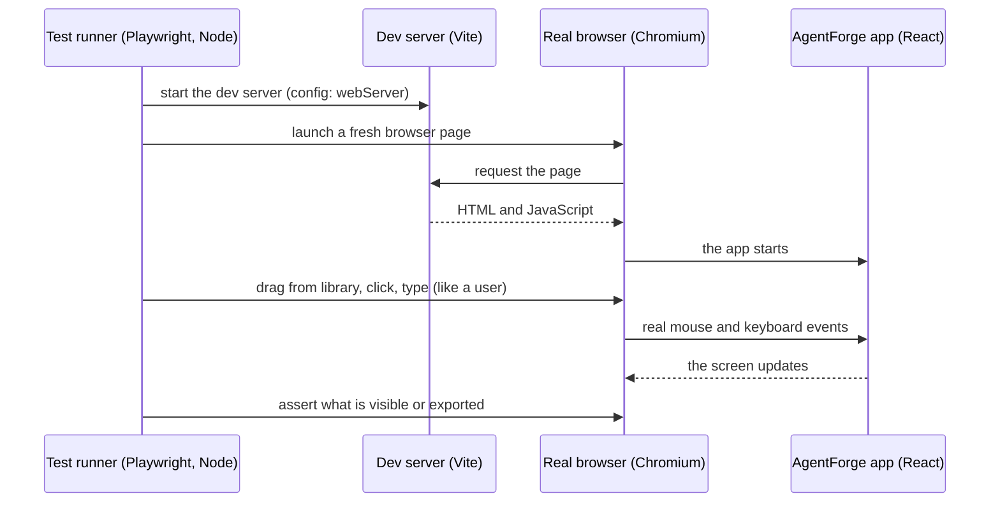
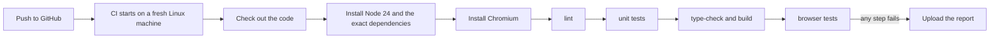
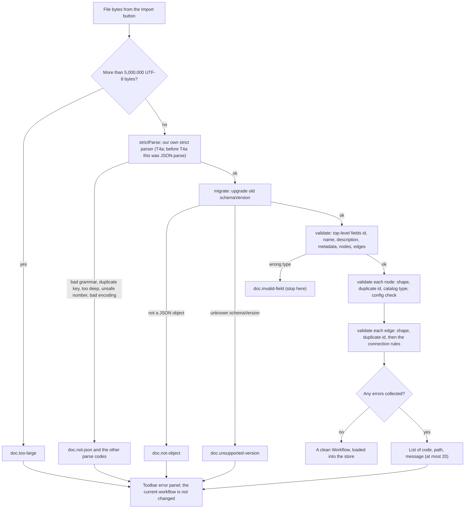
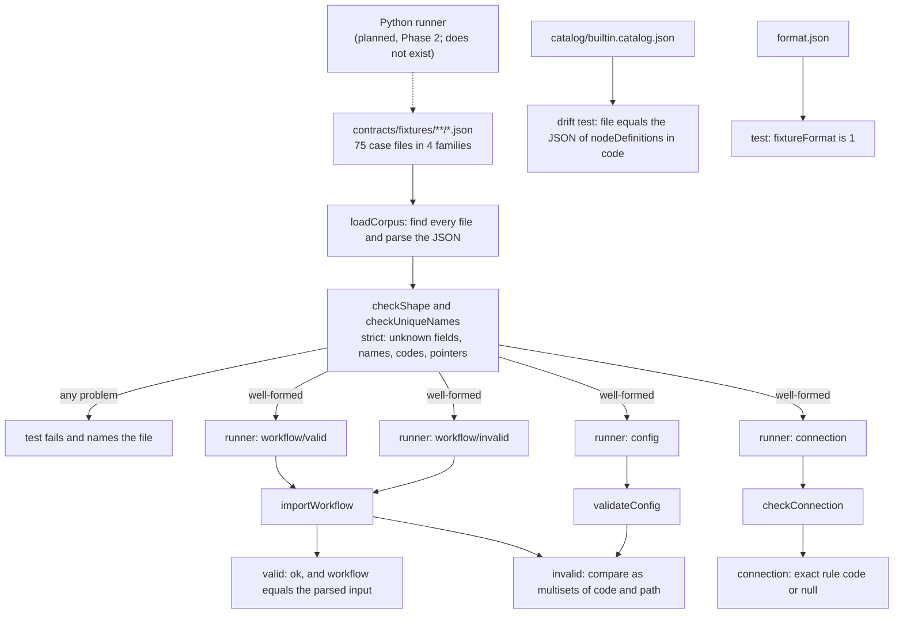
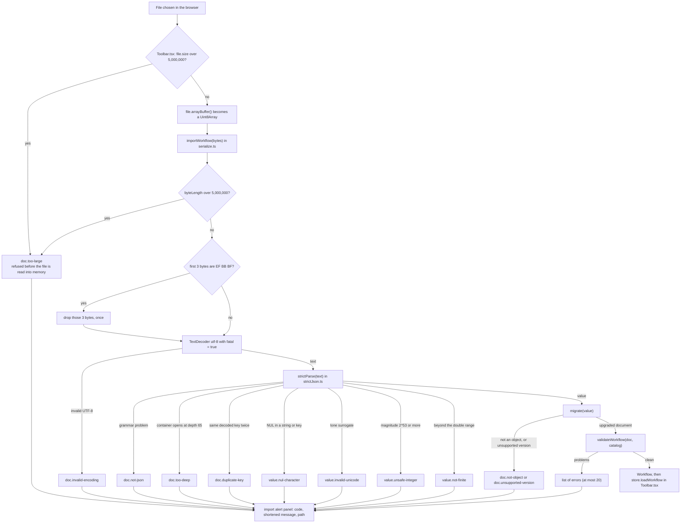

# AgentForge Learning Guide

> **For the Product Owner.** Part 1 is a plain-language **primer** (reference material: what we are building and how the code is organised). Part 2 is the **teaching record** (lessons actually taught and what you demonstrated).
> The **curriculum and statuses** are in `docs/LEARNING.md`. Learning progress is tracked separately from implementation progress.
> **Living document.** The Principal Architect updates it at the end of every task (D-028). The primer describes the project **as it is today**; where something is planned but not built, it says so.
> Last updated: 2026-11-04, after Phase 1.1 T4a (Lesson L4).

# Part 1: Primer

---

## 1. What we are building

AgentForge is a **visual builder for AI workflows**, in the same family as n8n, Langflow and Dify. A user:

1. **Draws** a workflow on a canvas by dragging boxes (called *nodes*) and connecting them with lines.
2. **(Later)** describes a workflow in plain English and lets AI draw it.
3. **(Later)** runs the workflow and watches what happens at each step.
4. **(Later)** builds *agents*: AI that decides its own next steps in a loop and can use tools.

A tiny example workflow: *Manual Trigger → LLM Prompt ("summarise this") → Output*. You press run, the text goes to an AI model, and the answer appears in the Output node.

## 2. Where we are today

| Built and tested | Not built yet |
|---|---|
| The visual editor in the browser: drag nodes from a library, connect them with rules, edit each node's settings, save the workflow to a `.json` file and load it back | Running workflows (the "engine") |
| A catalog of 6 node types | AI models, agents, tools (Phase 4) |
| 460 unit tests and 28 browser tests | Natural-language workflow generation (Phase 5) |
| A CI workflow that runs the checks on GitHub | The backend server, database, saving to a server (Phase 2) |

**Important:** today everything runs **in your browser only**. There is no server. Nothing runs a workflow yet. The editor produces a *description* of a workflow; later phases will execute it.

| Phase | What it delivers | Status |
|---|---|---|
| 1 | The visual editor | Done and accepted |
| 1.1 | Hardening: stricter file format rules, better settings forms, upgrades for old files, warnings, browser tests | In progress (tasks 1 to 4a of 10 done) |
| 2 | Backend server and database; save/load workflows | Planned, not approved |
| 3 | Execution engine: actually run workflows | Planned |
| 4 | AI runtime: LLM and Agent nodes | Planned |
| 5 | Describe a workflow in English and get it drawn | Planned |
| 6 | MCP and other integrations | Planned |
| 7 | Logins, credentials, production hardening | Planned |

## 3. The big picture

```
        YOUR BROWSER (built, Phase 1)                         SERVER (not built yet)
 ┌───────────────────────────────────────────┐        ┌─────────────────────────────────┐
 │ Node library  │  Canvas  │ Settings panel │        │ Stores workflows (database)     │
 │ (drag from)   │ (draw)   │ (edit a node)  │  <──>  │ Validates them                  │
 │               │          │                │  Phase │ Runs them (engine)              │
 │   Editor state ("store") = the workflow   │   2+   │ Runs AI agents                  │
 └───────────────────────────────────────────┘        └─────────────────────────────────┘
              │  Export / Import
              ▼
        a  workflow.json  file
```

The most important idea in the whole project: **the workflow is a JSON document** (a text file with a defined shape). The editor draws it, the server will store it, the engine will run it, and AI will generate it. Everything revolves around that one document, so we are careful about its exact format.

## 4. Key ideas (a glossary with examples)

**Workflow.** The whole diagram: nodes plus the lines between them.

**Node.** One box. It has a *type* (for example `llm.prompt`), a *label* you can rename, *settings* (called `config`) and a *position* on the canvas. The six types today: Manual Trigger, LLM Prompt, HTTP Request, Condition, Agent, Output.

**Port.** A connection point on a node. *Input* ports are on the left and *output* ports on the right. Each has a name (`input`, `text`, `data`) and a *data type* (`text`, `json`, `number`, ...).

**Edge.** A line from one node's output port to another node's input port.

**Data types and compatibility.** You can only connect compatible ports. `any` connects to everything; otherwise the types must match. So a number cannot flow into a text input.

**Catalog and node definition.** The catalog is the list of node types the platform offers. A *definition* describes one type: its ports, its settings, its icon. The library, the settings forms, the validator and (later) the engine and the AI generator all read the same catalog, so there is one source of truth. See `frontend/src/catalog/nodes.ts`.

**Config schema.** A description of what settings a node accepts (for example `temperature` is a number from 0 to 2). The settings panel builds its form from it, and the importer uses it to check files. We use a small, documented subset of **JSON Schema**, a standard way to describe JSON.

**Workflow JSON.** The file format. A minimal real example (a trigger connected to an output):

```json
{
  "schemaVersion": "1.0",
  "id": "wf_1a2b3c4d",
  "name": "Untitled workflow",
  "description": "",
  "nodes": [
    { "id": "n_1", "type": "trigger.manual", "typeVersion": 1, "label": "Manual Trigger",
      "config": { "payload": {} }, "position": { "x": 100, "y": 200 } },
    { "id": "n_2", "type": "output.result", "typeVersion": 1, "label": "Output",
      "config": { "format": "text" }, "position": { "x": 400, "y": 200 } }
  ],
  "edges": [
    { "id": "e_1", "source": { "nodeId": "n_1", "port": "data" },
      "target": { "nodeId": "n_2", "port": "input" } }
  ],
  "metadata": {}
}
```

**`schemaVersion` vs `typeVersion`.** Two separate version numbers. `schemaVersion` versions the *file format*. `typeVersion` versions *one node type* (if we change how the Agent node works, it becomes version 2). Keeping them separate lets each evolve without breaking the other.

**Migration.** Upgrading an old file to the current format *in memory*, without overwriting the original. Planned in Phase 1.1 (tasks T5 and T6).

**Validation (errors) vs warnings.** *Errors* mean the file is structurally wrong (unknown node type, impossible connection); it is rejected. *Warnings* mean "this looks incomplete" (an empty required setting, an unconnected node); they never stop you from working. We keep them strictly separate (decision D-018).

**DAG and "no cycles".** A *directed acyclic graph*: arrows that never loop back. The workflow engine will run nodes in dependency order, which only works if there are no loops. Anything that needs looping (an agent thinking in steps) happens *inside* the Agent node using a library called LangGraph. The editor already refuses a connection that would create a cycle.

**Condition and branches (planned).** A Condition node sends data down either its `true` or its `false` port. Nodes on the branch not taken are *skipped*. The exact rules are written in `docs/PHASE1_1_PLAN.md` section 3.4.

**Agent (planned).** A node where an AI model decides what to do next, repeatedly, and can call tools.

**Credentials.** API keys and passwords. **They never go inside a workflow file** (decision D-016). Later, workflows will refer to a stored credential by id. Until then, a detector will warn if someone pastes a secret into a setting (planned, task T9).

**Provider.** Which AI service a node uses: Ollama (local), OpenAI, Anthropic or Groq. We design so adding one does not change the file format.

**Strict parsing (built in task T4a, Lesson L4).** Reading an imported file with our own small parser instead of the browser's built-in one, so that problems the built-in parser hides (a repeated key, a number too big to store exactly, a file that is not valid UTF-8) become clear errors. It also enforces AgentForge's limits: numbers no larger than 2^53 - 1 in magnitude, nesting at most 64 levels, files at most 5,000,000 bytes. See `frontend/src/workflow/strictJson.ts` and `valuePolicy.ts`.

**Canonical JSON (planned, task T4b).** Writing a workflow to text in one exact, repeatable way (keys sorted, numbers formatted the same everywhere) so the same workflow always produces byte-identical text. This matters for comparing, hashing and testing across TypeScript, Python and the database.

**Fixtures (built in task T3, Lesson L3).** Shared test data files in the top-level `contracts/` folder, one case per file, with no code inside. The TypeScript tests read them today; the Python backend tests are planned (Phase 2) to read the same files, and only then can the two sides be said to agree.

## 5. A tour of the code

Everything built so far lives in `frontend/`. Think of it in layers:

```
frontend/src/
  workflow/      THE CONTRACT: types, rules, parsing. No screen code in here.
    types.ts          what a Workflow, node, edge, port and node definition look like
    connections.ts    "may this edge exist?" (the 7 connection rules)
    validate.ts       checks an imported file and returns a clean Workflow or a list of errors
    configSchema.ts   checks a node's settings against its schema
    migrate.ts        upgrades old file formats
    serialize.ts      export to text, import from text (bytes or text)
    strictJson.ts     our strict JSON parser for imported files (T4a)
    valuePolicy.ts    the limits (numbers, nesting, text rules) as one shared checker (T4a)
    errors.ts         the error codes and JSON Pointer paths (T2)
  catalog/       the six node types (nodes.ts) and lookups (index.ts)
  store/         editorStore.ts: the single source of truth for the workflow being edited
  canvas/        the drawing surface (React Flow) and flowMapping.ts, the only place that
                 translates our workflow into React Flow's objects
  nodes/         WorkflowNode.tsx: one component that draws every node type from the catalog
  library/       the searchable, draggable list of node types
  config-panel/  the settings form for the selected node
  app/           the page layout and the toolbar (New / Import / Export)
frontend/e2e/    browser tests that click through the real app (Playwright)
frontend/src/contracts/fixtures.test.ts   the runner for the shared fixtures
```

Outside `frontend/`, the top-level `contracts/` folder holds the language-neutral test data (JSON files, no code) that the runner reads (Lesson L3).

**Follow one action through the code.** You drag "LLM Prompt" onto the canvas:

1. `library/Library.tsx` starts a drag that carries the text `llm.prompt`.
2. `canvas/Canvas.tsx` receives the drop, converts the mouse position to canvas coordinates, and calls `addNode`.
3. `store/editorStore.ts` looks up the definition in the catalog, creates a node with default settings, and updates the workflow.
4. The store change re-renders: `canvas/flowMapping.ts` converts the workflow to React Flow objects, and `nodes/WorkflowNode.tsx` draws the box with its ports.
5. You connect two ports: `Canvas.tsx` asks `workflow/connections.ts` whether it is allowed, and only then calls `store.connect`.
6. You click Export: `app/Toolbar.tsx` calls `serialize.ts`, which writes the workflow to a `.json` file.

**Suggested reading order** (each is short): `workflow/types.ts` → `catalog/nodes.ts` → `workflow/connections.ts` → `store/editorStore.ts` → `canvas/Canvas.tsx` → `workflow/validate.ts`.

## 6. How we know it works

| Kind | Tool | What it does | Command |
|---|---|---|---|
| **Unit tests** | Vitest | Small, fast tests of single functions (the connection rules, the store, import/export, the strict parser, and the shared fixtures in `contracts/`). 460 today. | `npm test` |
| **Browser tests** | Playwright | A real browser clicks through the app: drag, connect, edit, export, import. 28 today. | `npm run test:e2e` |
| **Type check** | TypeScript | Catches mismatched data shapes before running | part of `npm run build` |
| **Lint** | Oxlint | Catches suspicious code patterns | `npm run lint` |
| **Everything** | | All of the above, in order | `npm run verify` |

"Green" means *the checks we wrote passed*. It does **not** mean there are no bugs. To make sure the tests are meaningful, we sometimes break the code on purpose and confirm a test fails (we did this for T1: removing the cycle rule made the cycle test fail).

## 7. How the team works

You are the **Product Owner**: you decide *what* and *why*, and you accept results. Claude, as **Principal Architect**, decides *how*, plans the work and keeps the documents honest. A **Sonnet 5.5** subagent writes the code for one task at a time. An **Opus 5.5** subagent reviews each task independently and never edits files. A **Sonnet 5.5 tutor** subagent prepares the lessons in Part 2 of this file. Then the architect reports to you in plain language. The full loop is in `CLAUDE.md` section 16 and decision D-027.

| Document | Read it to learn |
|---|---|
| `docs/PROJECT_BRAIN.md` | The current state, always |
| `docs/DECISIONS.md` | Every decision, and whether it is approved |
| `docs/ARCHITECTURE.md` | How the whole system is designed |
| `docs/ROADMAP.md` | The phases and where we are |
| `docs/PHASE1_1_PLAN.md` | The current detailed plan, task by task |
| `docs/DEVELOPMENT_LOG.md` | A diary of what was done, with real test results |
| `docs/LEARNING.md` | The curriculum: 12 modules, your learning status, interview questions |

## 8. Try it yourself

```
cd frontend
npm install              # first time only
npm run dev              # open http://localhost:5173
```

**Exercises**

1. **Build and export.** Drag Manual Trigger, LLM Prompt and Output onto the canvas and connect them. Click Export and open the `.json` file. Find your three nodes and two edges, and match them to section 4.
2. **Break a rule.** Drag two LLM Prompt nodes onto the canvas, connect A to B, then try to connect B back to A (a loop). Also try connecting the HTTP Request node's `Status` (a number) to an Agent's `Task` (text). The editor refuses both; `workflow/connections.ts` is the code that decides.
3. **Bad settings.** Select LLM Prompt and type `5` as the temperature. The form flags it and does not save it.
4. **Round trip.** Export, press New, Import the file. Export again and compare the two files; they are identical.
5. **See a test fail.** In `frontend/src/workflow/connections.ts`, comment out the line that returns `'cycle'`, run `npm run test:e2e`, and watch the cycle test fail. Undo the change (`git checkout -- frontend/src/workflow/connections.ts`).

## 9. Why we made these choices (short answers)

| Choice | Why |
|---|---|
| **A JSON document is the heart of the system** | One shared, checkable format that the editor, server, engine and AI can all agree on |
| **Our file format is separate from React Flow's** | The drawing library is a view detail; it must not leak into saved files or the backend |
| **One catalog drives everything** | Adding a node type means adding data, not changing five places |
| **The engine and LangGraph are separate** | A predictable "run these steps in order" engine for normal workflows; the looping, unpredictable AI behaviour is contained inside the Agent node |
| **Zustand for editor state** | Small, simple, and the canvas, library and settings panel all need to share the same workflow |
| **Our own small JSON Schema checker** | Fewer dependencies, and we can keep TypeScript and Python in exact agreement with shared test data |
| **TypeScript first, then Python models** | We built the editor first; in Phase 2 the backend models become the source of truth and generate the TypeScript types |
| **Warnings never block you** | An editor must let you hold half-finished work |
| **No secrets in files, ever** | A workflow file gets shared, committed and stored; a key inside would leak |

## 10. What happens next

Phase 1.1, in order: **T1** browser tests and CI (done); **T2** structured error codes (done); **T3** shared fixtures (done); **T4a** strict parsing and the policy limits (done, Lesson L4); **T4b** repeatable (canonical) JSON export; **T5** better settings schemas and the Groq provider; **T6** upgrading old files; **T8** the branch rules written down; **T7** warnings in the editor; **T9** secret detection; **T10** final documentation and review. Then, if you approve it, Phase 2: the backend server and database.

## 11. Glossary, quick reference

| Term | One line |
|---|---|
| **React / TypeScript / Vite** | The tools the frontend is made with: UI library, typed JavaScript, dev server and bundler |
| **React Flow (`@xyflow/react`)** | The library that draws the canvas, nodes and lines |
| **Zustand** | The small library that holds the editor's state |
| **Vitest / Playwright** | Unit-test runner / real-browser test runner |
| **CI** | Continuous integration: an automatic run of the checks on every change pushed to GitHub |
| **LangGraph** | A library for AI agents that loop and use tools (Phase 4) |
| **MCP** | Model Context Protocol: a standard way for AI to use outside tools (Phase 6) |
| **Pydantic / FastAPI** | Python tools for data models and the web server (Phase 2) |
| **PostgreSQL / JSONB** | The database and its JSON column type (Phase 2) |
| **Commit** | A saved snapshot of the project in Git |

---
---

# Part 2: Teaching record

> **What this part is.** A record of the lessons actually taught and what the Product Owner demonstrated. It is separate from the primer above (reference material) and from implementation progress.
> **Rule (D-029).** Every lesson ends with a **Knowledge Check / Interview Questions** section. You answer all of them in one dedicated learning session at the end of the project and submit the answers for evaluation. **Only then** are statuses updated. Until then every concept is **Explained (no evidence)**. The curriculum and statuses live in `docs/LEARNING.md`.

## Lesson index

| Lesson | After task | Modules | Taught | Check questions | Status |
|---|---|---|---|---|---|
| **L1** | Phase 1.1 T1: Playwright and CI | 12 (testing and CI) | 2026-11-03 | 5 (answered at the end of the project) | Explained; evaluation pending |
| **L2** | Phase 1.1 T2: structured validation errors | 3 (main); also 1 and 12 | 2026-11-03 | 6 (answered at the end of the project) | Explained; evaluation pending |
| **L3** | Phase 1.1 T3: shared JSON fixtures and the TypeScript runner | 1, 3, 12 | 2026-11-03 | 6 (answered at the end of the project) | Explained; evaluation pending |
| **L4** | Phase 1.1 T4a: strict JSON parsing and the policy limits | 3 (main), 12, 1 | 2026-11-04 | 6 (answered at the end of the project) | Explained; evaluation pending |

## Concept index

| Concept | Module | Lesson | Status |
|---|---|---|---|
| End-to-end test versus unit test | 12 | L1 | Explained (no evidence) |
| Test fixture and helper functions | 12 | L1 | Explained (no evidence) |
| Auto-waiting assertions | 12 | L1 | Explained (no evidence) |
| Flaky tests and retries | 12 | L1 | Explained (no evidence) |
| Vacuous tests and fault injection | 12 | L1 | Explained (no evidence) |
| Continuous integration (CI) | 12 | L1 | Explained (no evidence) |
| Supply-chain pinning by commit SHA | 12 | L1 | Explained (no evidence) |
| Machine-readable versus human-readable errors | 3 | L2 | Explained (no evidence) |
| Stable error codes as a contract (namespaced codes) | 1, 3 | L2 | Explained (no evidence) |
| JSON Pointer (RFC 6901) | 3 | L2 | Explained (no evidence) |
| String-literal union types and compile-time exhaustiveness (`ErrorCode`) | 3 | L2 | Explained (no evidence) |
| Validate, do not trust, at a boundary (own-property lookups) | 3, 12 | L2 | Explained (no evidence) |
| Table-driven tests, one test per code, guard tests | 12 | L2 | Explained (no evidence) |
| Errors versus warnings (D-018), applied to the import path | 3 | L2 | Explained (no evidence) |
| Contract-first design: one shared contract, two implementations (language-neutral fixtures) | 1 | L3 | Explained (no evidence) |
| Data-driven (table-driven) tests with test data kept apart from test code | 12 | L3 | Explained (no evidence) |
| A conformance suite and golden files; circular (self-confirming) tests and expectations written from the specification | 12 | L3 | Explained (no evidence) |
| Comparing `{code, path}` as multisets, never the message | 3, 12 | L3 | Explained (no evidence) |
| Rule order as part of a contract (`checkConnection`), caught only by a fixture | 1, 3 | L3 | Explained (no evidence) |
| Import semantics a second implementation must follow (cascades, stop-early, error cap) | 3 | L3 | Explained (no evidence) |
| Coverage guards, minimum-count floors and a drift test (fail-on-purpose regeneration) | 12 | L3 | Explained (no evidence) |
| A generator spec instead of a huge file (`inputRepeat`) | 12 | L3 | Explained (no evidence) |
| Mutation checks to prove a test can fail (applied to fixtures) | 12 | L3 | Explained (no evidence) |
| Trust boundary: untrusted file input, and why information lost during parsing cannot be recovered by checks afterwards | 3, 12 | L4 | Explained (no evidence) |
| What the built-in `JSON.parse` does silently (last duplicate key wins, big integers lose precision, invalid bytes replaced when decoding text) | 3 | L4 | Explained (no evidence) |
| A strict RFC 8259 parser: recursive descent, first problem only, a result type that never throws | 3 | L4 | Explained (no evidence) |
| Policy limits and where each rule comes from (RFC 8259, I-JSON / RFC 8785, AgentForge policy, PostgreSQL compatibility) | 1, 3 | L4 | Explained (no evidence) |
| Deciding a number's range from its token text, before conversion; why the safe-integer limit exists | 3 | L4 | Explained (no evidence) |
| Limits counted in the right unit: UTF-8 bytes not characters; depth counted as containers open | 3, 12 | L4 | Explained (no evidence) |
| Strict UTF-8 decoding, the byte order mark, and lone surrogates | 3 | L4 | Explained (no evidence) |
| Safe object construction (`defineProperty`, a key named `__proto__`) | 3, 12 | L4 | Explained (no evidence) |
| Round-trip integrity: values typed in the editor obey the same policy as imported files | 1, 3 | L4 | Explained (no evidence) |
| Reject rather than clamp or normalise | 3 | L4 | Explained (no evidence) |
| Bounding attacker-controlled text when it is echoed in a message (exact machine path, short human message) | 3, 12 | L4 | Explained (no evidence) |
| Boundary-value tests, differential testing against `JSON.parse`, fuzz-style truncation tests, a guard test over source text | 12 | L4 | Explained (no evidence) |
| Mutation testing and the equivalent mutant; a vacuous test caused by the tooling | 12 | L4 | Explained (no evidence) |
| Primer concepts (workflow, node, port, edge, catalog, config schema, `schemaVersion` vs `typeVersion`, validation vs warnings, DAG, credentials) | 1, 2, 3, 6, 7 | Primer (Part 1) | Explained as reference (no evidence, no lesson) |

---

## Lesson L1: Testing the editor like a user, and checking it automatically

**Task:** Phase 1.1 T1 (Playwright browser tests and the CI workflow). **Module:** 12 (Security, Testing and Deployment).

### 1. The problem

After Phase 1, the editor worked, and we knew it because someone (me) had clicked through it with a throwaway script that nobody else could run. In the next tasks (T2 to T9) we change the *rules* the editor depends on: how files are parsed, how settings are checked, how connections are judged. Any of those changes could quietly break something as basic as dragging a node. We needed a **robot user** that repeats the same checks, the same way, every time, and on every change.

### 2. The concept

**End-to-end (E2E) testing** means a program drives the *real application in a real browser*, the way a person would: it drags, clicks, types, then looks at what happened. It protects against **regressions** (something that used to work stops working).

Compare it with a **unit test**, which tests one small function in isolation (for example "is this connection allowed?"). Unit tests are fast and precise. E2E tests are slower but prove that all the pieces, including the screen, work together. Teams use both; a common picture is a *pyramid*: many unit tests, fewer E2E tests.

**Continuous integration (CI)** means a server automatically runs all the checks whenever code is pushed, so a break is noticed within minutes and not weeks.

### 3. Why this approach

- **Playwright** drives a real Chromium browser, so drag and drop, layout and keyboard behaviour are real, not simulated. It also *waits automatically* (see section 4), which removes most flakiness.
- **One browser (Chromium) and a fixed window size**, because the drag and connect tests depend on exact positions; fewer variables means more repeatable results.
- **A fresh page per test**, so tests cannot affect each other.
- **A rule that any console error fails the test**, so hidden crashes cannot pass unnoticed.
- **CI on GitHub** with a single command (`npm run verify`) so "green locally" and "green in CI" mean the same thing.
- **Actions pinned to a commit SHA** instead of a version tag (explained below).

### 4. How it works internally



**Auto-waiting.** A line such as `expect(editor.nodes).toHaveCount(3)` does not check once; it keeps re-checking until it is true or a time limit passes. That is better than "wait 2 seconds", which is either too slow or too short. The tests never use fixed sleeps.

**Flaky tests.** A test that sometimes passes and sometimes fails for no code reason. In CI we allow one retry (to keep a trace of what happened) but also set `failOnFlakyTests`, so a test that needed a retry still turns the run red and gets fixed instead of hidden.

### 5. How it communicates with other components

- The **runner** talks to the **browser** over a control channel (like a remote control).
- The **browser** talks to the **dev server** over ordinary HTTP, exactly as a user's browser would.
- Tests talk to the app only through the **screen** and the **exported file**, never by reaching into its internals. That is why they survive refactors.
- **CI** runs `npm run verify` on a GitHub machine:



### 6. Important code paths

| Where | What it does |
|---|---|
| `frontend/playwright.config.ts` | Chromium only, fixed window, starts its own dev server on a dedicated port and never reuses a running one, retries and flaky-failure policy for CI |
| `frontend/e2e/fixtures.ts` | Gives every test a fresh editor page and fails the test on any console error or uncaught error |
| `frontend/e2e/editor.ts` | Helpers that act like a user: `drop` (drag from the library onto the canvas), `connect` (drag between two ports), `exportWorkflow`, `importText` |
| `frontend/e2e/connections.e2e.ts` | One test per connection rule: valid, occupied input, duplicate, type mismatch, cycle, and live feedback while dragging |
| `frontend/package.json` (`verify`) | The single command: lint, unit tests, build with type-check, browser tests |
| `.github/workflows/ci.yml` | Runs `npm run verify` on GitHub on every push and pull request |

### 7. Alternatives and trade-offs

| Option | Good | Costs |
|---|---|---|
| **Playwright (chosen)** | Real browser, auto-waiting, good traces | Heavier than unit tests; needs a browser download |
| Cypress or Selenium | Also drive real browsers | Different trade-offs in speed, setup and API; no strong reason to switch |
| A simulated DOM (jsdom) with Testing Library | Very fast | Not a real browser: no real layout, so dragging and connecting cannot be tested properly |
| Only unit tests | Fastest, most precise | Cannot prove the screen, store and rules work together |
| Pin actions by tag (`@v7`) | Convenient | A tag can be moved; whoever controls the action repository could change what your CI runs |
| **Pin actions by commit SHA (chosen)** | The exact code is fixed and reviewable | Updates are manual |

### 8. Real-world applications

Every product team keeps a small E2E "smoke" suite in CI and treats flaky tests as bugs. Pinning CI actions to commit SHAs is a standard supply-chain precaution; in March 2025 a widely used GitHub Action (`tj-actions/changed-files`) was publicly reported as compromised, with its version tags repointed to malicious code, and workflows pinned to SHAs were not affected.

### Two lessons from our own review (real examples)

1. **A green test can be meaningless (a "vacuous" test).** The independent reviewer found that our test "a duplicate connection is rejected" still passed if we *deleted* the duplicate rule, because a different rule (the input is already occupied) rejected the same connection. The test was green but proved nothing about the rule in its title. The fix builds a situation where only the rule under test can reject, and we **proved** it by deleting the rule and watching the test fail. This technique, deliberately breaking the code to see whether a test notices, is called **fault injection** (or mutation testing).
2. **Understand your tools before asserting exact numbers.** Our first drag test failed because the node moved 90% of the mouse distance: the canvas library uses the first mouse movement to *start* the drag. The honest fix was to change what we assert (the exported position matches where the node really is), not to loosen the numbers until the test passed.

### Knowledge Check / Interview Questions

*Answers are not given here. Study this lesson and `docs/LEARNING.md`, then answer all questions in the dedicated learning session at the end of the project.*

1. We pinned the CI actions to a long commit code instead of a version tag like `v7`. In your own words, why? What attack does it defend against?
2. A test called "duplicate connections are rejected" stayed green after we deleted the duplicate rule. What does that tell you about a green test, and how do you check that a test is able to fail?
3. Give one kind of bug an end-to-end test would catch that a unit test of the connection rules would not, and one kind the unit test catches better.
4. What is "auto-waiting" in Playwright, and why is it better than waiting a fixed two seconds?
5. Locally and in CI we run the same single command (`npm run verify`). Why is that useful, and what does it consist of?

---

## Lesson L2: Errors that a program can read, not only a person

**Task:** Phase 1.1 T2 (structured validation errors), commit `29b8aeb`. **Modules:** 3 (Workflow JSON and State Management) mainly; also touches 1 (contracts) and 12 (testing).

### 1. The problem

When you imported a broken workflow file, the editor told you what was wrong as a **sentence**, for example `nodes[2]: duplicate node id "t".` A person can read that. A program cannot use it. Three things we are about to build need more:

- **The future Python backend** must reject the same bad files for the same reasons, and we want to *prove* it with shared tests (task T3). Comparing English sentences across two languages is fragile; one reworded message and every test breaks.
- **The future API** (Phase 2) will answer a bad request with an error body (HTTP 422). The frontend needs to know *which field* to highlight, not just show text.
- **The future AI generator** (Phase 5) will get validation errors fed back to it so it can repair its own draft. A model, like a program, does better with `{ what, where }` than with prose.

So before T3 we changed every error on the import path from a string into a small object with three parts.

### 2. The concept

Every error is now `{ code, path, message }`:

| Part | Plain meaning | Example | Who it is for |
|---|---|---|---|
| `code` | A short, stable **name** for the kind of problem | `node.unknown-type`, `connection.cycle` | Programs, tests, other languages |
| `path` | **Where** in the imported file the problem is | `/nodes/2/config/provider` | Programs (and humans debugging) |
| `message` | The sentence a person reads | `nodes[1] ("l"): unknown node type mystery.node@1.` | People |

Three ideas sit behind this:

1. **Machine-readable versus human-readable.** A message is written for people and may change (wording, translation). A code is a **contract**: once published, it never changes meaning. Good APIs return both.
2. **JSON Pointer (RFC 6901).** A standard text format for "the thing at this place inside a JSON document". `/nodes/2/config/provider` means: take `nodes`, its item number 2 (counting from 0), then `config`, then `provider`. The empty string `""` means the whole document. Characters `/` and `~` inside a key are escaped as `~1` and `~0`, so a key named `a/b` becomes `/a~1b`.
3. **Errors versus warnings (D-018).** These objects are only for **errors**: the file is structurally wrong and the import is rejected. "Looks incomplete" warnings are a separate list from a separate function (planned, T7) and are never mixed in.

The codes are grouped by a **namespace prefix** (`doc.`, `node.`, `edge.`, `connection.`, `schema.`). There are 23 today. They are listed in one place, `ERROR_CODES` in `frontend/src/workflow/errors.ts`, and more will be added by later tasks (for example `doc.duplicate-key` in T4). The plan for the full table is `docs/PHASE1_1_PLAN.md` section 3.2.

### 3. Why this approach

- **A plain object, not an exception or a class.** The import path already "never throws; returns readable errors" (see `importWorkflow`). Returning data keeps that, and a plain `{code, path, message}` turns into JSON with no effort, which is exactly what an API response and a shared test fixture are.
- **Strings from a closed list.** `ErrorCode` is a TypeScript type built from the `ERROR_CODES` list, so a typo such as `'node.unknwon-type'` does not compile.
- **The message text did not change.** T2 added structure; it did not rewrite sentences. That keeps the change small and lets the old assertions on wording stay valid.
- **The error list is plain data that both languages can read.** In Phase 2 the Python backend will produce the same `code` and `path` for the same input. That is **planned, not built**: there is no `backend/` folder yet, and until the shared fixtures run in Python (T3 writes them; Phase 2 adds the Python runner) nobody can claim the two sides agree.

### 4. How it works internally

The import path, from the file's text to a result (`frontend/src/workflow/serialize.ts`, `migrate.ts`, `validate.ts`):



Points worth knowing:

- **Early exits versus collecting.** The first four failures (too large, not JSON, not an object, unsupported version) stop immediately, because nothing else can be checked. Bad top-level fields also stop. After that the validator **collects**: it keeps going through every node and every edge so the user sees many problems at once, up to `MAX_ERRORS = 20` (extra errors are silently dropped).
- **One problem per node or edge, but all settings problems.** A node that is malformed, has a duplicate id or an unknown type reports that one problem and moves on (the `return err(...)` lines in `validate.ts`). Its settings are checked by `validateConfig`, which can report several errors for one node.
- **Who knows the path.** `validateConfig` in `configSchema.ts` does not know where the node sits in the file, so it returns `{ key, code, message }`. `validate.ts` builds the full pointer with `jsonPointer('nodes', i, 'config', key)`. This split matters because the settings form in the editor (`config-panel/ConfigPanel.tsx`) reuses the same checking code through `parseConfigInput`, and a form field has no document path.
- **One check, many callers.** The internal `checkValue` function in `configSchema.ts` is the single place that decides "is this value valid for this setting" and returns a code plus a message. The form and the importer both go through it, so they cannot disagree. This is the "avoid duplicated business logic" rule in action.
- **Reusing the editor's connection rules.** For each edge the importer calls `checkConnection` from `connections.ts`, the same function the canvas uses while you drag. It returns the *first* rule that fails, in a fixed order: unknown node, unknown port, self-loop, duplicate, input already occupied, type mismatch, cycle. Each edge is checked "as if it were being added" to the edges accepted so far.
- **The type system keeps the two lists in step.** The line that turns a connection problem into a code is the template `connection.${problem}`. TypeScript knows the result must be one of the codes in `ErrorCode`, so if someone adds an eighth connection rule and forgets to add its code, the project does not compile. This is a **string-literal union** with **compile-time exhaustiveness**: the compiler checks you covered every case.

### 5. How it communicates with other components

- `importWorkflow` (in `serialize.ts`) is the only entry point. It returns `{ ok: true, workflow }` or `{ ok: false, errors }`. The same `ValidationError` type is used by `migrate.ts`, `validate.ts` and `serialize.ts`, so nothing has to translate between layers.
- `frontend/src/app/Toolbar.tsx` receives the list and shows each item as the **code** in a small badge followed by the **message**. The path is shown next to the message as plain, muted text (for example `at /nodes/0/type`), so everyone can see it (the first version hid it in a tooltip, which a review flagged as not accessible). A failed import leaves the current workflow untouched; only a fully valid file replaces it.
- The browser test `frontend/e2e/import-export.e2e.ts` checks this on the real screen: a broken file shows `doc.not-json`, and a file with an unknown node type shows `node.unknown-type`, while the three nodes and two edges already on the canvas stay.
- **Built afterwards in T3 (Lesson L3):** the test cases now also live as shared JSON fixture files in the top-level `contracts/` folder. The TypeScript runner reads them today; the Python backend runner is **planned for Phase 2** and does not exist. The comparison looks at `{code, path}` only and ignores the human message and the order of the list.

### 6. Important code paths

| Where | What it does |
|---|---|
| `frontend/src/workflow/errors.ts` | `ERROR_CODES` (the closed list), `ErrorCode` (the type made from it), `ValidationError` (`{code, path, message}`), `jsonPointer(...)` (builds an escaped RFC 6901 pointer) |
| `frontend/src/workflow/validate.ts` | `validateWorkflow`: shape, nodes, edges; the small `err` helper that records an error and enforces the 20 limit; the `connection.${problem}` mapping |
| `frontend/src/workflow/configSchema.ts` | `checkValue` (one check, one code), `validateConfig` (returns `{key, code, message}` for each setting problem); `ConfigErrorCode` is limited to the `schema.*` codes |
| `frontend/src/workflow/migrate.ts` | `migrate`: reports `doc.not-object` and `doc.unsupported-version` with the path `/schemaVersion` |
| `frontend/src/workflow/serialize.ts` | `importWorkflow`: size check in bytes (`doc.too-large`), strict parsing (`doc.not-json` and the other parse codes; this was `JSON.parse` until T4a), then migrate and validate |
| `frontend/src/workflow/connections.ts` | `checkConnection` and `CONNECTION_ERROR_MESSAGES`: the seven connection rules and their sentences |
| `frontend/src/app/Toolbar.tsx` | The import error panel |
| `frontend/src/workflow/errors.test.ts` | The table of cases (one real bad file per code) and the guard tests |
| `frontend/src/workflow/serialize.test.ts`, `frontend/e2e/import-export.e2e.ts` | Existing tests re-expressed on `{code, path}`; the on-screen check |

#### How we test it: table-driven tests and guard tests

`errors.test.ts` is a good example of three test ideas.

1. **Table-driven test.** Instead of 23 hand-written tests, there is one table: for each code, a function that builds a real bad file and the path we expect. One loop runs them all. Adding a code means adding one row.
2. **One test per code, with a real input.** Each row starts from a valid workflow and makes **one** small edit, and a first test proves the starting workflow is valid. That is how we know a failure comes from the edit and from nothing else. The test asserts the *exact* code and path, not just "it failed".
3. **Guard tests.** These tests do not test behaviour; they test the *tests*. One checks that every code in `ERROR_CODES` has a row in the table and that every row is a real code, so nobody can add a code and forget its test. Another checks that every connection rule has a matching `connection.*` code and the counts are equal. The table is also typed `Record<ErrorCode, ...>`, so the compiler rejects a missing row as well. Why both? Vitest strips types without checking them, so the runtime guard catches the omission when tests run, and the type check catches it when the project is built.

### 7. Alternatives and trade-offs

| Option | Good | Costs |
|---|---|---|
| Strings only (before T2) | Simplest | Programs must read prose; one rewording breaks consumers; no location; cannot be shared with another language |
| Throw an exception on the first error | Natural in many languages | Only one problem at a time; exceptions do not travel across languages or over HTTP; control flow gets harder to follow |
| A single numeric code (like HTTP `422` or `errno`) | Compact | Unreadable; no room for location; numbers have no namespace, so adding codes means central coordination |
| Error classes (`UnknownNodeTypeError`, ...) | Typed in-language | Do not serialise to JSON or cross to Python; adding a class per rule is heavy |
| Use a JSON Schema library's error format (for example Ajv) | Ready-made, includes a pointer | Our schema language is a small subset we control (so TypeScript and Python can agree); the library's keywords would become our public contract, and we also have rules a schema cannot express (graph cycles, connection types) |
| **`{code, path, message}` with namespaced string codes (chosen)** | Stable, readable in logs, language-neutral, carries location, easy to turn into fixtures and API bodies | We must keep the code list consistent (hence the guard tests); a code never changes meaning once released |

One more design choice: `path` is a **JSON Pointer string**, not an array of keys. A single string is easy to compare, store and show, and the standard defines the escaping. An array (as some libraries use) avoids escaping but is awkward to compare in fixtures.

### 8. Real-world applications

- **HTTP APIs.** RFC 9457 "Problem Details for HTTP APIs" standardises a JSON error body with a stable `type` and a human `detail`, plus extension fields. FastAPI (our Phase 2 backend) returns validation failures as a list of objects, each with a location (`loc`), a machine-readable `type` and a human `msg`. Our shape was chosen to map onto that naturally.
- **Compilers and linters.** Diagnostics carry a file, line and column plus a rule or error id (TypeScript's `TS2322`, ESLint's rule names). The id lets you search, suppress and count; the message tells you what happened.
- **Form libraries.** Libraries such as Zod and Ajv report problems with a field path so the UI can put the red text next to the right input.

### Two lessons from our own review (real examples)

1. **A test that did not test what its title said, caught by asserting the exact code.** The old test was titled "edges: ..., cycle". Its last check only demanded that the message match `/e4.*(cycle|already has a connection)/`, which accepts either wording. When T2 changed it to assert the exact code, it turned out the failing rule was `connection.input-occupied`, not `connection.cycle`: the edge `e4` pointed at an input that `e1` already used, and `checkConnection` checks "input occupied" **before** "cycle" because the rules run in a fixed order. So the old test never exercised a cycle. The commit adds a comment saying so, a follow-up commit renamed the test, and `errors.test.ts` now has a real cycle (two HTTP nodes feeding each other) for `connection.cycle`. Same family as the "vacuous test" in Lesson L1: a loose assertion lets the wrong thing pass.
2. **An imported key can name something JavaScript quietly gives every object.** The independent reviewer found that a setting called `constructor` (or an own `__proto__` key written in the file) slipped past the "unknown setting" check. The reason: `schema.properties[key]` is an ordinary object lookup, and for the key `"constructor"` JavaScript returns an *inherited* member of every object, which looked like "a known setting", so no error was raised. The same mistake was possible for a `schemaVersion` of `"constructor"` in `migrate.ts`. The fix is to ask for an **own** property (`Object.hasOwn(...)`) before trusting the lookup. This was found in review and fixed in a follow-up commit (`b9d136a`). A second look then found the **same bug class in the canvas**: `flowMapping.ts` stored node sizes in a plain object keyed by node id, and node ids also come from imported files, so a node id of `"constructor"` or `"__proto__"` would have returned an inherited value instead of a size. It was fixed by switching that lookup to a `Map` (`60b1609`), which has no inherited keys. It is a classic **trust-boundary bug**: file contents are untrusted, and an untrusted string used as an object key must never be allowed to reach inherited members. Task T3 carried it forward (Lesson L3): the shared fixtures include keys named `constructor`, `toString`, `hasOwnProperty`, `valueOf` and `__proto__`, so the future Python side proves the same behaviour.

### Knowledge Check / Interview Questions

*Answers are not given here. Study this lesson and `docs/LEARNING.md`, then answer all questions in the dedicated learning session at the end of the project.*

1. A teammate says: "Why not keep the error strings and just have the Python backend produce the same sentences?" Give at least two concrete reasons the `{code, path, message}` design is better, and say which part of the object each reason relies on.
2. Write the JSON Pointer for the `provider` setting of the third node in the file, and for a setting whose key is `a/b`. What does the empty string `""` point to, and which of our errors uses it?
3. The old "cycle" test never produced a cycle error. Explain exactly why, which behaviour of `checkConnection` caused it, and how asserting the exact code exposed it. What does this tell you about assertions such as "the message matches A or B"?
4. `ErrorCode` is a union built from the `ERROR_CODES` list, and `errors.test.ts` also has runtime guard tests. What does the type protect you from, what do the guard tests protect you from, and why are both needed?
5. Config keys come from an untrusted file. Explain the `constructor` bug in plain language: what did the lookup return, why was no error produced, and why is `Object.hasOwn` the fix? Name one other way to avoid the problem.
6. Compare returning `{code, path, message}` objects with throwing exceptions or using error classes for a validator that must run in both TypeScript and Python and may later produce an HTTP response. Which would you choose and why?

---

## Lesson L3: One set of test data that two programming languages must both pass

**Task:** Phase 1.1 T3 (shared JSON fixtures and the TypeScript runner), commits `e28483d` and `b299782`. **Modules:** 1 (System Architecture: a shared contract between two implementations), 3 (Workflow JSON: validation behaviour), 12 (Testing: data-driven tests, coverage guards, mutation checks).

### 1. The problem

In Lesson L2 we gave every import error a stable `code` and a `path`. That solves half of a bigger problem. The editor today is TypeScript. In Phase 2 the backend will be Python, and it must **reject exactly the same bad workflow files for exactly the same reasons**, otherwise a file the editor accepts could be refused by the server (or worse, the reverse). Two programs in two languages will never be identical, so how do you prove they agree?

If each side writes its own tests, each side tests **its own idea** of the rules. Both can be green while the two disagree. We need one shared yardstick that both must pass. That yardstick is T3: a folder of **test data** that is not tied to any language.

An honest limit, stated up front: **in Phase 1.1 only TypeScript runs these fixtures. The Python runner does not exist.** It is planned for Phase 2 (`docs/PHASE1_1_PLAN.md` section 3.2, `backend/tests/test_fixtures.py`). Until it exists and passes, nobody may claim the two sides agree. T3 builds the yardstick and proves the TypeScript side against it; it does not prove parity.

### 2. The concept

**Test data separate from test code.** A normal test mixes both: `expect(importWorkflow(text)).toBe(...)`. Here the **cases** are plain JSON files (the "data") and a small **runner** program reads them (the "code"). The technical names are **data-driven** (or table-driven, as in L2) tests and a **conformance suite**. A conformance suite is a set of cases that any implementation of a specification can run to show it follows the specification.

**A contract between two implementations (Module 1).** In Lesson L2 we said the error `code` is a contract. T3 turns the whole behaviour of validation into a contract you can run. The Workflow JSON format is the contract between editor and server; the fixtures are the **executable examples** of that contract.

**A fixture** is a ready-made input plus the result we expect. In AgentForge one fixture is one small JSON file, for example `contracts/fixtures/config/cfg-key-constructor.json`:

```json
{
  "name": "cfg-key-constructor",
  "description": "A config key named after an inherited object member (constructor) is an unknown key, not a schema property.",
  "nodeType": "output.result",
  "config": { "constructor": 1 },
  "expect": [{ "code": "schema.additionalProperties", "path": "/constructor" }]
}
```

Read it as: "if a node of type `output.result` has a setting named `constructor`, the checker must report one error, code `schema.additionalProperties`, at `/constructor`." Nothing in the file says TypeScript or Python.

**The four families** (75 case files today; counts verified in the folder):

| Folder under `contracts/fixtures/` | Cases | Question the case asks |
|---|---|---|
| `workflow/valid/` | 7 | Does this whole file import successfully (and come out unchanged)? |
| `workflow/invalid/` | 31 | Is this whole file rejected, with exactly these `{code, path}` errors? |
| `connection/` | 22 | In this small graph, may this one edge be added? If not, which rule says no? |
| `config/` | 15 | Does this one node's settings object produce exactly these schema errors? |

Two more files are not cases: `format.json` (the version of the fixture format, currently `{ "fixtureFormat": 1 }`) and `catalog/builtin.catalog.json` (a JSON export of our node catalog, explained in section 4). The format of every family is documented in `contracts/README.md`.

### 3. Why this approach (the design decisions)

1. **Test data separate from test code.** Python cannot run a TypeScript test, but it can read a JSON file. Keeping cases as data is what makes a second language possible at all.
2. **`{code, path}` is the contract, and the message text is not.** A sentence such as `nodes[1] ("l"): unknown node type mystery.node@1.` is written for people, is built differently in each language and may be reworded. The code and the path are the stable, language-neutral part (L2). So the runner **never compares the message**.
3. **Compare error lists as multisets.** A *multiset* is a list where **order does not matter but duplicates do**: `[A, B]` equals `[B, A]`, but `[A, A, B]` does not equal `[A, B]`. Why order-insensitive? The README gives one reason: JavaScript objects keep integer-like keys in a different order from Python dictionaries, so two correct implementations may list the same errors in a different order. Why count duplicates? Two errors at the same place are two facts; losing one would hide a bug.
4. **The expected results are written from the rules, not copied from what the code prints.** If you generate the "expected" file by running the code, the test can only confirm the code does what it does, which is a **circular test**: it cannot fail when the code is wrong. `contracts/README.md` says it directly: case fixtures are never generated from code and are "the independent statement of what the code must do". (The one exception, the catalog export, is generated on purpose; see the drift test below.)
5. **Strict shape checking.** Unknown fields are errors, `name` must equal the file name, error codes must be real codes, paths must be JSON Pointers. A typo in a fixture must fail loudly, not be silently ignored.
6. **Guards that protect the test suite itself** (section 4): every error code must be covered, minimum counts stop fixtures being deleted, and a drift test keeps the catalog export honest.
7. **`inputRepeat`: a tiny generator spec instead of a huge file.** One case needs a 5 MB text (the importer refuses files over a size limit). The first version committed a file of about 5 MB. The fix describes it instead: `{ "unit": " ", "times": 5000001 }` means "the text is one space repeated 5,000,001 times", which is one byte over the 5,000,000-byte limit (the first version used 5 MiB of characters; task T4a changed the limit to bytes), so it must be rejected with `doc.too-large`. The runner builds the text at test time as `prefix + unit.repeat(times) + suffix`. `times` is capped at 10,000,000 so a typo cannot allocate gigabytes. The error-cap fixture (`wf-invalid-error-cap.json`) uses the same trick to build a 23-node document.
8. **Rule order is part of the contract.** See section 4 and the review stories.

### 4. How it works internally



The solid arrows are built and run by `npm test`. The dashed arrow is **planned for Phase 2**.

**The loader and the shape checker.** `loadCorpus` walks `contracts/fixtures`, parses each file and calls `checkShape(file, value)`, a pure function that returns a list of problems (an empty list means the file is well-formed). `checkUniqueNames` makes sure no two files share a `name`. If anything is wrong, one test fails with the file names listed, and the malformed file is not run. The shape checker is itself tested with deliberately bad examples (the `checkShape` tests at the bottom of the same file), so it cannot quietly stop checking.

**One runner per family**, each calling the **real** production function, not a copy:

- `workflow/valid` and `workflow/invalid` call `importWorkflow(text, nodeDefinitions)`. A valid case must succeed and the imported workflow must deep-equal the parsed input (the valid files are written in canonical shape, so importing changes nothing). An invalid case must fail with the expected multiset of `{code, path}`.
- `connection` builds a small workflow from the compact description in the file (each node `{id, type}`, empty `config`, position 0,0; edges numbered `e1`, `e2`...) and calls `checkConnection`. The result is compared with the expected rule code (`connection.cycle`, ...) or `null` for "allowed". It is a single result, so no multiset is needed.
- `config` finds the latest catalog definition of the node type, calls `validateConfig`, turns each result into `{code, path}` (with `jsonPointer(key)`, a path relative to the config object) and compares as multisets. It can take the settings as text (`configText`) when the exact characters matter: a JSON parser makes an **own** `__proto__` key, but a JavaScript object literal would set the prototype instead, so the `cfg-key-proto-own` fixture states its settings as raw text.

**The guards on the suite itself**, all in `frontend/src/contracts/fixtures.test.ts`:

- **Coverage guards.** One test checks that *every* error code in `ERROR_CODES` is expected by at least one `workflow/invalid` fixture. Another checks that every `connection.*` code is the expected result of at least one `connection` fixture. Add a code and forget a fixture, and the run fails.
- **Minimum-count floors** (`MIN_COUNTS`: 75 total, 7, 31, 22, 15). Deleting fixtures to make a failure go away would shrink the counts and fail the run. The README says the floors are raised when you add cases and never lowered.
- **A drift test for the catalog.** `builtin.catalog.json` is an export of `nodeDefinitions` from `frontend/src/catalog/nodes.ts`. The test asserts the stored file equals the code's catalog, so the catalog contract cannot change silently. If you change the catalog on purpose, you regenerate the file by running the tests with the environment variable `UPDATE_FIXTURES` set. In that mode the test rewrites the file and then **fails on purpose** ("catalog fixture regenerated; unset UPDATE_FIXTURES and run again"). Why fail deliberately? If a forgotten environment variable made the test rewrite and then pass, the drift check would **pass silently forever**, because the file would always be regenerated to match the code. Failing forces you to unset it and run again, so the next run really compares.

**Rule order, pinned by fixtures.** `checkConnection` (`frontend/src/workflow/connections.ts`) returns the **first** rule that fails, in this order: `unknown-node`, `unknown-port`, `self-loop`, `duplicate`, `input-occupied`, `type-mismatch`, `cycle`. That order is observable: when a proposed edge breaks two rules at once, the first one in the list is what you see. Python has to reproduce the order, so the order is part of the contract, and fixtures that break two rules at once pin each neighbouring pair (for example `conn-input-occupied-before-type-mismatch`, `conn-type-mismatch-before-cycle`, `conn-input-occupied-before-cycle`, `conn-unknown-port-before-self-loop`).

**Import semantics a second implementation must follow.** The README lists them because they are not obvious from the data alone and the fixtures pin them. In short:

- **Edges are checked in order against the edges accepted so far**, as if each were being added. A cycle is reported on the edge that *closes* it, not on the earlier edges.
- **A rejected item is not added.** So errors can **cascade**: a node with an unknown type is rejected, so an edge that uses it also fails with `connection.unknown-node` (fixture `wf-invalid-cascade-unknown-type-edge`).
- **The second duplicate is the one blamed**: with two nodes sharing an id, the error points at the later one.
- **Document-level errors stop early.** If a top-level field such as `id` has the wrong type, only that error is returned and nodes and edges are not examined (fixture `wf-invalid-doc-error-stops-before-nodes`).
- **At most 20 errors** are returned (`MAX_ERRORS` in `frontend/src/workflow/validate.ts`); the first 20 in checking order are kept (fixture `wf-invalid-error-cap`).

**The security carry-over is enforced by fixtures too.** In L2 the reviewer found that a setting named `constructor` slipped through. Now `cfg-key-constructor`, `cfg-key-tostring`, `cfg-key-hasownproperty`, `cfg-key-valueof` and `cfg-key-proto-own` each demand `schema.additionalProperties`, and two `wf-invalid-doc-unsupported-version-*` fixtures (`constructor`, `toString`) demand `doc.unsupported-version`. The fixtures are the written, runnable form of that security rule, so the Python side will have to prove it handles the same keys when its runner exists (planned).

### 5. How it communicates with other components

- The runner **imports the real functions**: `importWorkflow` (`serialize.ts`), `checkConnection` (`connections.ts`), `validateConfig` (`configSchema.ts`), `getLatestNodeDefinition` and `nodeDefinitions` (the catalog) and `ERROR_CODES` and `jsonPointer` (`errors.ts`). It reads the fixture files with Node's `fs`. Nothing else in the app knows the fixtures exist.
- It runs as part of the normal unit tests: `cd frontend && npm test`. That is why `npm run verify` and CI include it with no extra step. The runner has its own small TypeScript project, `frontend/tsconfig.contracts.json`, so Node's types are available to this one test without leaking into the browser app's type check.
- The fixtures depend on the **error code list** (`ERROR_CODES`) and the **catalog**. Change either and the coverage guard or drift test tells you.
- **Planned, not built:** in Phase 2 a Python test (`backend/tests/test_fixtures.py` in the plan) reads the same files and runs them against the Python models. Only when that runner exists and passes can we say the two sides agree. Later tasks also add fixture families (strict parsing and canonical JSON in T4, config schema cases in T5, migration fixtures in T6, warnings in T7, secrets in T9), all following this format.

### 6. Important code paths

| Where | What it does |
|---|---|
| `contracts/README.md` | The documented format of every family, the import semantics, the multiset rule, how to add a case and why never to edit expected values just to pass |
| `contracts/fixtures/{workflow/valid,workflow/invalid,connection,config}/*.json` | The 75 cases (one per file) |
| `contracts/fixtures/catalog/builtin.catalog.json` | JSON export of `nodeDefinitions`, protected by the drift test |
| `contracts/fixtures/format.json` | `{ "fixtureFormat": 1 }`, asserted by the runner |
| `frontend/src/contracts/fixtures.test.ts` | The runner: `checkShape`, `checkUniqueNames`, `loadCorpus`, `asMultiset`, `workflowText` (builds `inputRepeat`), `connectionWorkflow`, `MIN_COUNTS`, the coverage guards, the drift test, and the tests of `checkShape` itself |
| `frontend/tsconfig.contracts.json` | A separate TypeScript project for this one test (Node types) |
| `frontend/src/workflow/connections.ts`, `validate.ts`, `serialize.ts`, `configSchema.ts` | The real code the fixtures exercise |

### 7. Alternatives and trade-offs

| Option | Good | Costs |
|---|---|---|
| Each language writes its own tests | Simple, idiomatic | Each side tests its own interpretation; green and green can still disagree. No proof of agreement |
| **Shared language-neutral data plus one runner per language (chosen)** | One yardstick for both; cases are readable data; adding a case needs no code | We must write and maintain a runner per language and a documented format; the data format must stay simple |
| Generate "expected" from the current code (snapshot or golden-output tests) | Cheap to produce, good at spotting accidental change | Circular: it records what the code does, bugs included. Good as a regression net, weak as a specification. We use it only for the catalog export, where "equals the code" is exactly the point |
| Property-based tests (generate random inputs) | Finds surprising cases | Hard to share across languages (random generators and shrinkers differ); better as an addition (the plan mentions a property-style round trip in T4) |
| Test the future Python server over HTTP from TypeScript | Tests the real integration | Needs the server running; slower; failures are harder to pin to a rule. Useful later as integration tests, not as the rule-by-rule contract |
| Keep one implementation only (call the server for validation) | No second implementation to keep in step | The editor would need the network for every check and could not validate offline or while dragging |
| Compare the exact message text | Strictest | Brittle; couples languages to wording; blocks translation |

### 8. Real-world applications

*The following are from general knowledge, not from this repository.*

- **JSON-Schema-Test-Suite.** The JSON Schema community keeps a language-neutral collection of JSON test cases that validator libraries in many languages run. It is the same idea as `contracts/`, at much larger scale.
- **Parser conformance tests.** HTML5 parser implementations are commonly checked against shared tree-construction test files (the html5lib tests), so different engines agree on how to read broken HTML.
- **API contract testing.** Teams that split a frontend and a backend (or many microservices) test against a shared written contract (for example consumer-driven contract tests) so each side can change independently without breaking the other.
- **Golden files.** Many projects store expected output in files next to the tests and compare against them. The risk is the circularity discussed above: a golden file is only as good as the review that approved it.

### Three lessons from our own review (real examples)

1. **A test suite that cannot fail proves nothing, so we tried to make it fail (mutation checks).** The implementer reported deliberately breaking `checkConnection` in four different ways and confirming that each time exactly the intended fixture failed. One break was **swapping two rules** (for example checking `cycle` before `input-occupied`). That was caught **only by a new fixture**: the existing unit tests in `connections.test.ts` did not notice. Reading that file explains why: its occupied-input test has no cycle in it, and its cycle test builds a graph where the target input is free, so neither case is "both at once" and neither can tell which rule runs first. Only a case that breaks two rules together, such as `conn-input-occupied-before-cycle` (added in the review-fix commit `b299782`), can. Lesson: a **mutation check** (change the code on purpose, expect a test to fail) is how you learn whether the tests protect what you think they protect. It is the same idea as the fault injection in Lesson L1, now applied to the fixtures. *The mutation runs themselves were reported by the implementer; this lesson's author read the fixtures and tests but did not repeat the runs.*
2. **"Is the expected value a real specification, or just a copy of what the code does?"** The independent reviewer asked exactly this about the first corpus, because expectations that were derived from the code would be a circular test. The reviewer checked a sample of expected values against the specification, and found fixtures that encoded **behaviour that is about to change**. Two are labelled in their descriptions today. `wf-invalid-schema-required.json` says it "documents CURRENT behaviour": a config missing a required key is rejected with `schema.required`, and task T5 changes this under decision D-025 (a missing required key becomes a completeness warning, not a structural import error). `wf-invalid-doc-too-large.json` documents the Phase 1 limit, counted in characters, and says task T4 changes it to a count of UTF-8 bytes. Labelling them tells the next person (and the Python implementer) that these are deliberate snapshots of today, to be updated together with the code, not eternal truths. This is also why the README insists expectations come from the rules.
3. **A 5 MB file in the repository.** The first commit (`e28483d`) stored the "too large" case as a real file of about 5 million bytes. Every clone, diff and review would carry it. The fix commit (`b299782`) replaced it with the few-line `inputRepeat` generator spec. Generate big or repetitive test data; do not store it. (`inputRepeat` itself got a safety cap and tests, so the generator cannot be misused.)

A smaller point from the same review: the first version of the `connection` format filled each node's settings from the catalog defaults, so a connection fixture would silently change if a default changed. The fix gives every node an empty `config`, because the connection rules never read settings. A fixture format should depend on as little as possible.

### Knowledge Check / Interview Questions

*Answers are not given here. Study this lesson and `docs/LEARNING.md`, then answer all questions in the dedicated learning session at the end of the project.*

1. Explain in plain words why we keep test cases as JSON files in `contracts/` instead of writing them as ordinary Vitest tests. What does that make possible in Phase 2, and what can we **not** yet claim in Phase 1.1?
2. The runner compares only `{code, path}` and treats the error list as a multiset. Give one reason for ignoring the message, one reason for ignoring the order, and one reason for still counting duplicates.
3. `checkConnection` returns the first failing rule, in a fixed order. Describe a proposed connection that breaks two rules at once, say which error is reported and why, and explain why the older unit tests could not detect two rules being swapped but a fixture could.
4. What is a circular test? Why does `contracts/README.md` forbid generating case fixtures from the code, and why is the catalog export the one deliberate exception? What does the "fail on purpose" behaviour of `UPDATE_FIXTURES` protect against?
5. A new error code is added to `ERROR_CODES` but nobody writes a fixture for it, and another developer deletes three fixtures that were failing. Which guards in the runner catch each of these, and how?
6. Describe three rules of import behaviour that a second implementation must follow beyond "return the right error for a bad input" (for example cascades, the second duplicate being blamed, early exit on document errors, the 20-error cap). For one of them, say what a Python implementer would get wrong if it were not written down and pinned by a fixture.

---

## Lesson L4: Never trust the built-in parser with a file you did not write (strict JSON parsing and the policy limits)

**Task:** Phase 1.1 T4a (strict JSON parsing, policy limits and value checks), commits `9477df7` and the review-fix commit `a0abf63`. **Modules:** 3 (Workflow JSON: parsing untrusted input), 12 (Security and Testing: trust boundaries, boundary-value tests, mutation testing), 1 (System Architecture: the limits are part of the contract).

*T4b (canonical and export JSON, repeatable text for hashing) is a separate task and is not part of this lesson.*

### 1. The problem

When you press **Import**, you give the editor a file. The editor did not write that file. It may have been edited by hand, produced by another tool, damaged in transit, or crafted on purpose to cause trouble. In security language this is **untrusted input**, and the place where it enters the program is a **trust boundary**.

Until T4a, the importer read the text with the browser's built-in `JSON.parse`. That function is fast and correct for *what it was designed to do*: turn valid JSON text into JavaScript values. But for an untrusted file it quietly does several things we do not want. I re-ran the JavaScript ones on this machine:

| Input | What `JSON.parse` does | Why it matters to AgentForge |
|---|---|---|
| `{"a":1,"a":2}` | Returns `{a: 2}`. It silently keeps the **last** duplicate | A hand-edited workflow with two `"id"` or two `"type"` keys changes meaning with no warning. Which one did the author intend? |
| `9007199254740993` | Returns `9007199254740992` (verified: it is off by one) | The number was **changed before our code ever saw it**: the exact value you wrote is gone. This is why the policy limit exists (every accepted number must be exactly representable). With that limit in place, even a check on the parsed result would still refuse this particular number; see review story 1 for what that means for the design |
| `{"__proto__": {...}}` | Creates an ordinary own property named `__proto__` (verified). It does not change a prototype | `JSON.parse` itself is safe here, but any code that copies such a key with a plain assignment (`out[key] = value`) does set a prototype (verified in Node: `Object.keys` becomes empty and the inherited property appears). A hand-written parser, or later code, can get this wrong |
| `1e400` | Returns `Infinity` (verified in the plan's table) | Infinity cannot be written back to JSON, and Python's `json` reads it differently |
| Invalid UTF-8 bytes, when you first turn the file into a string with the usual `File.text()` | The invalid bytes are replaced by the replacement character U+FFFD (the decoder behaviour I verified: a stray byte `0xFF` followed by `A` becomes the replacement character then `A`) | A damaged file would **import "successfully" with corrupted text** instead of being refused |
| Very deep nesting, or a huge file | No limit that we choose, and no structured error we control (general knowledge about engines; not verified here) | A denial-of-service shape: someone sends a file that burns memory or time |

*Verification note.* The duplicate-key, big-integer, `1e400` and `__proto__` rows come from `docs/PHASE1_1_PLAN.md` section 3.5 (the hazards table, which the plan says was verified with Node 24.13 and Python 3.14.2 side by side). I re-ran the JavaScript behaviours of the duplicate key, the big integer, `__proto__` and the replacement character on the local Node. The Python column of that table I did **not** re-run. That `File.text()` uses the lenient decoder is general knowledge about the browser API, not something I tested here.

So the problem is not only "add more checks after parsing". The duplicate-key problem **destroys information during parsing**: once the built-in parser has kept the last value, nothing after it can know there were two. The same is true of bytes already replaced by U+FFFD. You cannot validate what you can no longer see. For numbers the story is subtler (and review story 1 below is honest about it): the rounded value still shows that a number was too large, so a range check afterwards would often agree with ours, but the exact digits are gone, the range check has to be exactly right, and the plan chose to decide from the text so that the rule can be stated, and later implemented in Python, in terms of what the file says. The parser itself has to be strict.

### 2. The concept

**Trust boundary and parse, then validate.** The rule in `.claude/rules/architecture.md` is "every load goes through `migrate()` then `validate()`". T4a adds a stage in front of both: a *strict parser* that decides what the text means. The three stages are: **read the text strictly** (T4a) -> **upgrade the old format** (`migrate`) -> **check the shape** (`validate`). The first stage is where bytes become data, so it must not lose anything.

**RFC 8259** is the standard that defines JSON text. A *strict* parser accepts exactly that grammar: no comments, no trailing commas, no `NaN`, no leading zeros such as `01`, no single quotes. A **recursive descent parser** is a parser written as small functions that call each other following the grammar (a value is an object or an array or a string or a number or `true`/`false`/`null`; an object contains values; and so on). It is the simplest kind to write by hand and to read.

**Policy limits, and where each rule comes from.** The grammar says what JSON *is*. AgentForge adds rules about what it *accepts*. It matters to say honestly where each one comes from, because in an interview "the standard says so" and "we decided so" are very different statements:

| Rule | Where it comes from |
|---|---|
| Text is valid JSON; no trailing garbage | RFC 8259 (the JSON grammar) |
| Object keys unique | I-JSON (RFC 7493), which the canonical JSON standard RFC 8785 requires of its input. **We enforce it while parsing** (`doc.duplicate-key`) |
| No lone surrogates in strings | I-JSON / RFC 8785 (`value.invalid-unicode`) |
| Numbers are finite | I-JSON (`value.not-finite`) |
| **Magnitude of every number at most 2^53 - 1** (9007199254740991) | **AgentForge policy** (`value.unsafe-integer`). Not an RFC rule. It is what keeps TypeScript and Python exactly in agreement and prevents silent rounding |
| No U+0000 (the NUL character) | **AgentForge / PostgreSQL compatibility rule** (`value.nul-character`). PostgreSQL's `jsonb` cannot store it (stated in the plan; PostgreSQL is not installed here, so not verified). **Not an RFC rule** |
| Nesting at most 64 levels, root = level 1 | **AgentForge policy** (`doc.too-deep`): stack safety, and Python and JavaScript recursion limits differ |
| Size at most 5,000,000 **UTF-8 bytes** | **AgentForge policy** (`doc.too-large`) |
| One leading byte order mark tolerated and removed; invalid UTF-8 refused | **AgentForge policy** (`doc.invalid-encoding`) |

These limits were approved in decision D-026 (clarification C2 for depth and size) and the number rule was clarified in D-031 (see `docs/DECISIONS.md`).

**Two small ideas with big consequences.**

- **Reject, do not repair.** When a file breaks a rule, we return an error. We do not clamp the number, drop the duplicate or replace the bad character. Silent repair means the editor shows something the file did not say, and a later export would then differ from what the author wrote.
- **Round-trip integrity.** If the editor lets you *export* a workflow, you must always be able to *import* it again. If the importer refuses files the editor happily produces, the user can create a file that they cannot reopen. So the same limits must also apply to values typed into the editor (section 4).

### 3. Why we selected this approach

1. **Our own parser (one file, `strictJson.ts`, about 260 lines) instead of `JSON.parse` plus extra checks.** Because information is lost *during* parsing: duplicates and invalid bytes can never be recovered afterwards (section 1), and the plan wants every rule stated in terms of what the file says. The binding safeguards for T4 (decision D-026, written out in `docs/PHASE1_1_PLAN.md` section 3.5) say it plainly: `JSON.parse` followed by `Number.isSafeInteger` "is **not** acceptable, because `JSON.parse` has already lost the information".
2. **A number is judged from its text.** The parser looks at the digits of the token, not at the converted number (section 4). This is a binding safeguard in D-026, and it is also what a Python implementation will naturally do, because Python reads integers exactly. As review story 1 explains, the observable verdicts are the same as a check after conversion; the benefit is a rule that is stated, and testable, in terms of the file's own text.
3. **One rule for numbers: magnitude at most 2^53 - 1** (decision D-031). The plan first said "integers must be safe integers". D-031 restates it as one magnitude rule, which is the same restriction because every double of magnitude 2^53 or more is already a whole number, and it removes the need to ask "is `1.0` or `1e2` an integer?" The rule applies to every number whatever its spelling, so `0.1` and `5e-324` are fine, and `1e21` and `9007199254740992` are not.
4. **Bytes, not characters, for size.** A limit is only a limit if it measures what is stored and sent. The letter `e` with an accent is one character but two bytes in UTF-8; an emoji is two JavaScript "characters" (a surrogate pair) but four bytes. A limit counted in characters would let a file of roughly twice the intended size through.
5. **Return the first problem as data, never throw.** `strictParse` returns `{ ok: true, value }` or `{ ok: false, error }` where the error is the same `{code, path, message}` shape from Lesson L2. The importer then returns the list of errors the toolbar already knows how to show. A parser that threw would need a try/catch at every caller.
6. **Same rules for typed values.** One shared module, `valuePolicy.ts`, so there is one definition of "allowed value".
7. **Do not add a library.** The architecture rules (`CLAUDE.md` section 4 and `.claude/rules/architecture.md`) require approval for any new major dependency, the Python side needs the same behaviour anyway, and 260 lines are small enough to be tested exhaustively (section 6 and the review stories).

### 4. How it works internally



Every box on the left is a place where the file can be refused, and every refusal is the same shape: `{code, path, message}`. Nothing in this chain throws to the user. The current graph is replaced only on the final `OK` box.

**Step 1: size, in bytes, twice.** `frontend/src/app/Toolbar.tsx` first compares `file.size` with `MAX_IMPORT_BYTES` (5,000,000, defined in `serialize.ts`), so an oversized file is refused **before it is read into memory**. `importWorkflow` checks again on the bytes (and for plain strings, which the tests and fixtures use, `utf8Length` counts the UTF-8 size without encoding a copy, and stops counting once the limit is passed). A lone surrogate counts as 3 bytes because that is what encoding it to UTF-8 would produce (U+FFFD). The checks are repeated on purpose: the function is the real defence and must not rely on its caller.

**Step 2: encoding.** If the first three bytes are EF BB BF, that is a **byte order mark** (BOM), an invisible marker some editors, notably on Windows, put at the start of a UTF-8 file. We drop exactly one. Then `TextDecoder('utf-8', { fatal: true, ignoreBOM: true })` turns bytes into text. `fatal: true` is the important part: instead of silently inventing replacement characters, it throws, and we turn that into `doc.invalid-encoding`. (`ignoreBOM: true` only means the decoder keeps a BOM so that we, not the decoder, decide to strip one; a second BOM is then ordinary content and gets a normal `doc.not-json`. The fixture `wf-invalid-bom-twice` pins this.)

**Step 3: `strictParse`.** It keeps a position `pos` in the text and a `path` stack that always holds the location of whatever it is reading (the segments become the JSON Pointer in the error, using `jsonPointer` from `errors.ts`). It reads one value at a time:

- **Strings** are decoded (escapes resolved) first, and **then** checked: the check `stringProblem` in `valuePolicy.ts` looks at the *decoded* text for U+0000 and for lone surrogates. Checking after decoding means it does not matter how the character was spelled in the file. A key written as the letter `a` and the same key written with the six-character escape for `a` (backslash, u, 0, 0, 6, 1) are the same key, so they count as a duplicate. Likewise a NUL written as an escape is caught.
- **Numbers** go through `classifyNumber(token)`. Let me explain it with an example. The token `9007199254740993` is split into its digit string and exponent. The code works out `mag`, the number of digits in the integer part (here 16). If `mag` is 17 or more, the value is at least 10^16, which is above 2^53, so it is too big. If `mag` is 15 or less, it is below 2^53. If it is exactly 16, it compares the first 16 digits **as text** with `'9007199254740992'` (2^53 written out); two digit strings of the same length compare correctly as text. `9007199254740993` is not below `...992`, so the verdict is `value.unsafe-integer`. Only afterwards is the token converted with `Number(token)`: to tell "too big but finite" (`value.unsafe-integer`) from "beyond the double range" (`1e400`, `value.not-finite`), and as a backstop for the odd token such as `9007199254740991.7` whose text is below 2^53 but whose nearest double is exactly 2^53. Absurd exponent text such as `1e999999999999999999999` is capped so the arithmetic cannot misbehave.
- **Depth** is passed down as a counter. `enter(depth)` runs when a `[` or `{` opens and rejects the 65th level **before reading anything inside it**, so a file made of 200,000 opening brackets is refused at once without a stack overflow (a test does exactly this).
- **Duplicate keys.** Each object keeps a `Set` of the keys seen so far (after decoding). The second occurrence stops the parse with `doc.duplicate-key`, and the path points at the second occurrence.
- **Building the object.** Each member is added with `Object.defineProperty`, not with `out[key] = value`. A plain assignment to a key named `__proto__` changes the object's prototype (I verified this on Node); `defineProperty` always creates an ordinary property. So `__proto__` is just a key. A test checks that after parsing such a document, `({}).polluted` is still undefined.
- **First problem only.** A private `Stop` exception unwinds the recursion when something is wrong, and `strictParse` catches it at the top and returns it as a result. The whole function is wrapped, so even an unexpected failure becomes a `doc.not-json` result and not a crash.

**Step 4: message safety.** Error messages can contain attacker-chosen text (an object key). Before the review fix, the duplicate-key message echoed the key whole, so a 2,000,000-character key produced a 2,000,000-character error message pushed into the page. Now the message uses `shorten(...)` at 100 characters (`MAX_ECHO`), while the machine-readable `path` stays exact because it is a contract value (Lesson L2). The import alert panel in `Toolbar.tsx` also cuts any message or path to 200 characters for display, using `frontend/src/app/shorten.ts`, which never cuts a surrogate pair in half.

**Step 5: values typed in the editor.** `valuePolicy.ts` exports `findPolicyViolations(value, baseDepth)`, which walks an **already parsed value** and applies the same rules (finite numbers, magnitude at most 2^53 - 1, no NUL, no lone surrogates, depth). `parseConfigInput` in `frontend/src/workflow/configSchema.ts` calls it after the ordinary schema check, and refuses to commit a value the importer would reject. A config object sits at depth 5 in the document (Workflow = 1, nodes = 2, node = 3, config = 4, the typed object = 5), so the constant `CONFIG_PARENT_DEPTH` is 4, and a typed JSON object can nest 60 levels before it would break the limit of 64 (the tests check 60 accepted and 61 rejected). A test, "round trip: the deepest value the panel accepts survives export then import", pins the promise. An honest detail: for an object-typed setting `parseConfigInput` still reads what you typed with `JSON.parse`, because this is the user's own text in a form, not an imported file; the safety comes from checking the resulting **value**, which is exactly what would be exported. The "no `JSON.parse(`" guard test (section 6) covers the four import-path files, not this one.

### 5. How it communicates with other components

- **`Toolbar.tsx` -> `importWorkflow`.** The toolbar hands over bytes (`new Uint8Array(await file.arrayBuffer())`) and shows the list of errors. Only a fully valid result calls `useEditorStore.getState().loadWorkflow(...)`; a rejected file leaves the current graph untouched (an end-to-end test checks this for a duplicate key).
- **`importWorkflow` -> `strictParse` -> `migrate` -> `validateWorkflow`.** The three-stage rule from the architecture rules. Because all three return the same error shape, the code that shows errors does not care which stage failed.
- **`strictJson.ts` <-> `valuePolicy.ts` <-> `errors.ts`.** The parser imports the limits and messages from `valuePolicy.ts`, and `jsonPointer` and the error types from `errors.ts`. Seven new error codes (30 in `ERROR_CODES` now): `doc.too-deep`, `doc.duplicate-key`, `doc.invalid-encoding`, `value.not-finite`, `value.unsafe-integer`, `value.invalid-unicode`, `value.nul-character`.
- **`ConfigPanel.tsx` -> `parseConfigInput` -> `findPolicyViolations`.** The settings form calls the same policy on typed values.
- **The shared fixtures (Lesson L3).** The runner `frontend/src/contracts/fixtures.test.ts` feeds the fixtures to `importWorkflow`. A new fixture field, `inputBytesBase64`, carries raw bytes (for invalid UTF-8 and BOM cases), because text cannot express them. There are now **153 case files** (valid 19, invalid 97, connection 22, config 15; I counted the folders) and the runner's minimum-count floor is 153. `contracts/README.md` documents every rule above "for a second implementation".
- **Planned, not built: Python.** The README states: "TypeScript runs these fixtures only; no Python parity is claimed until a Python runner exists." The plan's section 3.5 describes how Python would do it (`json.loads` with a hook that rejects duplicates, plus an iterative walk), but none of that exists. The plan's hazards table is the checklist for that future work.

### 6. Important code paths

| Where | What it does |
|---|---|
| `frontend/src/workflow/strictJson.ts` | `strictParse(text)`: the parser. `classifyNumber(token)`: the number verdict from text. Private helpers `parseString`, `parseNumber`, `parseObject`, `parseArray`, `enter` (depth), `shorten` (bounded echo), `Stop` (first problem) |
| `frontend/src/workflow/valuePolicy.ts` | `MAX_DEPTH` (64), `MAX_SAFE_MAGNITUDE` (2^53 - 1), `POLICY_MESSAGES`, `stringProblem` (NUL and lone surrogates), `findPolicyViolations` (the same rules on a parsed value; at most 20 findings; never descends past the depth limit) |
| `frontend/src/workflow/serialize.ts` | `importWorkflow(input: string or Uint8Array, catalog)`: size, BOM, strict decode, then the three stages. `MAX_IMPORT_BYTES`, `importTooLarge`, `utf8Length` |
| `frontend/src/app/Toolbar.tsx`, `frontend/src/app/shorten.ts` | Reads the file as bytes, refuses oversize files before reading, shows errors with shortened text |
| `frontend/src/workflow/configSchema.ts` | `parseConfigInput`: schema check, then `findPolicyViolations` with `CONFIG_PARENT_DEPTH` = 4 |
| `frontend/src/workflow/strictJson.test.ts` | Grammar accepted and rejected; duplicate keys; the 64 versus 65 depth boundary; string policy; the number boundary list; safe `__proto__`; a differential test (400 seeded random documents must parse to exactly what `JSON.parse` returns, for valid input); every-prefix and random-garbage "never throws" tests |
| `frontend/src/workflow/serialize.test.ts` | The size boundary in bytes (including 2,500,001 two-byte characters); BOM; invalid UTF-8; truncating a valid file at every byte; and a **guard test** that fails if the text `JSON.parse(` appears in `serialize.ts`, `strictJson.ts`, `migrate.ts` or `validate.ts` |
| `frontend/src/workflow/valuePolicy.test.ts` | The policy on typed values, and the round-trip test |
| `contracts/fixtures/workflow/{valid,invalid}/` | Boundary pairs: depth 64 valid and 65 invalid (arrays and objects), `...991` valid and `...992` invalid, exactly 5,000,000 bytes valid-size and one more too large, 2,500,000 versus 2,500,001 two-byte characters, BOM once versus twice, four invalid UTF-8 shapes |
| `contracts/README.md` | The parsing and policy rules written for a second implementation |

**The testing ideas worth knowing** (Module 12):

- **Boundary-value tests.** Bugs live at the edges, so the tests come in pairs on each side of every limit: 64 and 65 levels deep, `9007199254740991` and `9007199254740992`, 5,000,000 and 5,000,001 bytes. A limit tested only at one side could be off by one without anyone noticing.
- **Bytes versus characters, proved by a test.** 2,500,001 copies of the two-byte character is 5,000,002 bytes but only 2,500,001 characters, so it must be refused even though it is "less than 5,000,000 characters". The twin case with 2,500,000 copies is exactly at the limit and must be accepted as far as size goes (it then fails as not JSON, a different error, which is how the test shows the size check passed).
- **Differential testing.** Run two implementations on the same input and compare. For input that is valid and has no duplicates, our parser must give exactly what `JSON.parse` gives (including negative zero and the order of integer-like keys). Where we are **intentionally different** (duplicates, big numbers) the tests state the difference explicitly instead.
- **Never-throws tests.** Cut a valid document at every possible length, and feed 2,000 strings of random JSON-ish characters; the parser must always return a structured result with a known error code.

### 7. Alternatives and trade-offs

| Option | Good | Costs |
|---|---|---|
| **`JSON.parse`, then check the result** | One line, fast, already trusted | Cannot see duplicates (collapsed) or invalid bytes (already replaced), and no control over depth or error shape. For numbers a range check afterwards can work (story 1), but only if written exactly right |
| **`JSON.parse` with a reviver function** | Lets you inspect each value as it is built | The reviver runs after the values were converted and after duplicates collapsed, so it sees the same damaged data |
| **A third-party strict JSON library** | Less code to write and own | A new dependency that needs approval (`CLAUDE.md` section 4); we would still need Python to behave identically; harder to add our exact policy limits; the dependency is another supply-chain risk (compare the SHA pinning in Lesson L1) |
| **A schema-validation library (for example JSON Schema validators)** | Good for *shape* | Works on parsed data, so it does not solve the loss during parsing; we already use a small documented subset of JSON Schema for settings (Lesson L2), and the plan keeps that decision |
| **A streaming parser** | Handles files too large for memory | We cap files at 5,000,000 bytes, so memory is not the problem. More complex, and the rules above (duplicates, depth) still have to be coded |
| **Arbitrary-precision numbers (accept `9007199254740993` exactly using `BigInt`)** | No loss at all | TypeScript and Python would need to agree on a number model across the editor, the engine and PostgreSQL; the plan chose a smaller, safer limit instead |
| **Clamp or normalise instead of rejecting** (cut the number, drop the second key, fix the Unicode) | Fewer user-facing errors | The editor shows something the file never said; hashing and comparing files becomes unreliable; and different implementations repair differently. The design rejects with a precise code and path |
| **Count the size in characters** | Easy (`text.length`) | The same file means different sizes in different languages (JavaScript counts UTF-16 units, Python counts code points), and the stored size is bytes. Bytes are the only unit all sides agree on |

### 8. Real-world applications

*The following are from general knowledge, not from this repository.*

- **Parser differentials.** Security write-ups on JSON have shown that different parsers disagree about duplicate keys, big numbers, comments and strange Unicode. When a gateway checks a request with one parser and the backend acts on it with another, an attacker can send a document that the first reads as harmless and the second as harmful. The usual defence is the one used here: one strict parser at the boundary, and a documented policy.
- **Prototype pollution.** A long list of JavaScript library vulnerabilities came from merging untrusted objects with keys such as `__proto__` into other objects. Creating properties explicitly, and checking own properties, are standard defences (the same idea as the own-property lookups in Lesson L2).
- **I-JSON (RFC 7493).** A profile of JSON for protocols that need interoperability: unique keys, valid Unicode, numbers within double range. JSON canonicalization (RFC 8785, which T4b will use) assumes its input obeys it.
- **Big identifiers.** Services whose numeric ids exceed 2^53 have had to send them as strings so that JavaScript clients do not round them. Our safe-integer magnitude rule exists for the same reason.
- **Input limits.** Size, depth and time limits on parsers are a standard defence against denial of service by deeply nested or enormous documents.
- **Mutation testing tools** (for example Stryker for JavaScript) automate the idea used in our review.

### Three lessons from our own review (real examples)

1. **An "equivalent mutant": when you cannot write a test that fails, say so.** In **mutation testing** you change the code on purpose (a *mutant*) and check that some test fails. If no test fails, either the tests have a gap, or the mutant behaves *identically* to the original (an **equivalent mutant**), in which case no test could ever tell them apart. The mutation test run during the review found this for the number check. Our code decides the range from the token text, and a mutant that decided only after conversion (`Number(token)`, then compare with 2^53 - 1) survived. The reason is rounding. Converting text to the nearest double never moves a value across 2^53 (that number is exactly representable and rounding is monotonic): anything that is 2^53 or more in the text converts to a double of 2^53 or more, and a token just below it, such as `9007199254740991.7`, rounds **up to** exactly 2^53, which the post-conversion check also rejects. The comment in `classifyNumber` and the test comment in `strictJson.test.ts` both say the two approaches give the same verdicts. So the honest response was to **record the equivalent mutant and not to invent a fake test** that pretends to distinguish them. The code stays written from the text because the binding safeguard says so (D-026 final authorization, item 1, recorded in `docs/PHASE1_1_PLAN.md` section 3.5) and because it states the intent; the real protection is that the mutation that *does* matter, `JSON.parse` followed by `Number.isSafeInteger`, is caught by many tests. (That version would, for one thing, refuse `0.5`, because `Number.isSafeInteger(0.5)` is false; the accepted-number tests and fixtures with fractions and exponents fail under it.) *This story is from the review as reported to me; the review record is not yet in `docs/DEVELOPMENT_LOG.md` at the time of writing, and I did not repeat the mutation run. I did verify the reasoning on the local Node: `9007199254740991.7` converts to exactly 2^53 and `9007199254740991.3` to 2^53 - 1.*
2. **A test that was empty for tool reasons.** A test claimed to cover a lone surrogate in the size check, but the file-writing tool had converted the escape into the ordinary replacement character, so the test was checking something else entirely. The fix builds the character at run time. In `frontend/src/workflow/serialize.test.ts` you can see `const lone = String.fromCharCode(0xd800)` with a comment that a lone surrogate "cannot be stored in a UTF-8 source file", and the at-limit case (1,666,666 of them at 3 bytes each is 4,999,998 bytes; at 4 bytes each it would be over) is the one that tells 3 from 4. Lesson: a test can be **vacuous** (unable to fail) because of your tools, not only because of its logic. The review-fix commit also removed invisible characters from the source and builds the byte order mark with `String.fromCharCode(0xfeff)`; the repository's `implementer.md` now records this tool hazard. Fault injection (Lesson L1) is how you find such tests: break the code and see whether the test notices.
3. **Do not echo attacker-controlled text without a bound.** The first version of the duplicate-key message included the whole key. A 2,000,000-character key therefore became a 2,000,000-character message in the UI: the importer was refusing a hostile file and being harmed by the refusal. The fix (commit `a0abf63`): the message echoes at most 100 characters, the `path` stays exact, and the alert panel shortens anything over 200 characters. A test builds the 2,000,000-character key and asserts the message is at most 150 characters but the path is exact; a second assertion shows a key at the cut-off is echoed whole. Lesson: **error handling is part of the attack surface**.

### Knowledge Check / Interview Questions

*Answers are not given here. Study this lesson and `docs/LEARNING.md`, then answer all questions in the dedicated learning session at the end of the project.*

1. A colleague says "we can just call `JSON.parse` and then check each number and each key". Name two kinds of problem for which that design fails outright because the evidence is gone before the check runs, and one kind of number for which the post-conversion check would give the same verdict as ours. Then explain, using `9007199254740993`, `9007199254740991.7` and `0.5`, what the mutation test of the review taught us about "decide from the token text, then convert".
2. List the policy limits of the import path. For each, say whether it comes from an RFC, from I-JSON or RFC 8785, from AgentForge policy, or from PostgreSQL compatibility, and why it is important to be accurate about the source when you present this to an engineer who knows JSON well.
3. Why is the size limit counted in UTF-8 bytes and not in characters? Describe the two test cases (with 2,500,000 and 2,500,001 two-byte characters) and say what each proves, including why the 2,500,000 case still fails and why that failure is the right one.
4. The importer decodes the file with a *fatal* UTF-8 decoder and strips one byte order mark. What would happen to a damaged file if it used the default lenient decoding, and what would happen to a file that begins with two byte order marks? Where in the code and fixtures are these decisions pinned?
5. Walk through what happens when a user types a deeply nested JSON object or the number `9007199254740993` into a node's settings panel. Why must the editor obey the same limits as the importer (round-trip integrity), what does `CONFIG_PARENT_DEPTH` represent, and which part of that path still uses `JSON.parse` and why is it acceptable there?
6. Our review found an equivalent mutant, a vacuous surrogate test and an unbounded error message. For each, state in your own words what went wrong, how it was detected, and what the response was. Then explain why, for the equivalent mutant, "write a test that tells them apart" would have been the wrong response.